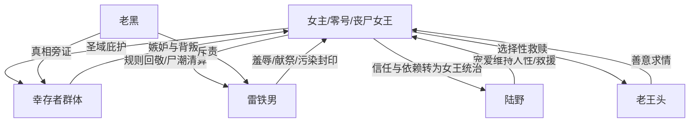

# 角色标签图谱

## 角色清单

### 我 / 9527 / 丧尸女王 — 娇软封印体转末世女王
- 叙事功能: 承担受害者、封印、灾厄本体和最终清算者四重功能。
- 核心标签: 吉祥物、零号感染者、女王
- 弧光: 被宠着维持人性的小公主 → 被羞辱献祭的濒死者 → 醒来的末世主宰
- 台词风格: 前半哀求解释，后半极短冷句审判。
- 关键行为: 忍受羞辱、预警尸潮、觉醒后撤去庇护、保下善良者。
- 读者情绪关系: 前半心疼，后半爽和敬畏并存。

### 雷铁男 — 伪正义铁血教官 / 价值观反派
- 叙事功能: 持续制造压迫，输出错误规则，作为 M3 回旋清算对象。
- 核心标签: 大义凛然、偏执、弱肉强食
- 弧光: 空降掌权 → 群体煽动 → 献祭女主 → 被尸潮吞噬后精神摧毁
- 台词风格: 命令式、口号式、道德绑架式。
- 关键行为: 打翻奶茶、剪碎裙子、强穿血衣、踩断老王头腿、挂女主祭旗。
- 读者情绪关系: 强恨点，越自信越期待她被规则反噬。

### 陆野 — 铁血守护者 / 封印维护者
- 叙事功能: 前期缺席制造危机，后期揭示真相并托举女主位格。
- 核心标签: 队长、兵王、女王骑士
- 弧光: 被众人误读为偏宠女主 → 归来崩溃救人 → 跪迎女王并辅佐新秩序
- 台词风格: 冷硬解释，关键句短促有权威。
- 关键行为: 三年宠女主维持圣域，归来救下旗杆上的女主，揭示零号真相，准备红色女王袍。
- 读者情绪关系: 提供安全感、补偿感和“终于有人懂她”的情绪释放。

### 老王头 — 底层善意锚点
- 叙事功能: 证明基地并非全员该死，为女主后续选择性清算提供道德坐标。
- 核心标签: 老厨师、善良、弱者
- 弧光: 替女主求情 → 被踩断腿丢弃 → 被女主救下
- 台词风格: 朴素、护短、低姿态。
- 关键行为: 跪地替女主求情，临走叮嘱女主活下去。
- 读者情绪关系: 心疼与正义校准，避免女主清算显得无差别滥杀。

### 老黑 — 真相放大器 / 权威旁证
- 叙事功能: 在陆野之前先爆出“镇压地狱”的信息，证明雷铁男犯下不可逆大错。
- 核心标签: 副队长、知情者、惊恐见证人
- 弧光: 战场支援者 → 绝望斥责雷铁男 → 新秩序执行者
- 台词风格: 急促、崩溃、信息密集。
- 关键行为: 怒吼雷铁男，揭示宠女主不是偏爱而是生存逻辑。
- 读者情绪关系: 提前点燃真相期待，增强反转可信度。

### 幸存者群体 — 墙头草群众 / 受庇护而不知恩
- 叙事功能: 放大群体暴力，提供选择性清算对象。
- 核心标签: 嫉妒、沉默、帮凶
- 弧光: 被圣域保护 → 围观羞辱 → 帮忙献祭 → 被女王按行为分级处置
- 台词风格: 窃窃私语、推责求饶。
- 关键行为: 起哄、沉默、帮忙按住女主，最后磕头求饶。
- 读者情绪关系: 引发对群体忘恩的厌恶，也通过保留少数善者维持道德平衡。

## 关系网络

## 角色功能对照表（供改编参考）

| 原角色 | 极致标签 | 叙事功能 | 读者情绪功能 | 改编时必须保留的 |
|--------|---------|---------|-------------|---------------|
| 女主 | 娇软封印体/末世女王 | 受害者与最终清算者 | 心疼、爽、敬畏 | “被宠是封印”与“觉醒后高位冷漠” |
| 雷铁男 | 伪正义教官 | 压迫与错误规则输出 | 恨、期待报应 | 口号式规则必须被原样回敬 |
| 陆野 | 铁血守护者 | 揭秘与补偿 | 安全感、情绪释放 | 三年宠爱背后有生存逻辑 |
| 老王头 | 善良弱者 | 道德锚点 | 心疼、正义感 | 替女主求情并被惩罚 |
| 老黑 | 权威旁证 | 信息爆破 | 震撼、确认爽点 | “你根本不知道你干了什么”型爆点 |
| 幸存者 | 群体帮凶 | 群体暴力与分级清算 | 厌恶、爽 | 需区分起哄者、沉默者、善意者 |
