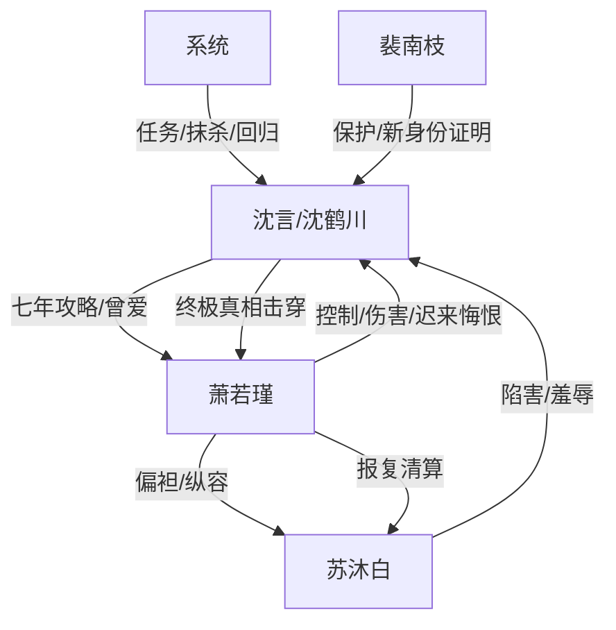

# 角色标签图谱

## 角色清单

### 沈言 / 沈鹤川 — 清醒受虐攻略者 / 终极大男主

- 叙事功能: 承受前半所有压迫，死亡后成为旁观审判者，最后以真实身份完成价值坐标反转。
- 核心标签: 隐忍、冷感、身份反差
- 弧光: 爱她如命的攻略者 → 心死脱离的灵魂 → 沈氏继承人沈鹤川
- 台词风格: 短句、冷静、杀人诛心
- 关键行为: 跳鲨鱼池夺坠；水牢中拒绝服软；死亡后旁观；拍卖会上否认沈言身份并揭开骗局。
- 读者情绪关系: 前半心疼，后半爽，结尾带轻微道德震颤。

### 萧若瑾 — 京圈太女 / 控制型追妻火葬场女主

- 叙事功能: 主要施害者，负责制造爱情背叛、权力压迫和迟来悔恨。
- 核心标签: 傲慢、偏执、控制欲
- 弧光: 掌控一切的京圈太女 → 拒绝承认死亡的疯子 → 自虐殉葬的失败者
- 台词风格: 命令式、施舍式、后期崩溃哀求
- 关键行为: 纵容苏沐白夺坠；踹断沈言腿；关水牢；锁吊坠；死后补偿；最终自虐而死。
- 读者情绪关系: 前半恨，后半看她崩溃获得清算感。

### 苏沐白 — 绿茶男 / 冒功陷害者

- 叙事功能: 外部第三者和催化剂，推动萧若瑾偏袒，具体执行羞辱与陷害。
- 核心标签: 装弱、恶毒、偷功
- 弧光: 被偏爱的“小男生” → 被查出伪造和冒功 → 生不如死
- 台词风格: 哥哥式茶言茶语，装无辜、扮弱者
- 关键行为: 丢吊坠进鲨鱼池；穿白衬衫刺激沈言；自伤陷害；水牢抽鞭。
- 读者情绪关系: 纯恨点，承担直接报应爽点。

### 裴南枝 — 新商业女王 / 保护型未婚妻

- 叙事功能: 后期新坐标系证明，展示沈鹤川已被更高价值关系接住。
- 核心标签: 女王、护短、体面
- 弧光: 登场即稳定强者，无明显变化
- 台词风格: 冷、利落、占有边界清晰
- 关键行为: 拍卖会上踹开萧若瑾，维护沈鹤川。
- 读者情绪关系: 补偿感、替代性安全感。

### 系统 — 规则裁判 / 终局执行器

- 叙事功能: 给吊坠任务赋予生死必要性，执行死亡、灵魂剥离、躯壳回收与回归。
- 核心标签: 冰冷、机械、不可谈判
- 弧光: 抹杀倒计时 → 灵魂剥离 → 躯壳回收 → 世界线收束
- 台词风格: 机械提示
- 关键行为: 发布终极任务，倒计时，具象化日记本，回收躯壳。
- 读者情绪关系: 强化宿命压迫和反转可信度。

## 关系网络

## 角色功能对照表（供改编参考）

| 原角色 | 极致标签 | 叙事功能 | 读者情绪功能 | 改编时必须保留的 |
|--------|---------|---------|-------------|---------------|
| 沈言/沈鹤川 | 清醒攻略者/隐藏继承人 | 承压、死亡、反转、清算 | 心疼转爽 | 前半极弱、后半极强；心死后不回头 |
| 萧若瑾 | 傲慢太女 | 施害与火葬场 | 恨与看崩溃 | 控制欲、偏袒第三者、迟来补偿无效 |
| 苏沐白 | 绿茶男 | 具体陷害者 | 纯恨点 | 装弱、冒功、自伤陷害、镜像报应 |
| 裴南枝 | 强势未婚妻 | 新生活证明 | 补偿爽 | 公开护主角，形成旧爱对照 |
| 系统 | 机械裁判 | 生死规则与回归逻辑 | 悬念和宿命感 | 倒计时、灵魂线、最终回归规则 |
