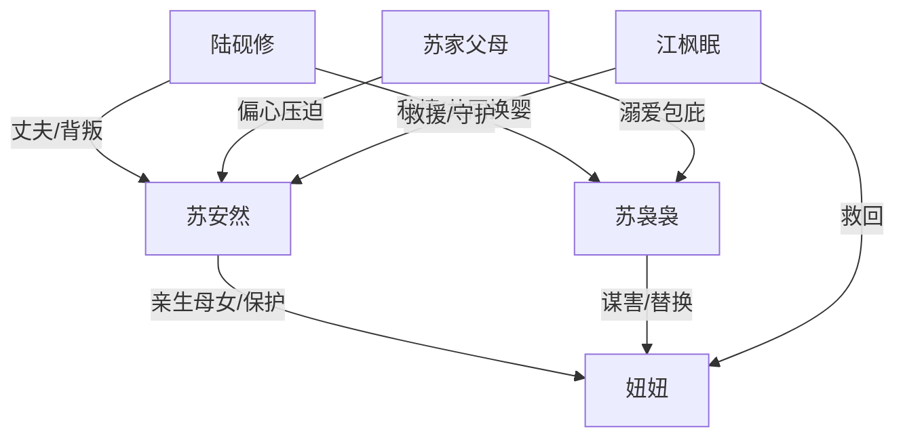

# 角色标签图谱

## 角色清单

### 苏安然 — 重生护女复仇母亲
- 叙事功能: 第一视角承压者与反杀执行者，承担读者站队中心。
- 核心标签: 母性、清醒、隐忍反击
- 弧光: 被蒙骗至死 → 重生抢婴 → 被污名化 → 公开清算后新生
- 台词风格: 前期哀求质问，后期短句决绝
- 关键行为: 抢回无痣亲女、雨夜求医、联系江枫眠、公开放证据、离婚
- 读者情绪关系: 心疼、替她憋屈、期待她翻盘

### 陆砚修 — 温柔伪装的背叛渣夫
- 叙事功能: 最大亲密关系背叛者，提供 M5 温度反转。
- 核心标签: 偏信、虚伪、伪深情
- 弧光: 守护誓言者 → 拔管杀妻者 → 抢婴包庇者 → 悔恨失败者
- 台词风格: 对苏袅袅温柔，对女主训斥，败露后求饶
- 关键行为: 换婴、拔氧气管、调走医生、拉黑女主、送精神病院
- 读者情绪关系: 恨、厌恶、期待报应

### 苏袅袅 — 绿茶假千金/恶毒小三
- 叙事功能: 直接施害者，承担最具体恶行。
- 核心标签: 伪善、嫉妒、狠毒
- 弧光: 被偏爱的假千金 → 抢夫抢女 → 谋害婴儿 → 入狱惨死
- 台词风格: 哭腔、委屈、道德绑架
- 关键行为: 调包孩子、栽赃、喂牛奶、掐婴、弃婴
- 读者情绪关系: 极恨，承担最强清算欲

### 苏家父母 — 偏心亲情压迫者
- 叙事功能: 家庭伦理恨点来源，证明血缘不等于亲情。
- 核心标签: 偏心、愚蠢、助恶
- 弧光: 宠假女轻亲女 → 公开污名女主 → 真相前崩塌 → 入狱
- 台词风格: 家长式训斥、断亲威胁
- 关键行为: 指责女主、砸伤女主、帮苏袅袅夺婴、送女主精神病院
- 读者情绪关系: 恨、反感、期待断亲清算

### 江枫眠 — 警察竹马/救援者
- 叙事功能: 外部正义力量，承接女主求助并推动公开翻案。
- 核心标签: 冷静、可靠、旧情守护
- 弧光: 电话中承诺接她 → 抱婴入场 → 公开证据 → 陪伴新生
- 台词风格: 冷幽默、短句、带压迫感
- 关键行为: 救下女婴、带警察入场、播放监控、保护女主
- 读者情绪关系: 安全感、补偿感、轻甜

### 女儿/妞妞 — 无辜被害婴儿
- 叙事功能: 情绪债核心载体，所有复仇正当性的来源。
- 核心标签: 弱小、无辜、被争夺
- 弧光: 被调包对象 → 被虐害濒死 → 被救回 → 随母新生
- 台词风格: 无
- 关键行为: 通过红痣缺失、过敏、脖颈青紫痕迹作为证据锚点
- 读者情绪关系: 心疼、保护欲、促使读者要求重罚

## 关系网络

## 角色功能对照表（供改编参考）

| 原角色 | 极致标签 | 叙事功能 | 读者情绪功能 | 改编时必须保留的 |
|--------|---------|---------|-------------|---------------|
| 苏安然 | 重生护女复仇母亲 | 承压与反击 | 心疼、爽 | 母亲身份、亲女被害、公开清算 |
| 陆砚修 | 伪深情渣夫 | 亲密背叛 | 恨、厌恶 | 昔日誓言与现世伤害对照 |
| 苏袅袅 | 绿茶假千金 | 直接施害 | 极恨 | 伪善话术和具体谋害动作 |
| 苏家父母 | 偏心助恶父母 | 家庭伦理压迫 | 憋屈 | 帮外人伤亲女 |
| 江枫眠 | 正义竹马警察 | 外部翻案 | 安全感 | 带证据入场、公权力背书 |
| 妞妞 | 无辜婴儿 | 情绪债核心 | 心疼 | 可视化伤痕/物证锚点 |
