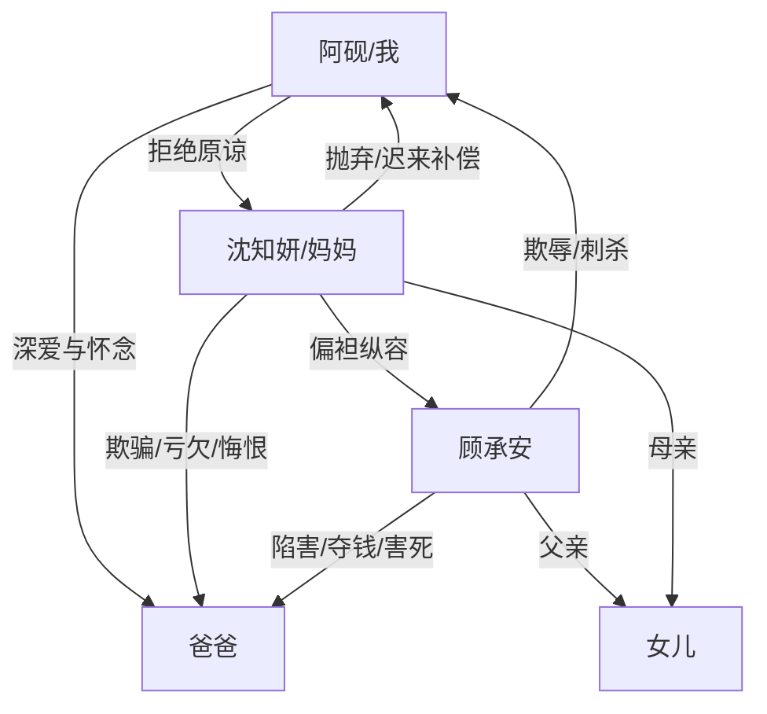

# 角色标签图谱

## 角色清单

### 我 / 阿砚 — 清醒受害者、拒绝和解的遗孤
- 叙事功能: 第一人称见证者、情绪债承载者、最终价值清算者
- 核心标签: 清醒、创伤、克制
- 弧光: 被抛弃的服务员 → 失控揭真相 → 接受补偿但拒绝原谅 → 好好活着
- 台词风格: 短句、反问、冷判词
- 关键行为: 当众揭母亲旧恶；说出父亲已死；揭露空卡；设立医疗救助基金
- 读者情绪关系: 心疼、代入、替他说出“不原谅”的爽感

### 沈知妍 / 妈妈 — 迟来深情的偏袒型母亲
- 叙事功能: 根本施害者、悔恨承载者、迟来补偿样本
- 核心标签: 自欺、偏袒、迟钝
- 弧光: 施舍和问罪 → 否认父亲死亡 → 查证崩塌 → 清算顾承安 → 挡刀死亡
- 台词风格: 居高临下、命令式，后期破碎道歉
- 关键行为: 假破产、赶走父子、冻结/放任空卡、迟来查病历、挡刀
- 读者情绪关系: 恨、厌、后期复杂但不允许洗白

### 爸爸 — 温柔苦命父亲、情绪债核心
- 叙事功能: 道德坐标、被亏欠者、所有清算的理由
- 核心标签: 温柔、隐忍、心软
- 弧光: 替妻还债捐肝 → 被婚礼羞辱 → 带儿子求生 → 等不到手术费死亡
- 台词风格: 温柔、护子、低姿态求生
- 关键行为: 捐肝卖血、给儿子过生日、把外套盖给儿子、临死前安慰儿子
- 读者情绪关系: 极度心疼，是复仇合法性的来源

### 顾承安 — 绿茶男小三、外显恶源
- 叙事功能: 直接反派、真相自爆器、母亲罪责放大器
- 核心标签: 嫉妒、恶毒、表演型弱者
- 弧光: 装病夺爱 → 侵占手术费 → 自爆真相 → 刺杀失败 → 死刑
- 台词风格: 挑衅、阴毒、甩锅
- 关键行为: 设计骗局、转走五十万、滚楼陷害、持刀报复
- 读者情绪关系: 纯恨点，必须被法律清算

### 顾承安女儿 — 无辜但镜像的孩子
- 叙事功能: 镜像“当年的我”，让报应带出复杂余味
- 核心标签: 被宠坏、无辜、镜像
- 弧光: 被母亲带着吃饭 → 目睹父母丑陋 → 车祸死亡
- 台词风格: 儿童式恐惧
- 关键行为: 说“爸爸好可怕，妈妈也好可怕”
- 读者情绪关系: 复杂，不制造爽感，制造因果阴影

## 关系网络

## 角色功能对照表（供改编参考）

| 原角色 | 极致标签 | 叙事功能 | 读者情绪功能 | 改编时必须保留的 |
|--------|---------|---------|-------------|---------------|
| 阿砚 | 清醒遗孤 | 见证与审判 | 代入、心疼、爽 | 不原谅、不卖惨求爱 |
| 沈知妍 | 迟来深情母亲 | 根本施害与悔恨 | 恨与复杂 | 她的不作为必须直接导致死亡 |
| 爸爸 | 温柔苦命父亲 | 道德锚点 | 心疼、催泪 | 具体善良行为与死亡不可逆 |
| 顾承安 | 绿茶男小三 | 外显恶 | 强恨点 | 自爆恶意、法律清算 |
| 女儿 | 镜像孩子 | 因果余波 | 复杂余味 | 不承担主恶，不能写成纯报应工具 |
