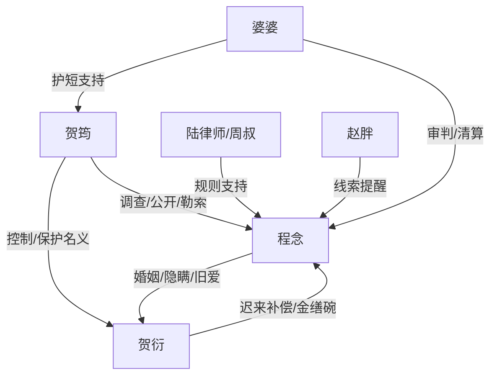

# 角色标签图谱

## 角色清单

### 程念 — 克制隐富复仇女主
- 叙事功能: 承受审判、保存证据、启动规则反击，并承担情感余味。
- 核心标签: 隐富、克制、边界感
- 弧光: 隐瞒维系婚姻 → 被审判触底 → 用证据清算 → 独立离开但保留余温
- 台词风格: 短句、反问少、定性准
- 关键行为: 拿出离婚协议；拒签认错书；向合规部提交证据；起诉隐私侵权；搬去新房
- 读者情绪关系: 心疼、爽、敬佩，也对她隐瞒有复杂理解

### 贺筠 — 控制型亲情反派
- 叙事功能: 制造主要压迫，推动家庭矛盾职业化、网络化、法律化。
- 核心标签: 审计师、控制欲、伪保护
- 弧光: 自认正义查嫂子 → 越界公开隐私 → 反噬丢工作 → 被定性为控制者
- 台词风格: 像办案汇报，精准、冷、带威胁
- 关键行为: 查资产；联系公司；扣相册；违规查库；投喂自媒体
- 读者情绪关系: 强恨点，越界越多，清算越爽

### 贺衍 — 摇摆丈夫/迟醒旧爱
- 叙事功能: 承接婚姻信任主题，提供温度反转曲线。
- 核心标签: 自尊强、站中间、迟来清醒
- 弧光: 受骗愤怒 → 纵容妹妹 → 发现女主付出 → 主动处理妹妹 → 克制求和
- 台词风格: 前期质问，中期求退让，后期低姿态
- 关键行为: 质问隐瞒；要求签协议；归还相册；处理自媒体；送金缮碗
- 读者情绪关系: 又气又心疼，后期承担遗憾感

### 婆婆/方阿姨 — 护短家庭秩序维护者
- 叙事功能: 代表传统家庭审判和护短逻辑。
- 核心标签: 护儿女、现实、双标
- 弧光: 审判女主 → 配合扣物 → 为女儿求情
- 台词风格: 家长式、理所当然
- 关键行为: 要求交代；清算吃住；劝签认错书；求程念帮贺筠找工作
- 读者情绪关系: 憋屈、反感

### 陆律师/周叔 — 规则反击辅助者
- 叙事功能: 提供制度通道，让反击合法化。
- 核心标签: 专业、冷静、规则
- 弧光: 通知复核 → 指出违规路径 → 协助冻结解除
- 台词风格: 专业解释型
- 关键行为: 解释信托条款、指明违规调查可解除冻结
- 读者情绪关系: 安全感、爽点支点

### 赵胖 — 外部证人
- 叙事功能: 提供餐厅骗局线索，推动贺筠反噬哥哥。
- 核心标签: 忠诚、敏锐、烟火气
- 弧光: 旁观餐厅 → 发现假博主 → 通知程念
- 台词风格: 口语化、直接
- 关键行为: 打电话提醒博主异常
- 读者情绪关系: 可信赖的辅助角色

## 关系网络

## 角色功能对照表（供改编参考）

| 原角色 | 极致标签 | 叙事功能 | 读者情绪功能 | 改编时必须保留的 |
|--------|---------|---------|-------------|---------------|
| 程念 | 克制隐富女主 | 承压与反击主体 | 心疼、爽、余味 | 不哭闹，靠证据和边界完成反击 |
| 贺筠 | 控制型亲情反派 | 制造越界压迫 | 恨点 | “保护”名义下的连续越界 |
| 贺衍 | 摇摆迟醒丈夫 | 温度反转 | 酸涩、复杂 | 站中间造成伤害，后期真正醒悟 |
| 婆婆 | 护短长辈 | 家庭审判背书 | 憋屈 | 双标逻辑 |
| 陆律师/周叔 | 规则支点 | 合法反击通道 | 安全感 | 证据链与制度性清算 |
| 赵胖 | 外部证人 | 暴露新危机 | 轻爽 | 关键线索递送 |
