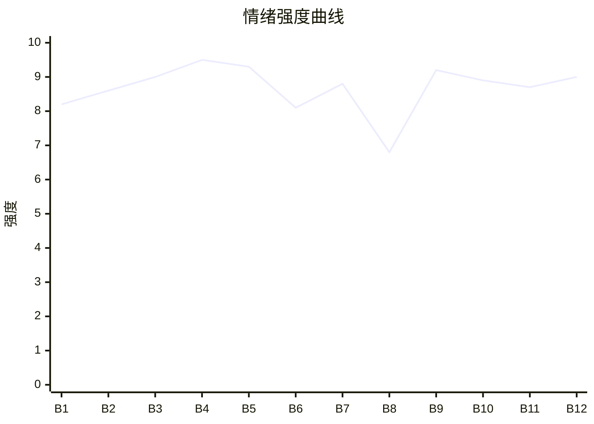

# Beat Sheet 节拍器

## 全文概况

- 总字数: 约 11600 字
- 节拍数: 12 幕
- 核心母题（Logline）: 被偏心家庭和未婚夫连续牺牲的亲生女，为逃离山神婚约三次求婚失败，最终在被替嫁和羞辱后主动断情嫁入祖地，并让所有亏欠她的人追悔失去。
- 情绪模式: 极致打压 → 触底断情 → 真相爆雷 → 迟来追悔 → 温柔补偿 → 权力清算

## 节拍详表

### Beat 1: 婚礼被夺，山神婚约压顶 [简介-第1章前段]

- **字数**: 约 900 字（占比 7.8%）
- **核心事件**: 婚礼当天，母亲以属相犯冲为由抢走婚服，让妹妹替嫁；女主提醒嫁不出去会被接去做山神新娘，却无人相信。
- **情绪标签**: 震惊、荒诞、绝望
- **情绪强度**: 8.2/10
- **情绪方向**: ⚡突变
- **冲突类型**: 大转折
- **悬念钩子**: “今年已经是第三年”，山神那边是否真的会来接人？
- **叙事速度**: 快
- **对话占比**: 35%
- **reversal_mechanism**: [M5]
- **hook_strength**: 8.4/10（极端度 2.5/3，信息密度 2.7/3，悬念尖锐度 1.8/2，节奏利落度 1.4/2）
- **关键句**: “而今年，已经是第三年。”
- **原文摘录**: “婚礼当天，妈妈说我和沈宗樾属相犯冲，抢了我的婚服，让妹妹替嫁。全家人都默认了。好像所有人都忘了，族内早就选定我为山神的新娘。成年后三年要是嫁不出去，就默认我同意和山神的婚事。而今年，已经是第三年。”

### Beat 2: 未婚夫背刺，女主主动求接走 [第1章中段]

- **字数**: 约 850 字（占比 7.3%）
- **核心事件**: 女主连夜找沈宗樾求助，沈宗樾安慰她等待，却转头告密，导致女主被反锁。
- **情绪标签**: 背叛、孤立、窒息
- **情绪强度**: 8.6/10
- **情绪方向**: ↓下降
- **冲突类型**: 大转折
- **悬念钩子**: 女主打电话给族长，说“可以派人来接我了”。
- **叙事速度**: 快
- **对话占比**: 45%
- **reversal_mechanism**: [M5]
- **hook_strength**: null
- **关键句**: “您可以派人来接我了。”
- **原文摘录**: “我连夜找到沈宗樾，想求他带我走，他却安慰我：‘你才是我最后的妻子，我给她的只是一个仪式而已。’……沈宗樾将我找他的事情，告诉爸妈，他们担心我破坏婚事，直接把我反锁在房间。……‘我知道的，族长。’‘您可以派人来接我了。’”

### Beat 3: 三年婚礼债，亲吻击碎爱情 [第1章后段]

- **字数**: 约 950 字（占比 8.2%）
- **核心事件**: 女主回忆三年婚礼都因妹妹失败；窗外妹妹穿她婚服，沈宗樾亲吻妹妹。
- **情绪标签**: 心碎、旧债累积、幻灭
- **情绪强度**: 9.0/10
- **情绪方向**: ↓下降
- **冲突类型**: 大转折
- **悬念钩子**: 女主对沈宗樾的喜欢彻底碎裂，后续会如何选择？
- **叙事速度**: 中
- **对话占比**: 20%
- **reversal_mechanism**: [M5]
- **hook_strength**: null
- **关键句**: “此刻，他亲了。只是那个人不是我。”
- **原文摘录**: “这已经是我和沈宗樾办的的三场婚礼。和他相爱三年，每一年，他都会向我求婚，让我嫁给他。可每一次，都会因为妹妹，被打破。……低下头，在妹妹的唇边印上了一吻。这一刻，我心碎了。对沈宗樾所有的喜欢，都化成了碎片。”

### Beat 4: 礼金勒索与婚闹侵犯 [第2章]

- **字数**: 约 1250 字（占比 10.8%）
- **核心事件**: 母亲索要女主三万奖金给妹妹刷礼金；婚闹者闯入女主房间，进行性骚扰，家人和未婚夫纵容。
- **情绪标签**: 愤怒、恐惧、羞辱
- **情绪强度**: 9.5/10
- **情绪方向**: ↓下降
- **冲突类型**: 大转折
- **悬念钩子**: 最糟糕的侵犯即将发生，谁来救她？
- **叙事速度**: 快
- **对话占比**: 55%
- **reversal_mechanism**: [M3, M5]
- **hook_strength**: null
- **关键句**: “她不愿意给你结婚的礼金，那就闹一闹吧，算是帮她省了一笔钱。”
- **原文摘录**: “你之前工作不是发了三万的奖金吗？我看就都发给你妹妹当礼金行了。……我被直接摁到了床上。双手被牢牢抓到了头顶……门外传来苏伊宁和父母的声音。……‘不用管她，结婚闹伴娘很正常。’……沈宗樾看了半掩的房门一眼，也帮着妈妈说话。‘我哥们都是有数的，应该只是闹一闹她。’”

### Beat 5: 宗族救场，断情散吞下 [第3章]

- **字数**: 约 1300 字（占比 11.2%）
- **核心事件**: 宗族长辈救下女主，惩治婚闹者，并递上断情散；女主回忆曾经被爱、后来被迫让出一切，最终吞药。
- **情绪标签**: 触底、决绝、麻木后的平静
- **情绪强度**: 9.3/10
- **情绪方向**: ↑上升
- **冲突类型**: 大转折
- **悬念钩子**: 吃下断情散后，女主是否真的忘情？
- **叙事速度**: 中
- **对话占比**: 35%
- **reversal_mechanism**: [M5]
- **hook_strength**: null
- **关键句**: “曾经淤积在我身体的郁结，爱而不得，好像在这一刻都消散了。”
- **原文摘录**: “就在我以为最糟糕的情况要发生的时候，大门再次打开。三个我曾经在宗族看到过的长辈走了进来。……‘敢欺负山神新娘，送回去都好好教训一顿。’……他递给我一颗蜜蜡封的药丸。……我解开蜜蜡，将丸药一口吞下。”

### Beat 6: 山神新娘现身，旧人错过识别 [第4章]

- **字数**: 约 1000 字（占比 8.6%）
- **核心事件**: 女主换上藏青婚服，由族长接出；父母不知她就是山神新娘，沈宗樾被苏伊宁牵制。
- **情绪标签**: 反讽、疏离、期待打脸
- **情绪强度**: 8.1/10
- **情绪方向**: ↑上升
- **冲突类型**: 微冲突
- **悬念钩子**: 被拖下来的婚闹者喊出苏挽月名字，沈宗樾开始意识到不对。
- **叙事速度**: 快
- **对话占比**: 50%
- **reversal_mechanism**: [M3, M6]
- **hook_strength**: null
- **关键句**: “误会了，我们只是来接山神的新娘。”
- **原文摘录**: “绣着苏家图腾的藏青色婚服被缓缓展开……‘误会了，我们只是来接山神的新娘。’……只有沈宗樾察觉不对劲……苏伊宁……‘沈哥哥要是舍不得，这婚不结也罢。’……‘这几个试图对山神新娘欲行不轨的青年，我们已经教训了。’”

### Beat 7: 空房间与婚书前奏，追悔启动 [第5章前半]

- **字数**: 约 900 字（占比 7.8%）
- **核心事件**: 卢彦君说出沈宗樾默认婚闹，众人冲上楼发现女主已走，只剩被撕坏的短袖。
- **情绪标签**: 迟来的恐慌、报应启动
- **情绪强度**: 8.8/10
- **情绪方向**: ↑上升
- **冲突类型**: 大转折
- **悬念钩子**: 女主已被接走，旧人是否还能追回？
- **叙事速度**: 快
- **对话占比**: 45%
- **reversal_mechanism**: [M3, M5]
- **hook_strength**: null
- **关键句**: “房间已经空空荡荡。”
- **原文摘录**: “‘不是沈哥你默认我们闹的吗？’……三人抛下苏伊宁，往楼上冲去。第三次破开那个门，房间已经空空荡荡。属于我的为数不多的衣服，已经被清空。凌乱不堪的床上被放着一件被撕扯坏的短袖。”

### Beat 8: 温柔山神登场，补偿线开启 [第5章后半]

- **字数**: 约 850 字（占比 7.3%）
- **核心事件**: 女主抵达山中，面具男人苏泽温和接住她，提出可以相处试试，不强迫。
- **情绪标签**: 安宁、意外、松动
- **情绪强度**: 6.8/10
- **情绪方向**: ↑上升
- **冲突类型**: 微冲突
- **悬念钩子**: 山神并不可怕，他会给女主怎样的新生活？
- **叙事速度**: 慢
- **对话占比**: 40%
- **reversal_mechanism**: [M5]
- **hook_strength**: null
- **关键句**: “我不会强迫你做我的新娘，咱们可以相处相处。”
- **原文摘录**: “我看到一个带着面具的人影。他朝我伸出手。‘你就是我的新娘吗？’……‘我不会强迫你做我的新娘，咱们可以相处相处，如果你觉得合适，咱们就试一试。’……我回头看了一眼雨夜，竟是觉得难得的安宁。”

### Beat 9: 假算命与养女阴谋直播爆雷 [第6章-第7章前段]

- **字数**: 约 1600 字（占比 13.8%）
- **核心事件**: 卢彦君拿出聊天记录，苏伊宁露馅；算命先生电话打来，假骨折、假跳伞、假批命全部曝光，直播间舆论反噬。
- **情绪标签**: 痛快、震惊、集体审判
- **情绪强度**: 9.2/10
- **情绪方向**: ↑上升
- **冲突类型**: 大转折
- **悬念钩子**: 旧人知道断情散真相后，会如何崩溃追赶？
- **叙事速度**: 快
- **对话占比**: 65%
- **reversal_mechanism**: [M3, M6]
- **hook_strength**: null
- **关键句**: “那什么假骨折，假跳伞，假……还有这最近的让我假装算命先生，给你批命……”
- **原文摘录**: “‘昨天你还给我们发消息，让我们今天闹一下苏挽月，最好能毁了她。’……扩音器传来算命先生的声音。‘苏小姐，事情都按照你说的办了，你啥时候补尾款啊。’……‘那什么假骨折，假跳伞，假……还有这最近的让我假装算命先生，给你批命……’……网络上骂声不断，不少人叫嚣着平台退款。”

### Beat 10: 旧爱回忆与祖宅婚书落定 [第7章后段-第8章前段]

- **字数**: 约 1200 字（占比 10.3%）
- **核心事件**: 沈宗樾从闺蜜处得知断情散后果，回忆曾经承诺；赶到祖宅后，族长拿出婚书，宣布女主自立门户。
- **情绪标签**: 悔恨、不可逆、闭环
- **情绪强度**: 8.9/10
- **情绪方向**: ↑上升
- **冲突类型**: 大转折
- **悬念钩子**: 他们终于见到女主时，女主还会认他们吗？
- **叙事速度**: 中
- **对话占比**: 45%
- **reversal_mechanism**: [M5, M6]
- **hook_strength**: null
- **关键句**: “婚书已经签了，婚也成了。”
- **原文摘录**: “‘嫁给山神后，族里的人会让她直接断情，忘记亲人，朋友，爱人。’……‘那我可得快点把你娶回家，可不能让你帮我忘干净。’……可是，她还是被抢走了。……阿嬷展开，婚书上是我签好的名字，和我并列在一起的还有一个，苏泽。”

### Beat 11: 新婚补偿与冷淡见旧人 [第8章后段]

- **字数**: 约 1250 字（占比 10.8%）
- **核心事件**: 苏泽用奶茶、芥末饼干补偿女主被忽视的口味；女主完成最后一礼。再见旧人，她转三万礼金，冷淡拒绝回家。
- **情绪标签**: 治愈、爽、冷感打脸
- **情绪强度**: 8.7/10
- **情绪方向**: ↑上升
- **冲突类型**: 大转折
- **悬念钩子**: 旧人会如何尝试补偿？女主会不会动摇？
- **叙事速度**: 中
- **对话占比**: 50%
- **reversal_mechanism**: [M3, M5]
- **hook_strength**: null
- **关键句**: “你是过来问我要红包，给苏伊宁当礼金的吗？”
- **原文摘录**: “‘外面人很喜欢喝奶茶……你喜欢芥末味道的东西，这些小饼干，也是我让他们提前烤出来。’……‘好吃。’……再见到爸妈和沈宗樾的时候，已经是第二天。……‘你是过来问我要红包，给苏伊宁当礼金的吗？我现在银行卡就这些了，你拿走吧。’”

### Beat 12: 逐项否定补偿，养女再抢失败，族权清算 [第9章]

- **字数**: 约 1550 字（占比 13.4%）
- **核心事件**: 父母和沈宗樾拿旧补偿物靠近，被女主逐项指出记错；苏伊宁想抢山神失败；族长驱逐父母一脉，相关产业受打压，女主安稳收束。
- **情绪标签**: 痛快、彻底、平和
- **情绪强度**: 9.0/10
- **情绪方向**: →平稳高位
- **冲突类型**: 大转折
- **悬念钩子**: 无，完成收束。
- **叙事速度**: 快
- **对话占比**: 55%
- **reversal_mechanism**: [M3, M5, M6]
- **hook_strength**: null
- **关键句**: “我的东西，你不都喜欢抢吗？这次你也来抢一抢啊？”
- **原文摘录**: “‘你记错了，我不喜欢栗子糕，苏伊宁喜欢。’……‘你记错了，是你生日的时候，我亲手给你雕刻了一个木头娃娃，结果你因为苏伊宁一句，娃娃很土，就扔进了火堆。’……‘我的东西，你不都喜欢抢吗？这次你也来抢一抢啊？’……族长下令，以后爸妈那一脉的苏家，再也不能进山，祭祖也不用来了。……我想，这样一辈子，也不错。”

## 情绪曲线可视化

## 节拍密度检测

- 平均每 967 字一个节拍
- 微冲突密度: 每约 2900 字一次
- 大转折密度: 每约 1050 字一次
- 判定: 符合高频节拍器标准；前半每章都有压迫升级，后半每章都有真相/追悔/清算升级。

## 反转机制清单(Reversal Mechanisms)

从 prompts/patterns/reversal-mechanisms.md 的 8 大机制中命中以下机制:

| 机制 ID | 机制名 | 承载 Beat | 关键段落/金句 | 等价改编提示 |
|--------|--------|-----------|--------------|-------------|
| M3 | 因果回旋反讽 | Beat 4, 9, 11, 12 | “你是过来问我要红包，给苏伊宁当礼金的吗？”“你记错了，我不喜欢栗子糕，苏伊宁喜欢。” | 必须找到施害者的旧规则或旧话术，后文用同结构冷静回敬。 |
| M5 | 温度反转曲线 | Beat 1-5, 8, 10-12 | “那个时候，他们对我的爱，是全心全意的。”对照“别这么亲昵，我不习惯。” | 必须显式写出曾经温柔，再写归零与负值追悔，不能直接从坏人到报应。 |
| M6 | 多层递进反转 | Beat 6, 9, 10, 12 | “误会了，我们只是来接山神的新娘。”“婚书已经签了，婚也成了。” | 反转层数不能少；情节、真相、权力、关系归属要逐层升维。 |
