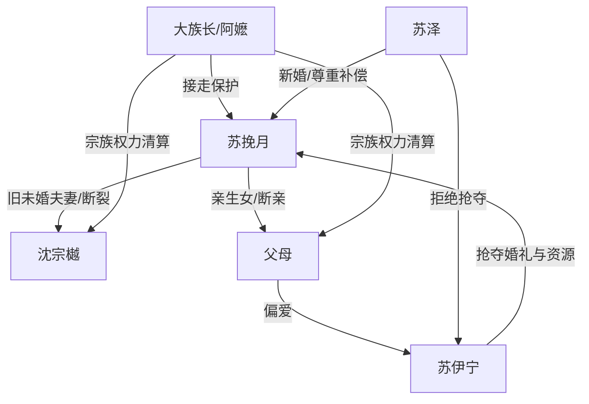

# 角色标签图谱

## 角色清单

### 苏挽月 — 断情清醒受害者/新山神新娘

- 叙事功能: 承受家庭与爱情双重剥夺，并在断情后完成冷淡反杀。
- 核心标签: 被偏置的亲生女、断情者、冷静新娘
- 弧光: 乞求被带走 → 主动被接走 → 吞药断情 → 冷淡拒绝旧人 → 安稳新生
- 台词风格: 前期克制解释，后期冷淡短句，常用“你记错了”反杀。
- 关键行为: 打电话给族长、吞断情散、签婚书、转三万、砸果盘。
- 读者情绪关系: 心疼、代入、爽。

### 苏伊宁 — 白莲抢夺型养女

- 叙事功能: 持续制造替代与剥夺，是所有偏心和阴谋的触发器。
- 核心标签: 养女白莲、抢夺者、伪弱者
- 弧光: 被全家偏爱 → 婚礼得意 → 阴谋曝光 → 名声崩塌 → 再抢山神失败
- 台词风格: 撒娇、装可怜、以死威胁、转移责任。
- 关键行为: 假骨折、假跳伞、买通算命先生、设计婚闹、试图替换山神新娘。
- 读者情绪关系: 恨、厌恶、期待报应。

### 沈宗樾 — 迟来深情未婚夫

- 叙事功能: 爱情线施害者，提供“曾爱却失去”的温度反转。
- 核心标签: 犹豫纵容者、迟来追悔、伪深情
- 弧光: 承诺娶女主 → 纵容替嫁和婚闹 → 发现真相 → 追悔无门
- 台词风格: 前期安抚式欺骗，后期焦急哀求。
- 关键行为: 告密、亲吻苏伊宁、默许兄弟闹女主、砸门求娶。
- 读者情绪关系: 恨其不作为，爽于其失去。

### 爸妈 — 偏心道德绑架型父母

- 叙事功能: 亲情压迫源，用“公平/妹妹可怜”合理化剥夺。
- 核心标签: 偏心父母、道德绑架、迟来悔恨
- 弧光: 抢婚服 → 索礼金 → 纵容婚闹 → 真相后崩溃 → 被族权排除
- 台词风格: 命令、责备、事后哭求。
- 关键行为: 把女主反锁、逼钱、拦住救援、拿栗子糕和手串补偿。
- 读者情绪关系: 恨、憋屈、期待他们被冷待。

### 苏泽 — 温柔山神凭依/补偿型新男主

- 叙事功能: 为女主提供安全、尊重与逐项补偿，是新生活承诺。
- 核心标签: 温柔山神、边界感、照顾者
- 弧光: 神秘接亲者 → 温和背她上山 → 尊重试婚 → 正式成婚 → 护妻清算
- 台词风格: 笨拙、温和、尊重边界。
- 关键行为: 背女主、准备奶茶和芥末饼干、允许假夫妻、驱逐苏伊宁。
- 读者情绪关系: 安心、甜、补偿。

### 大族长/阿嬷 — 规则执行者

- 叙事功能: 代表更高秩序，既是山神婚约压力，也是后期清算权力。
- 核心标签: 宗族权威、古礼执行者、保护者
- 弧光: 提醒婚约 → 救场 → 接亲 → 出示婚书 → 驱逐旧家
- 台词风格: 冷淡、公事公办。
- 关键行为: 救下女主、惩治婚闹者、递断情散、取消合作。
- 读者情绪关系: 爽、威慑、秩序补偿。

## 关系网络

## 角色功能对照表（供改编参考）

| 原角色 | 极致标签 | 叙事功能 | 读者情绪功能 | 改编时必须保留的 |
|--------|---------|---------|-------------|---------------|
| 苏挽月 | 断情清醒受害者 | 承债与反杀主体 | 心疼转爽 | 主动放弃旧人、冷淡回敬 |
| 苏伊宁 | 白莲抢夺者 | 制造一切剥夺 | 恨点集中 | 三次破坏婚礼、最后还想抢 |
| 沈宗樾 | 迟来深情 | 爱情债来源 | 失去感爽点 | 曾承诺、后纵容、追悔无门 |
| 父母 | 偏心道德绑架 | 亲情债来源 | 憋屈与报应期待 | 抢资源、逼让步、拿错补偿 |
| 苏泽 | 温柔补偿型男主 | 新秩序和新爱 | 安心与甜爽 | 尊重边界、逐项照顾女主 |
| 大族长 | 高权力执行者 | 清算工具 | 降维爽感 | 婚书、族权、合作取消 |
