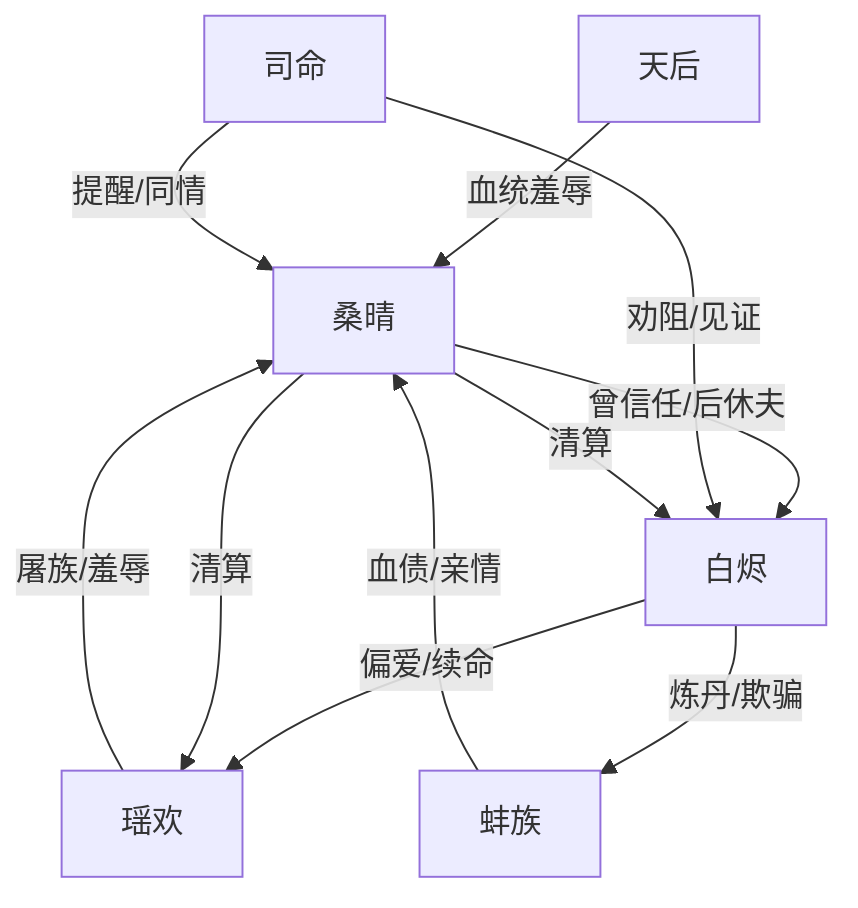

# 角色标签图谱

## 角色清单

### 桑晴 — 灭族复仇女主
- 叙事功能: 受害者、见证者、复仇执行者、代价承担者
- 核心标签: 蚌族公主、孕期弃妇、入魔复仇
- 弧光: 最有望成神的公主 → 被欺骗的天妃 → 跳台断情 → 入魔清算 → 化蚌沉睡
- 台词风格: 前期克制顺从，后期短句冷刺
- 关键行为: 写休夫书、跳诛仙台、入魔、清算白烬瑶欢、护送族人转世
- 读者情绪关系: 心疼、憋屈、期待她复仇、最终为代价难过

### 白烬 — 伪深情神君
- 叙事功能: 最大背叛者、权力压迫源、迟来悔恨载体
- 核心标签: 神君、青梅脑、伪公正
- 弧光: 救命恩人假象 → 灭族共犯 → 剜眼施暴者 → 悔恨疯魔 → 被分食
- 台词风格: 高高在上、合理化伤害、悔后哀求
- 关键行为: 娶桑晴瞒天道、炼蚌族成丹、偏袒瑶欢、剜眼、追妻求复合
- 读者情绪关系: 恨、恶心、期待他悔疯和被清算

### 瑶欢 — 恶毒青梅圣女
- 叙事功能: 显性恶女、血债触发器、白烬偏心试金石
- 核心标签: 圣女、绿茶、食族续命者
- 弧光: 被娇养的真爱 → 炫耀丹药 → 刺激桑晴跳台 → 失宠 → 被清算
- 台词风格: 撒娇式恶毒，装弱式栽赃
- 关键行为: 屠蚌族、吃丹、羞辱孕肚、送血珠、踩碎眼睛
- 读者情绪关系: 强恨点，承担最直接的报应期待

### 司命 — 清醒旁观者
- 叙事功能: 道德见证人、信息辅助者、读者嘴替
- 核心标签: 清醒、讽刺、公道残存
- 弧光: 劝阻白烬 → 见证桑晴休夫 → 告知行踪风险
- 台词风格: 直白讽刺
- 关键行为: 质问炼丹、拒绝白烬、提醒桑晴
- 读者情绪关系: 代替读者骂醒反派，提供轻微安慰

### 天后 — 门第压迫者
- 叙事功能: 制度性羞辱、九重天歧视妖族的具象化
- 核心标签: 恶婆母、血统歧视、权势帮凶
- 弧光: 始终厌弃桑晴
- 台词风格: 毒辣、蔑称密集
- 关键行为: 罚跪碎瓷、咒骂孽种、逼桑晴让位
- 读者情绪关系: 加重憋屈和族群压迫感

### 蚌族亲人 — 血债核心
- 叙事功能: 情绪债本金、桑晴复仇正当性来源
- 核心标签: 无辜、护女、被炼化
- 弧光: 被误以为潜入深海 → 真相为护桑晴赴死 → 转世
- 台词风格: 母后残魂温柔劝阻
- 关键行为: 父王断臂、母后束手、哥哥自杀、母后赠法
- 读者情绪关系: 心疼、悲愤、认可复仇边界

## 关系网络

## 角色功能对照表（供改编参考）

| 原角色 | 极致标签 | 叙事功能 | 读者情绪功能 | 改编时必须保留的 |
|--------|---------|---------|-------------|---------------|
| 桑晴 | 灭族复仇女主 | 受害到清算 | 心疼转爽 | 她必须主动休夫/断情/付代价 |
| 白烬 | 伪深情神君 | 背叛与悔恨 | 恨、等报应 | 曾救她是假象，悔恨必须太迟 |
| 瑶欢 | 恶毒青梅圣女 | 显性施害 | 强恨点 | 炫耀吃掉受害者亲族的载体 |
| 司命 | 清醒旁观者 | 道德锚点 | 替读者出气 | “休夫不是和离”类规则打脸 |
| 天后 | 权力帮凶 | 制度羞辱 | 憋屈加码 | 公开场合孕期羞辱 |
| 蚌族 | 无辜亲族 | 血债本金 | 悲痛正当性 | 亲人因女主而死的补刀真相 |
