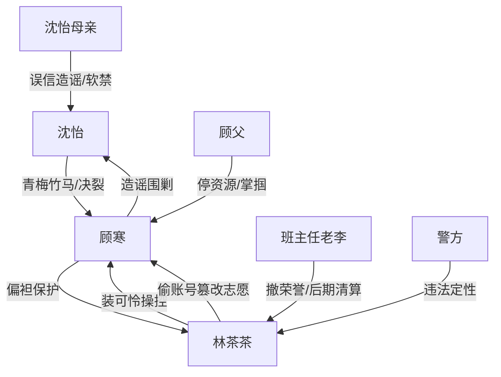

# 角色标签图谱

## 角色清单

### 沈怡 — 清醒反杀型大女主

- 叙事功能: 受害者、设局者、最终审判者
- 核心标签: 清北苗子、冷静、边界感
- 弧光: 被污名化的受害者 → 当众反杀的清醒者 → 走向更广阔世界
- 台词风格: 短句、反问、冷静补刀
- 关键行为: 不急着解释，保留顾寒语音，等待录取通知书现场引爆
- 读者情绪关系: 心疼、代入、爽

### 顾寒 — 伪善竹马/自私双标男

- 叙事功能: 主要被反噬对象，M3 因果回旋承载者
- 核心标签: 清北苗子、双标、大度绑架
- 弧光: 站在道德高台审判女主 → 被自己规则反噬 → 跪求女主帮忙
- 台词风格: 居高临下、道德说教、崩溃求饶
- 关键行为: 劝女主大度，群内立誓，礼堂公开羞辱，最后求助
- 读者情绪关系: 恨、鄙夷、看他崩溃的爽

### 林茶茶 — 绿茶贫困生/嫉妒型施害者

- 叙事功能: 直接篡改者，舆论操纵者
- 核心标签: 装可怜、嫉妒、违法
- 弧光: 被保护的贫困生 → 当众失口自证 → 犯罪者
- 台词风格: 夹子音、哭腔、自我矮化式道德绑架
- 关键行为: 偷账号改志愿，发小作文，抢荣誉，承认故意毁沈怡
- 读者情绪关系: 恨、恶心、期待被揭穿

### 沈怡母亲 — 被舆论裹挟的亲情压迫者

- 叙事功能: 家庭层面的二次伤害
- 核心标签: 面子优先、轻信外人、控制
- 弧光: 相信顾寒造谣 → 软禁女主 → 后文淡出
- 台词风格: 命令式、羞辱式
- 关键行为: 阻止报警，没收手机，要求复读
- 读者情绪关系: 憋屈、失望

### 班主任老李 — 权威误判者/后期清算者

- 叙事功能: 学校权威压迫与反转见证
- 核心标签: 偏听偏信、势利、后知后觉
- 弧光: 撤销女主荣誉 → 当众训斥林茶茶和顾寒
- 台词风格: 教训式、权威式
- 关键行为: 转授荣誉，后期指出篡改志愿违法
- 读者情绪关系: 前恨后略解气

### 顾父 — 后期现实清算力量

- 叙事功能: 给顾寒现实惩罚，补足家庭报应
- 核心标签: 功利父亲、资源切断者、现实审判
- 弧光: 赶到现场 → 掌掴顾寒 → 停卡停资源
- 台词风格: 冷硬、现实
- 关键行为: 断掉顾寒复读/出国幻想
- 读者情绪关系: 解气

## 关系网络

## 角色功能对照表（供改编参考）

| 原角色 | 极致标签 | 叙事功能 | 读者情绪功能 | 改编时必须保留的 |
|--------|---------|---------|-------------|---------------|
| 沈怡 | 清醒大女主 | 被害者+反杀者 | 心疼转爽 | 克制、不提前摊牌、公开引爆 |
| 顾寒 | 伪善竹马 | 规则制定者+被反噬者 | 恨与爽 | “劝人大度”必须原样回旋 |
| 林茶茶 | 绿茶贫困生 | 直接作恶者 | 恶心与期待揭穿 | 装可怜话术+失口自证 |
| 沈母 | 亲情压迫 | 二次伤害 | 憋屈 | 相信外人、阻止报警 |
| 班主任 | 权威误判 | 公共污名化 | 愤怒转清算 | 撤荣誉/公开反转 |
| 顾父 | 现实惩罚 | 资源清算 | 解气 | 断掉反派退路 |
