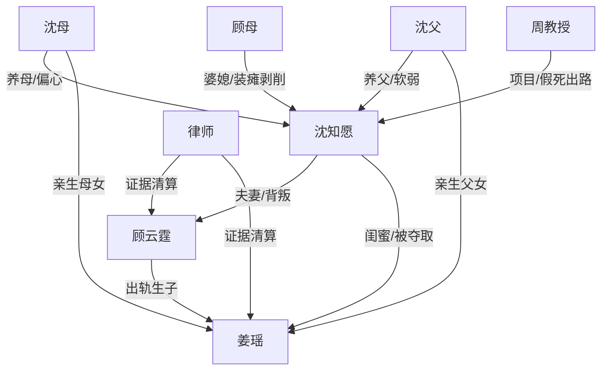

# 角色标签图谱

## 角色清单

### 沈知愿 — 隐忍清醒医学大女主
- 叙事功能: 受害者、证据收集者、假死反杀执行者、最终补偿对象
- 核心标签: 专业、隐忍、清醒
- 弧光: 背负愧疚的遗孀 → 被全员背叛的弃子 → 假死出走的复仇者 → 医学新星
- 台词风格: 前半压抑短句，后半冷静切割
- 关键行为: 高速助产、签字设局、保存胚胎、请求假死、进入研究基地、回国清算
- 读者情绪关系: 心疼、代入、爽

### 顾云霆 — 自私悔疯渣夫
- 叙事功能: 爱情背叛核心、温度反转承载者、悔恨补偿对象
- 核心标签: 自负、偏听、迟悔
- 弧光: 假死出轨者 → 胚胎毁灭者 → 真相崩塌者 → 精神失衡的悔夫
- 台词风格: 前半理直气壮，后半哭求忏悔
- 关键行为: 假死骗女主、护姜瑶、扔胚胎、夺手机、查周琛、求复合
- 读者情绪关系: 恨、看他悔恨获得爽感

### 姜瑶 — 白莲真凶亲女儿
- 叙事功能: 反派发动机，制造身世、孩子、医闹三重伤害
- 核心标签: 白莲、夺取、恶毒
- 弧光: 装死闺蜜 → 被偏爱的亲女儿 → 雪崩真凶 → 坐牢失业
- 台词风格: 哭腔伪善，先发制人
- 关键行为: 与顾云霆假死生子、陷害周琛、害死胚胎、制造雪崩、婴儿室下药
- 读者情绪关系: 强恨点，承担主要报应期待

### 沈母 — 偏心亏欠型母亲
- 叙事功能: 亲情背叛放大器
- 核心标签: 偏心、愧疚转嫁、迟悔
- 弧光: 合谋欺骗养女 → 逼女主让产 → 痛失女主 → 中风忏悔
- 台词风格: 尖锐、命令式
- 关键行为: 陪演三年、逼签协议、扇女主、维护姜瑶
- 读者情绪关系: 恨其偏心，后期报应带来偿还感

### 沈父 — 软弱旁观父亲
- 叙事功能: 亲情失守的旁证
- 核心标签: 软弱、后悔、无力
- 弧光: 附和骗局 → 偶有良心 → 崩溃中风
- 台词风格: 劝和、叹气、迟来维护
- 关键行为: 应和装瘫骗局、劝签字、后期质问姜瑶
- 读者情绪关系: 失望，报应中等

### 顾母/婆婆 — 装瘫剥削者
- 叙事功能: 把女主愧疚具象化为三年照护劳动
- 核心标签: 装病、剥削、迟悔
- 弧光: 装瘫享受照顾 → 维护姜瑶 → 得知真相 → 出家赎罪
- 台词风格: 前期伪慈爱，后期崩溃
- 关键行为: 装瘫三年、打女主、后期掌掴姜瑶
- 读者情绪关系: 恨与清算快感

### 周教授/医疗团队 — 出路与假死工具
- 叙事功能: 给女主提供合理离场、假死、医学成名路径
- 核心标签: 专业、外部秩序、救援
- 弧光: 项目邀请者 → 假死配合者 → 荣誉背书者
- 台词风格: 简洁、官方
- 关键行为: 接收女主、发布殉职信息、帮助完成研究
- 读者情绪关系: 安全感、补偿感

## 关系网络

## 角色功能对照表（供改编参考）

| 原角色 | 极致标签 | 叙事功能 | 读者情绪功能 | 改编时必须保留的 |
|--------|---------|---------|-------------|---------------|
| 沈知愿 | 隐忍清醒医学大女主 | 承债与反杀 | 心疼+爽 | 专业能力、假死离场、不复合 |
| 顾云霆 | 悔疯渣夫 | 爱情背叛与悔恨 | 恨+看悔 | 假死欺骗、毁核心信物、迟来崩溃 |
| 姜瑶 | 白莲真凶 | 夺取与陷害 | 强恨点 | 闺蜜身份、亲女儿身份、害死孩子 |
| 沈母 | 偏心母亲 | 亲情背叛 | 憋屈 | 为亲女儿牺牲养女 |
| 顾母 | 装病婆婆 | 愧疚剥削 | 愤怒 | 装病三年、后期赎罪 |
| 周教授 | 外部秩序 | 出路与背书 | 安全感 | 假死与成就路径 |
