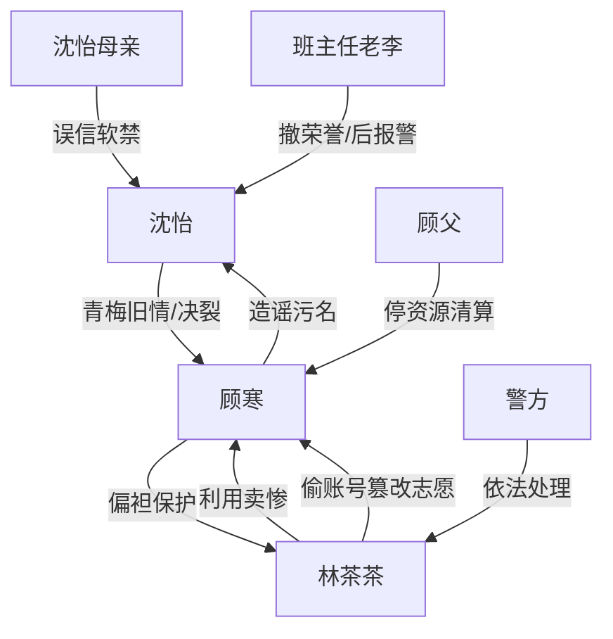

# 角色标签图谱

## 角色清单

### 沈怡 — 清醒反杀型大女主

- 叙事功能: 被污名的受害者、反杀执行者、价值坐标中心。
- 核心标签: 清北苗子、冷静蓄证、边界感强。
- 弧光: 被竹马误伤和全校围攻 → 借证据当众翻盘 → 进入清北切断旧关系。
- 台词风格: 短句、反问、原话回敬。
- 关键行为: 保存语音、等待通知书公开场、播放证据、拒绝帮顾寒。
- 读者情绪关系: 心疼、代入、爽。

### 顾寒 — 双标竹马/道德绑架者

- 叙事功能: 最大情绪债制造者，承担原话回旋的被惩罚对象。
- 核心标签: 清北苗子、傲慢、男权双标。
- 弧光: 站在道德高地劝女主大度 → 当众翻车 → 求助无门沦落大专。
- 台词风格: 居高临下、命令式、崩溃后求饶。
- 关键行为: 挂断电话、发群语音、造谣沈怡、毕业礼羞辱、拆错通知书。
- 读者情绪关系: 恨、厌恶、看他崩溃获得爽感。

### 林茶茶 — 绿茶贫困生/嫉妒型施害者

- 叙事功能: 直接篡改志愿者，触发主线危机和互撕真相。
- 核心标签: 卖惨、装弱、嫉妒。
- 弧光: 装可怜博同情 → 荣誉加身 → 当众失言认罪 → 被警方带走。
- 台词风格: “我家穷”“我不是故意的”“顾寒哥哥”式软刀子。
- 关键行为: 偷账号、改志愿、发小作文、假摔、承认“故意毁她”。
- 读者情绪关系: 恨、恶心、期待报应。

### 沈怡母亲 — 被舆论裹挟的亲情压迫者

- 叙事功能: 强化女主孤立无援，制造家庭线情绪债。
- 核心标签: 偏听偏信、重名声、控制。
- 弧光: 相信顾寒造谣并软禁女主 → 后文未重点清算，功能性压迫。
- 台词风格: 训斥、命令、羞辱。
- 关键行为: 不让报警、没收手机、让沈怡反省。
- 读者情绪关系: 憋屈、失望。

### 班主任老李 — 失职权威

- 叙事功能: 将私人污名升级为学校权威判决。
- 核心标签: 偏听、势利、失职。
- 弧光: 撤销沈怡荣誉 → 真相后怒扇顾寒、斥责林茶茶。
- 台词风格: 权威训话。
- 关键行为: 改优秀毕业生名额、赶沈怡、真相后报警配合。
- 读者情绪关系: 前恨后有限补偿。

### 顾父 — 外部清算者

- 叙事功能: 对顾寒施加资源清算，补足家庭报应。
- 核心标签: 严厉、现实、止损。
- 弧光: 赶到现场 → 停资源 → 配合警方。
- 台词风格: 冷硬、短句。
- 关键行为: 扇顾寒、停卡停车、点破“大度”双标。
- 读者情绪关系: 爽点辅助。

## 关系网络

## 角色功能对照表（供改编参考）

| 原角色 | 极致标签 | 叙事功能 | 读者情绪功能 | 改编时必须保留的 |
|--------|---------|---------|-------------|---------------|
| 沈怡 | 清醒大女主 | 受害者与反杀者 | 心疼、爽 | 冷静蓄证、不心软、不复合 |
| 顾寒 | 双标竹马 | 原话回旋对象 | 恨、爽 | 公开劝大度、公开翻车、求助被拒 |
| 林茶茶 | 绿茶贫困生 | 直接施害者 | 恶心、期待惩罚 | 卖惨话术、偷账号、当众失言 |
| 沈母 | 偏听亲人 | 孤立女主 | 憋屈 | 阻止报警/软禁功能 |
| 老李 | 失职权威 | 放大污名 | 愤怒、补偿 | 权威错判和后期改口 |
| 顾父 | 清算家长 | 外部报应 | 爽 | 停资源、点破双标 |
