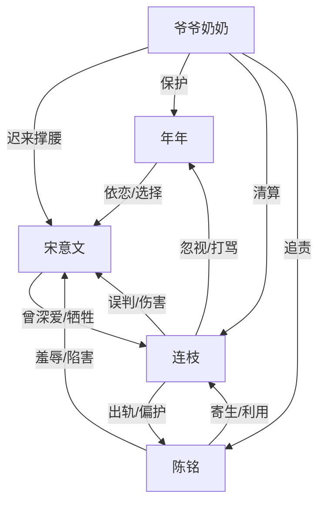

# 角色标签图谱

## 角色清单

### 年年 — 天真见证者/童言刀
- 叙事功能: 第一人称镜头，负责把成人伦理冲突转译成童真残酷。
- 核心标签: 无辜、敏感、站父亲。
- 弧光: 懵懂旁观 → 被迫失父 → 主动拒绝母亲 → 获得新家庭补偿。
- 台词风格: 短、直、孩子气，但经常刺中真相。
- 关键行为: 追问上学原因、砸徽章、拒绝母亲礼物与骑大马。
- 读者情绪关系: 心疼、保护欲、代替读者发出道德审判。

### 宋意文 — 隐忍献祭型男主/清醒离场者
- 叙事功能: 情绪债核心承载者，也是后半反击的执行者。
- 核心标签: 隐忍、重情、护女。
- 弧光: 自我牺牲 → 被背叛压垮 → 死亡假象醒悟 → 拒绝复合。
- 台词风格: 前期克制沉默，后期短句清算。
- 关键行为: 收留陈铭、让名额给连枝、护女反击、设计死亡假象。
- 读者情绪关系: 心疼、憋屈、后期爽感来源。

### 连枝 — 负心妻/迟来悔恨者
- 叙事功能: 施害者与火葬场承受者，负责制造温度反转。
- 核心标签: 自负、偏心、迟钝。
- 弧光: 掌控家庭 → 偏护陈铭 → 误害意文 → 失去一切后悔。
- 台词风格: 前期合理化、命令式；后期哀求式。
- 关键行为: 出轨陈铭、登记结婚、逼父亲背锅、试图把年年过给陈铭。
- 读者情绪关系: 恨、怒、后段看她悔恨获得清算快感。

### 陈铭 — 绿茶男小三/寄生反派
- 叙事功能: 持续升级羞辱，诱发连枝做错选择，后期承接罪案清算。
- 核心标签: 装弱、恶毒、贪婪。
- 弧光: 被救者 → 夺位者 → 犯罪者 → 被带走清算。
- 台词风格: 茶言茶语，表面委屈，实则挑衅。
- 关键行为: 与连枝登记、怀孕报告挑衅、买凶围堵、卖数据。
- 读者情绪关系: 强恨点，越装越让读者想看报应。

### 爷爷奶奶 — 高位清算者/迟来的后盾
- 叙事功能: 提供权力反转，补足父亲过去牺牲真相。
- 核心标签: 愧疚、护短、有权威。
- 弧光: 决裂缺席 → 赶来撑腰 → 配合假死 → 清算反派。
- 台词风格: 直接、怒斥、带长辈权威。
- 关键行为: 揭名额真相、压住连枝、配合演戏。
- 读者情绪关系: 补偿感、撑腰爽感。

## 关系网络

## 角色功能对照表（供改编参考）

| 原角色 | 极致标签 | 叙事功能 | 读者情绪功能 | 改编时必须保留的 |
|--------|---------|---------|-------------|---------------|
| 年年 | 童言刀见证者 | 第一视角与无辜承伤 | 心疼/代入 | 孩子视角、童言误读成人丑事 |
| 宋意文 | 隐忍献祭者 | 情绪债承载与后期离场 | 心疼/爽 | 为妻牺牲、护女、最终不回头 |
| 连枝 | 负心火葬场 | 施害与悔恨 | 恨/看报应 | 偏护第三者、迟来醒悟、求而不得 |
| 陈铭 | 绿茶寄生者 | 恨点放大器 | 强烈厌恶 | 装弱挑衅、夺名分、犯罪反噬 |
| 爷奶 | 权力后盾 | 权力反转 | 撑腰爽 | 迟来但有力，揭开父亲价值 |
