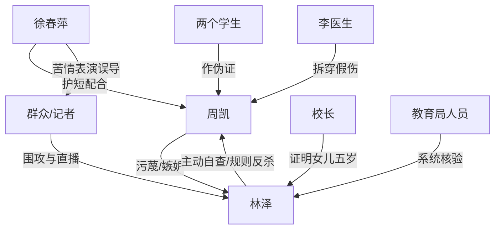

# 角色标签图谱

## 角色清单

### 林泽 — 清醒克制型被构陷教师
- 叙事功能: 被污蔑者、规则反杀执行者、道德坐标中心。
- 核心标签: 克制、尽责、证据意识强。
- 弧光: 被当众围攻 → 主动自查 → 冷静清算 → 回归教师本职。
- 台词风格: 短句、追问、证据导向。
- 关键行为: 要求证据；主动举报自己；提前找医生验伤；拒绝替周凯撤销后果。
- 读者情绪关系: 让读者心疼、代入、最终获得替他出气的爽感。

### 周凯 — 白眼狼式表演型施害学生
- 叙事功能: 主反派、情绪债制造者、因果回旋承受者。
- 核心标签: 伪正义、嫉妒、甩锅。
- 弧光: 正义举报者伪装 → 连续圆谎 → 崩溃求救 → 人生失控。
- 台词风格: 道德词密集，常用“为您好”“公平”“良心过不去”包装私欲。
- 关键行为: 找记者直播；污蔑作弊；伪造伤痕；拉同学作伪证；求林泽救他。
- 读者情绪关系: 前期让读者憋屈恨，后期提供打脸爽点。

### 徐春萍 — 苦情戏码型共犯母亲
- 叙事功能: 放大周凯弱者滤镜，引导群众误判。
- 核心标签: 表演、护短、共犯。
- 弧光: 跪地求情 → 煽动围观 → 得意露馅。
- 台词风格: 哭诉、退让式控诉、以弱逼强。
- 关键行为: 当众下跪；抱住周凯；指控林泽伤害孩子。
- 读者情绪关系: 让读者厌恶“会哭就有理”的舆论操控。

### 校长 — 第一层事实反转工具人
- 叙事功能: 付费节点揭示核心事实。
- 核心标签: 严肃、知情、证实。
- 弧光: 被迫接案 → 当众困惑 → 出示五岁证据。
- 台词风格: 官方、克制。
- 关键行为: 说出“女儿才五岁”；出示照片。
- 读者情绪关系: 带来第一次强打脸爽点。

### 李医生 — 证据清算工具人
- 叙事功能: 拆穿伪伤痕，完成第二层证据反转。
- 核心标签: 专业、快速、客观。
- 弧光: 后台待命 → 出场检查 → 一句话定性。
- 台词风格: 简短结论式。
- 关键行为: 检查伤痕并展示颜料。
- 读者情绪关系: 提供强证据爽点。

### 围观群众/记者 — 舆论放大器
- 叙事功能: 制造压迫场，后期成为反噬见证者。
- 核心标签: 盲从、易怒、反转风向。
- 弧光: 围攻林泽 → 怀疑周凯 → 见证清算。
- 台词风格: 弹幕式、极端判断。
- 关键行为: 直播、辱骂、逼迫举报。
- 读者情绪关系: 前期加压，后期增强公开打脸快感。

## 关系网络

## 角色功能对照表（供改编参考）

| 原角色 | 极致标签 | 叙事功能 | 读者情绪功能 | 改编时必须保留的 |
|--------|---------|---------|-------------|---------------|
| 林泽 | 清醒被构陷者 | 规则反杀主角 | 心疼、代入、爽 | 克制追证、主动引入第三方调查 |
| 周凯 | 白眼狼伪正义反派 | 制造情绪债 | 恨、想看报应 | 用道德话术包装私欲，连续圆谎 |
| 徐春萍 | 苦情共犯 | 舆论催化 | 厌恶、憋屈 | 下跪/哭诉式弱者表演 |
| 校长 | 第一证据人 | 付费反转 | 爽、松一口气 | 当众揭穿核心荒诞事实 |
| 李医生 | 专业证据人 | 二次反转 | 痛快 | 拆穿伪造物证 |
| 群众/记者 | 舆论场 | 压迫与反噬 | 窒息、公开打脸 | 直播或公开记录必须保留 |
