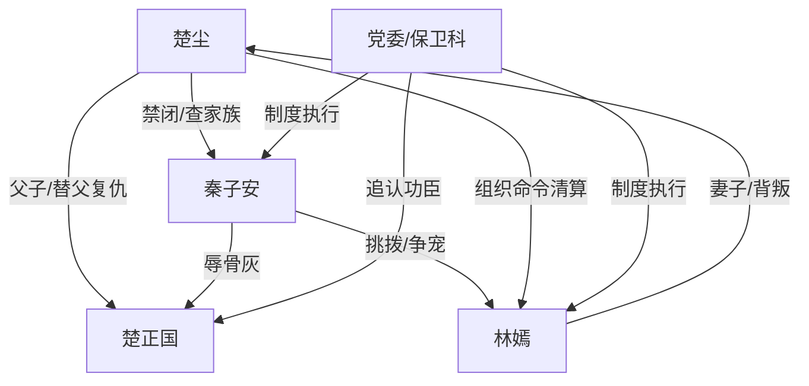

# 角色标签图谱

## 角色清单

### 楚尘 — 心死复仇型营长
- 叙事功能: 第一人称主角，情绪债承受者与清算执行者。
- 核心标签: 克制、制度复仇、心死不回头
- 弧光: 绝望求救的丈夫 → 抱骨灰心死的儿子 → 冷眼清算的转业军人
- 台词风格: 短句、命令式、冷拒绝
- 关键行为: 发九十九封电报、用父亲战功换命令、送离婚申请、绕过自刺的林嫣
- 读者情绪关系: 心疼、代入、爽

### 林嫣 — 凉薄名医/迟到悔恨者
- 叙事功能: 婚姻背叛者，温度反转承载者。
- 核心标签: 自负、偏宠、迟悔
- 弧光: 被仰望的保卫处名医 → 不信死亡的高位妻子 → 被锁墓旁忏悔的罪人
- 台词风格: 前期高高在上，后期嘶哑崩溃
- 关键行为: 为秦子安小伤留下、阻止楚尘护骨灰、跪求复合、自刺心口
- 读者情绪关系: 恨、厌、后期获得报应快感

### 秦子安 — 绿茶实习生/骨灰羞辱者
- 叙事功能: 即时恨点制造者，推动触底极辱。
- 核心标签: 恃宠、恶毒、怯懦
- 弧光: 被偏爱的实习生 → 当众辱骨灰的挑衅者 → 边境疯癫者
- 台词风格: 装无辜、挑衅、崩溃尖叫
- 关键行为: 自划伤口骗林嫣、嘲讽灵堂、撒骨灰、求林嫣救命
- 读者情绪关系: 极恨、期待被惩罚

### 楚正国 — 功勋父亲/情绪债核心
- 叙事功能: 道德坐标与复仇正当性来源。
- 核心标签: 功臣、父亲、被辜负者
- 弧光: 镇守边境三十载的老boss → 病危等不到救治 → 墓碑成为终身惩罚场
- 台词风格: 基本无台词，以身份与遗体存在
- 关键行为: 以一生战功换来最后命令
- 读者情绪关系: 心疼、敬重、愤怒来源

### 保卫科长/党委 — 制度审判者
- 叙事功能: 将私人情绪升级为公共正义。
- 核心标签: 威严、执行、清算
- 弧光: 追悼会旁观力量 → 命令执行者 → 终身锁墓判决者
- 台词风格: 公文式、审判式
- 关键行为: 宣读命令、押解二人、执行最终惩罚
- 读者情绪关系: 爽、信服

## 关系网络

## 角色功能对照表（供改编参考）

| 原角色 | 极致标签 | 叙事功能 | 读者情绪功能 | 改编时必须保留的 |
|--------|---------|---------|-------------|---------------|
| 楚尘 | 心死复仇者 | 承债与清算 | 心疼、代入、爽 | 冷静拒绝，不回头 |
| 林嫣 | 迟到悔恨者 | 温度反转 | 恨、看她悔 | 先不信，后崩溃 |
| 秦子安 | 恃宠绿茶 | 制造恨点 | 极致厌恶 | 小伤换命、当众羞辱 |
| 楚正国 | 功勋父亲 | 道德锚点 | 心疼、正义感 | 必须是救不回的亲人/长辈 |
| 党委/保卫科 | 制度权力 | 降维清算 | 爽感背书 | 必须有正式文件/命令 |
