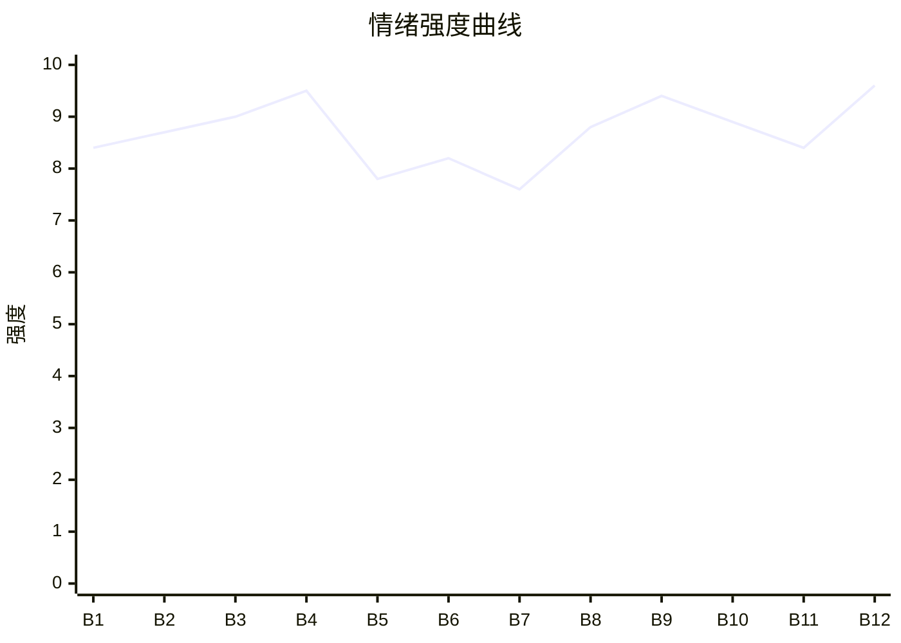

# Beat Sheet 节拍器

## 全文概况

- 总字数: 约 14500 字
- 节拍数: 12 幕
- 核心母题（Logline）: 被全家忽视的女儿林月汐，在亲情地位不如宠物的长期压迫中离家自救，靠写作获得自我价值，最终拒绝原家庭的功利性和解，亲手选择真正有温度的家人。
- 情绪模式: 极致忽视 → 累积憋屈 → 爆发离家 → 低谷自救 → 曝光反噬 → 冷静清算 → 价值胜利

## 节拍详表

### Beat 1: 微信群排除与家庭身份钩子 [开篇-第一章前半]
- **字数**: 约 900 字（占比 6%）
- **核心事件**: 女主发现家族群连宠物都有账号，唯独没有她；妹妹公开说她“不算家里人”。
- **情绪标签**: 震惊、憋屈、被抹除
- **情绪强度**: 8.4/10
- **情绪方向**: ⚡突变
- **冲突类型**: 大转折
- **悬念钩子**: 为什么亲女儿会被全家排除到不如宠物？
- **叙事速度**: 快
- **对话占比**: 25%
- **reversal_mechanism**: [M3]
- **hook_strength**: 8.8/10（极端度 2.5/3，信息密度 2.8/3，悬念 1.8/2，节奏 1.7/2）
- **关键句**: “那只猪在群里有专属的发言位。而我这个亲姐姐却不配进群。”
- **原文摘录**: 家里微信群叫“幸福一家人”，成员包括父母兄弟姐妹和三只宠物，唯独没有女主。她请求妹妹拉她进群，妹妹说“那个群只加家里人，你进来不合适吧？”随后妹妹视频《猜猜我家有几口人》摆出五个人和三只宠物，缺女主；弹幕问姐姐，妹妹回复“哦，她不算是家里人。”团队以“节目效果”公关。

### Beat 2: 餐桌座位羞辱 [第二章]
- **字数**: 约 1600 字（占比 11%）
- **核心事件**: 家庭聚餐中，荷兰猪有专属座位，女主只能坐角落折叠椅；她尝试换座被全家压回去。
- **情绪标签**: 羞辱、心寒、窒息
- **情绪强度**: 8.7/10
- **情绪方向**: ↑上升
- **冲突类型**: 大转折
- **悬念钩子**: 女主还要忍多久？
- **叙事速度**: 中
- **对话占比**: 38%
- **reversal_mechanism**: [M3, M5]
- **hook_strength**: null
- **关键句**: “我不是跟一只荷兰猪争座位。我是想坐在你们中间。”
- **原文摘录**: 聚餐座位固定，父母兄妹和宠物都有位置。女主坐折叠椅，夹菜要站起来。她提前搬到妹妹和荷兰猪之间，母亲要求她让位：“那个位置是小葵的。它习惯了。”弟弟说别闹，哥哥催她快点，父亲让她听话。饭后她看到家庭相册仍无自己，只能回到十平米小屋。

### Beat 3: 兄妹长期轻贱回忆 [第三章]
- **字数**: 约 1900 字（占比 13%）
- **核心事件**: 妹妹、哥哥、弟弟各自用“垃圾、佣人、保姆/司机女儿”式标签否定女主身份。
- **情绪标签**: 愤怒、心疼、积怨
- **情绪强度**: 9.0/10
- **情绪方向**: ↑上升
- **冲突类型**: 微冲突群
- **悬念钩子**: 全家都把她当外人，她会怎样脱离？
- **叙事速度**: 快
- **对话占比**: 35%
- **reversal_mechanism**: [M3]
- **hook_strength**: null
- **关键句**: “原来我的面子，在他那里还不如一只狗。”
- **原文摘录**: 妹妹填家庭人口写 5，扔掉女主签名专辑；哥哥凌晨叫她煮面，拒给签名照，却给狗朋友写“To 雪糕”；弟弟怀疑她被抱错，做亲子鉴定仍说她不像家人，并在领奖台称她是保姆。

### Beat 4: 父母冷漠与病中崩盘 [第四章]
- **字数**: 约 2100 字（占比 14%）
- **核心事件**: 女主高烧在母亲医院独自输液，母亲却陪荷兰猪；回家后被指责不收拾，情绪首次爆发。
- **情绪标签**: 绝望、崩裂、反抗
- **情绪强度**: 9.5/10
- **情绪方向**: ⚡突变
- **冲突类型**: 大转折
- **悬念钩子**: 女主说要搬出去，家人会挽留吗？
- **叙事速度**: 中
- **对话占比**: 42%
- **reversal_mechanism**: [M5]
- **hook_strength**: null
- **关键句**: “既然这个家没有我的位置，那我就搬出去好了。”
- **原文摘录**: 父亲忽视她成绩，母亲作为医生却不陪她高烧急诊。母亲去陪感冒的荷兰猪，回家还责怪她没收拾。女主质问“你怎么不直接让小葵做你女儿？”母亲扇她，父亲逼道歉，妹妹嫌她矫情。女主宣布搬出去。

### Beat 5: 离家与断供后的安静 [第五章前半]
- **字数**: 约 1300 字（占比 9%）
- **核心事件**: 家人因荷兰猪发烫抛下女主，女主拖箱离家；家人之后只因宠物和杂务联系她。
- **情绪标签**: 冷、清醒、松绑
- **情绪强度**: 7.8/10
- **情绪方向**: ↓下降后平稳
- **冲突类型**: 微冲突
- **悬念钩子**: 女主能否建立自己的生活？
- **叙事速度**: 快
- **对话占比**: 30%
- **reversal_mechanism**: [M5]
- **hook_strength**: null
- **关键句**: “我不是你雇的保姆。”
- **原文摘录**: 家人听到小葵发烫立刻离开。女主在零下十几度拖行李走。哥哥来电让她遛狗，妹妹找小葵衣服，弟弟通知把她房间改猫窝。女主逐一切断，世界彻底安静。

### Beat 6: 生日长寿面与替代亲情萌芽 [第五章后半]
- **字数**: 约 1200 字（占比 8%）
- **核心事件**: 女主租下简陋单间，生日当天房东奶奶端来长寿面，这是她第一次被人庆生。
- **情绪标签**: 酸涩、暖、触底反弹
- **情绪强度**: 8.2/10
- **情绪方向**: ↑上升
- **冲突类型**: 微冲突
- **悬念钩子**: 这份陌生人的温暖会不会成为新家？
- **叙事速度**: 慢
- **对话占比**: 15%
- **reversal_mechanism**: [M5]
- **hook_strength**: null
- **关键句**: “这是我长这么大第一次，有人给我煮长寿面。”
- **原文摘录**: 女主毕业后租九百块单间，生日自己买小蛋糕。新闻推送父亲上市全家合影，她反扣手机。房东奶奶端面来，冷着脸说吃完刷碗。女主吃一口，烫得眼泪掉下来。

### Beat 7: 博客发声与自我价值生长 [第六章]
- **字数**: 约 1800 字（占比 12%）
- **核心事件**: 女主写被遗忘者故事获得共鸣，与房东奶奶互相照料，成为千万粉情感博主。
- **情绪标签**: 共鸣、治愈、成长
- **情绪强度**: 7.6/10
- **情绪方向**: ↑上升
- **冲突类型**: 微冲突
- **悬念钩子**: 原家庭刷到她之后会如何反扑？
- **叙事速度**: 中
- **对话占比**: 22%
- **reversal_mechanism**: [M5, M6]
- **hook_strength**: null
- **关键句**: “有些伤口可以写给自己看，但不能拿来消费。”
- **原文摘录**: 女主月薪四千工作，更新博客。一句“热闹是属于他们的”引爆评论。她和房东奶奶种菜、互相留饭送物。粉丝突破千万，她参加访谈，谈原生家庭伤害但不消费自己经历。节目播出后，妹妹急了。

### Beat 8: 舆论扒皮与家人上门 [第七章]
- **字数**: 约 1800 字（占比 12%）
- **核心事件**: 网友扒出她和妹妹关系，旧言论反噬；家人上门要求她帮妹妹公关。
- **情绪标签**: 期待、压迫回潮、冷笑
- **情绪强度**: 8.8/10
- **情绪方向**: ↑上升
- **冲突类型**: 大转折
- **悬念钩子**: 女主会否公开清算这些年？
- **叙事速度**: 快
- **对话占比**: 45%
- **reversal_mechanism**: [M3, M6]
- **hook_strength**: null
- **关键句**: “回应我不是她的亲姐姐？还是回应她对我很好？”
- **原文摘录**: 网友把林月汐和林昭晚照片放一起，翻出“不算家里人”旧直播。妹妹质问是否她搞鬼。晚上家人来小院，嫌她住得差，又要求她回应。父亲说家里哪里苛待她，她逐项指出杂物间、够不着菜、座位让给小葵。

### Beat 9: 院中清算与生育真相 [第八章]
- **字数**: 约 1700 字（占比 12%）
- **核心事件**: 女主当面清算哥哥弟弟的旧伤，并揭开母亲从怀孕起就放弃她的真相。
- **情绪标签**: 清算、钝痛、释放
- **情绪强度**: 9.4/10
- **情绪方向**: ⚡突变
- **冲突类型**: 大转折
- **悬念钩子**: 家人会被舆论与真相怎样反噬？
- **叙事速度**: 中
- **对话占比**: 50%
- **reversal_mechanism**: [M3, M5, M6]
- **hook_strength**: null
- **关键句**: “你在生下我的时候，就已经在心里放弃我了。不是吗？”
- **原文摘录**: 女主指出哥哥直播中称她佣人、弟弟雨天抢伞称她司机女儿。她说这些不是鸡毛蒜皮，而是他们习惯了她退让。随后揭开母亲怀孕时吃药、提前剖腹产、不愿为她多等一个月。最后她拒绝趁机控诉，也拒绝回应。

### Beat 10: 舆论死网与迟来求和 [第九章前半]
- **字数**: 约 1600 字（占比 11%）
- **核心事件**: 父亲声明被无全家福打脸，旧同学同事作证；家人开始求补偿。
- **情绪标签**: 爽、反讽、迟到
- **情绪强度**: 8.9/10
- **情绪方向**: ↑上升
- **冲突类型**: 大转折
- **悬念钩子**: 女主会接受补偿吗？
- **叙事速度**: 快
- **对话占比**: 25%
- **reversal_mechanism**: [M3, M6]
- **hook_strength**: null
- **关键句**: “他们终于认认真真去翻看了我的博客。”
- **原文摘录**: 父亲用集团号声明家庭和睦，却拿不出有女主的全家福。初中同学、弟弟同学纷纷作证，公关稿不堪一击。妹妹邀请她去生日会，哥哥寄“To 汐汐”签名照，弟弟邀她坐第一排，父母小心翼翼打电话。

### Beat 11: 拒绝修复光环 [第九章后半]
- **字数**: 约 700 字（占比 5%）
- **核心事件**: 女主看清家人的悔意是光环危机下的成本计算，拒绝所有补偿。
- **情绪标签**: 清醒、痛快、断舍离
- **情绪强度**: 8.4/10
- **情绪方向**: →平稳高位
- **冲突类型**: 微冲突
- **悬念钩子**: 她最终会如何定义自己的家？
- **叙事速度**: 中
- **对话占比**: 20%
- **reversal_mechanism**: [M3, M5]
- **hook_strength**: null
- **关键句**: “他们不是真心后悔，他们只是怕失去自己身上的光环。”
- **原文摘录**: 妹妹说给她留最好位置，她回“你的生日会向来只请家里人，我不是。”弟弟请她以家人身份坐第一排，她回“我一个司机的女儿，就不抢了。”她拒绝房子和温柔电话，因为那只是修复光环成本最低的办法。

### Beat 12: 颁奖典礼选择真正家人 [第十章]
- **字数**: 约 1500 字（占比 10%）
- **核心事件**: 女主领奖时原家人期待和解，她却牵起房东奶奶，公开定义真正家人。
- **情绪标签**: 圆满、升华、报偿
- **情绪强度**: 9.6/10
- **情绪方向**: ↑上升
- **冲突类型**: 大转折
- **悬念钩子**: 结尾价值余韵
- **叙事速度**: 中
- **对话占比**: 35%
- **reversal_mechanism**: [M3, M5, M6]
- **hook_strength**: null
- **关键句**: “这是我亲自挑选的家人。没有血缘，但有温度。”
- **原文摘录**: 女主小院生活稳定，把奶奶故事写进博客，粉丝五千万。领奖典礼主持人问家人是否到场，原家人坐前排期待上台。女主想起弟弟领奖时不叫她，转身走向后排，牵起房东奶奶，说她是亲自挑选的家人。掌声爆发，女主明白“家不是被生在哪，而是爱被留在哪。”

## 情绪曲线可视化

## 节拍密度检测

- 平均每 1200 字一个节拍
- 微冲突密度: 每 900-1200 字一次
- 大转折密度: 每 2500-3200 字一次
- 判定: 符合高频节拍器标准

## 反转机制清单(Reversal Mechanisms)

| 机制 ID | 机制名 | 承载 Beat | 关键段落/金句 | 等价改编提示 |
|--------|--------|-----------|--------------|-------------|
| M3 | 因果回旋反讽 | Beat 1, 8, 10-12 | “她不算是家里人” → “你的生日会向来只请家里人，我不是” → “这是我亲自挑选的家人” | 必须保留施害者原句/规则在结尾被女主原结构回敬 |
| M5 | 温度反转曲线 | Beat 2, 4, 6, 7, 11, 12 | 原家人冷到零度，陌生奶奶用面、灯、饭补位；结尾血缘家人失温，非血缘家人升温 | 温度正负必须通过具体照料物件呈现，不能抽象说爱 |
| M6 | 多层递进反转 | Beat 7-12 | 博客爆红 → 身份被扒 → 家人上门清算 → 舆论反噬 → 颁奖选家人 | 层数不能少，每层从个人伤害升到公众评价，再升到价值定义 |
