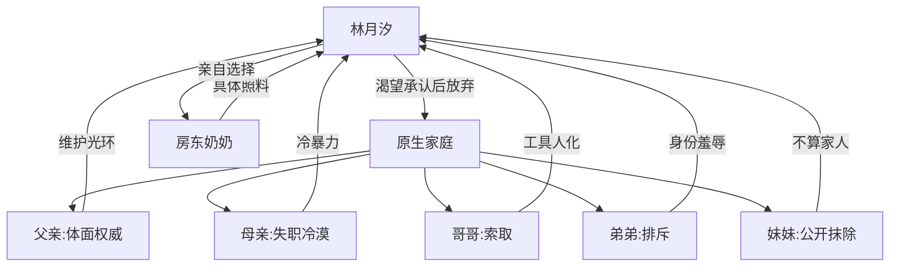

# 角色标签图谱

## 角色清单

### 林月汐 — 透明人清醒大女主
- 叙事功能: 受害者、记录者、最终价值裁决者。
- 核心标签: 被忽视、克制、清醒生长。
- 弧光: 求进入家庭 → 离家自救 → 自选家人。
- 台词风格: 平静短句，反问清算。
- 关键行为: 搬离原家、持续写博客、拒绝功利和解、颁奖牵起奶奶。
- 读者情绪关系: 心疼、代入、爽。

### 林昭晚 — 光环妹妹/软刀施害者
- 叙事功能: 开篇排除女主的主压迫者之一。
- 核心标签: 千万粉 UP 主、宠物母爱表演、伪温柔。
- 弧光: 公开否认姐姐 → 舆论翻车 → 请求姐姐出席生日会。
- 台词风格: 轻飘飘、撒娇式伤人。
- 关键行为: 说女主“不算家里人”，要求女主帮公关。
- 读者情绪关系: 恨、反感、期待打脸。

### 林星野 — 顶流哥哥/理所当然索取者
- 叙事功能: 展示女主工具人地位。
- 核心标签: 电竞顶流、懒惰索取、轻慢。
- 弧光: 叫女主煮面不给尊重 → 寄迟来的签名照。
- 台词风格: 命令式、敷衍。
- 关键行为: 称女主佣人，给狗签名却不给妹妹。
- 读者情绪关系: 憋屈、讽刺爽。

### 林泽辰 — 天才弟弟/理性冷暴力者
- 叙事功能: 用“科学判断”包装亲情排斥。
- 核心标签: 天才、冷漠、傲慢。
- 弧光: 叫亲姐保姆/司机女儿 → 邀她第一排。
- 台词风格: 论文式、通知式。
- 关键行为: 做亲子鉴定、把她房间改猫窝。
- 读者情绪关系: 恨、寒心。

### 父亲 — 光环家长/体面维护者
- 叙事功能: 家庭秩序的最终背书者。
- 核心标签: 商界精英、权威、体面至上。
- 弧光: 无视女儿 → 集团声明翻车 → 温和求和。
- 台词风格: 命令、训斥、体面话。
- 关键行为: 让她听母亲的，发布家庭和睦声明。
- 读者情绪关系: 压迫、反感。

### 母亲 — 医学专家/失职母亲
- 叙事功能: 最强心痛源。
- 核心标签: 救别人、不救女儿、冷暴力。
- 弧光: 陪荷兰猪不陪高烧女儿 → 被揭穿从怀孕起放弃她。
- 台词风格: 不耐烦、责备。
- 关键行为: 扇耳光，说“不该把你生下来”。
- 读者情绪关系: 最强恨点之一。

### 房东奶奶 — 刀子嘴替代家人
- 叙事功能: 治愈线与新家庭载体。
- 核心标签: 嘴硬、照料、温度。
- 弧光: 冷脸房东 → 留灯留饭 → 被女主公开选择为家人。
- 台词风格: 嫌弃式关心。
- 关键行为: 端长寿面、留灯、留饭、出席颁奖。
- 读者情绪关系: 暖、安慰、补偿。

## 关系网络

## 角色功能对照表（供改编参考）

| 原角色 | 极致标签 | 叙事功能 | 读者情绪功能 | 改编时必须保留的 |
|--------|---------|---------|-------------|---------------|
| 林月汐 | 透明人清醒大女主 | 承债与裁决 | 心疼、爽 | 从求认同到自选家人 |
| 林昭晚 | 光环妹妹 | 公开抹除 | 恨 | “不算家人”级别的公开羞辱 |
| 林星野 | 顶流哥哥 | 工具人压迫 | 憋屈 | 宠物/外人待遇高于女主 |
| 林泽辰 | 天才弟弟 | 身份否认 | 寒心 | 把亲姐说成保姆/司机女儿 |
| 父亲 | 体面权威 | 家庭秩序背书 | 压迫 | 先否认苛待，后体面危机 |
| 母亲 | 失职专家 | 亲情伤口核心 | 心痛、恨 | 救别人不救女儿的极端对比 |
| 房东奶奶 | 替代家人 | 情感补偿 | 暖 | 用饭、灯、衣物等具体动作给爱 |
