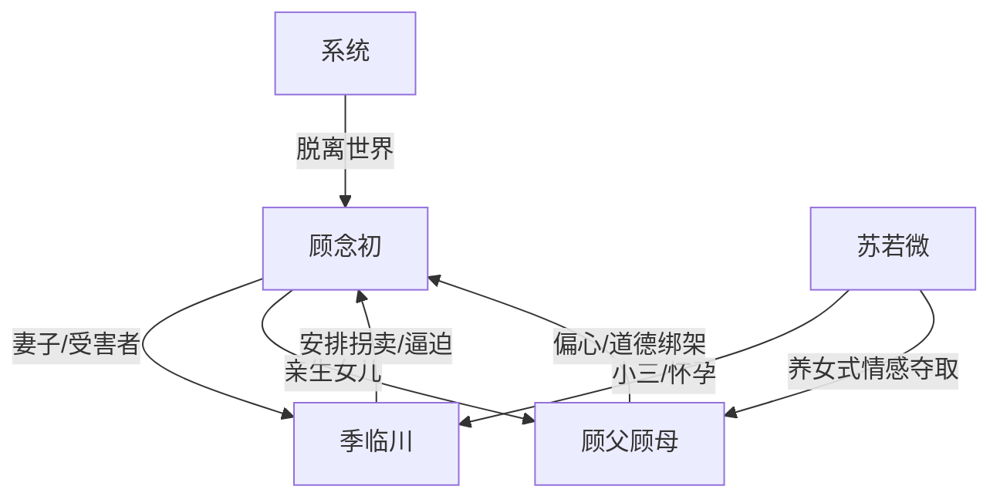

# 角色标签图谱

## 角色清单

### 顾念初 — 十世受害的冷静退场女主
- 叙事功能: 情绪承载者、道德中心、不可逆清算的触发器
- 核心标签: 被拐卖受害者、原配妻子、被父母放弃的亲女儿
- 弧光: 反复求生 → 彻底死心 → 主动脱离世界
- 台词风格: 短、冷、低能量
- 关键行为: 放弃第十一次重生，选择三天后消失
- 读者情绪关系: 心疼、代入、替她恨所有人

### 季临川 — 迟来深情的施害丈夫
- 叙事功能: 第一压迫者，后半悔恨清算对象
- 核心标签: 出轨丈夫、操控者、迟来悔疯
- 弧光: 自以为掌控 → 侥幸寻找 → 崩溃认错
- 台词风格: 前期命令式，后期破碎重复
- 关键行为: 安排拐卖、逼女主照顾小三、目睹女主消失
- 读者情绪关系: 恨，后半看他崩溃获得爽感

### 顾父顾母 — 偏心养女的亲生父母
- 叙事功能: 亲情压迫源，强化女主孤立无援
- 核心标签: 糊涂父母、道德绑架、迟来悔恨
- 弧光: 逼女儿牺牲 → 发现女儿消失 → 悔不当初
- 台词风格: “都是为你好/多忍忍”式家庭伦理压迫
- 关键行为: 劝跳楼、逼照顾苏若微、母亲下跪、后期撞墙悔恨
- 读者情绪关系: 恨、憋屈、期待报应

### 苏若微 — 绿茶型夺取者
- 叙事功能: 拱火器、情绪债制造者、偏心机制受益人
- 核心标签: 保姆女儿、怀孕小三、卖惨绿茶
- 弧光: 众星捧月 → 话术失效 → 被季临川切割
- 台词风格: 装可怜、自贬式攻击、假哭威胁
- 关键行为: 抢丈夫、逼原配伺候、打翻馄饨栽赃
- 读者情绪关系: 强烈厌恶，期待失宠

### 系统 — 不可逆退场机制
- 叙事功能: 赋予女主最终选择权，让“失去”变成规则清算
- 核心标签: 重生规则、脱离程序、现实合理化
- 弧光: 提供选择 → 执行消失 → 抹除痕迹
- 台词风格: 冷静机械
- 关键行为: 启动三天倒计时，抹除女主存在
- 读者情绪关系: 爽点工具，替女主完成不可逆离开

## 关系网络

## 角色功能对照表（供改编参考）

| 原角色 | 极致标签 | 叙事功能 | 读者情绪功能 | 改编时必须保留的 |
|--------|---------|---------|-------------|---------------|
| 顾念初 | 冷静退场受害女主 | 道德中心 | 心疼、代入 | 她必须主动选择离开 |
| 季临川 | 迟来深情丈夫 | 主压迫者/悔恨者 | 恨转爽 | 前期必须亲手伤害女主 |
| 顾父顾母 | 偏心亲人 | 亲情背刺 | 憋屈、愤怒 | 必须牺牲亲女儿成全外人 |
| 苏若微 | 绿茶夺取者 | 拱火器 | 厌恶 | 必须持续卖惨并抢占女主资源 |
| 系统 | 规则执行器 | 不可逆清算 | 爽 | 必须让失去无法挽回 |
