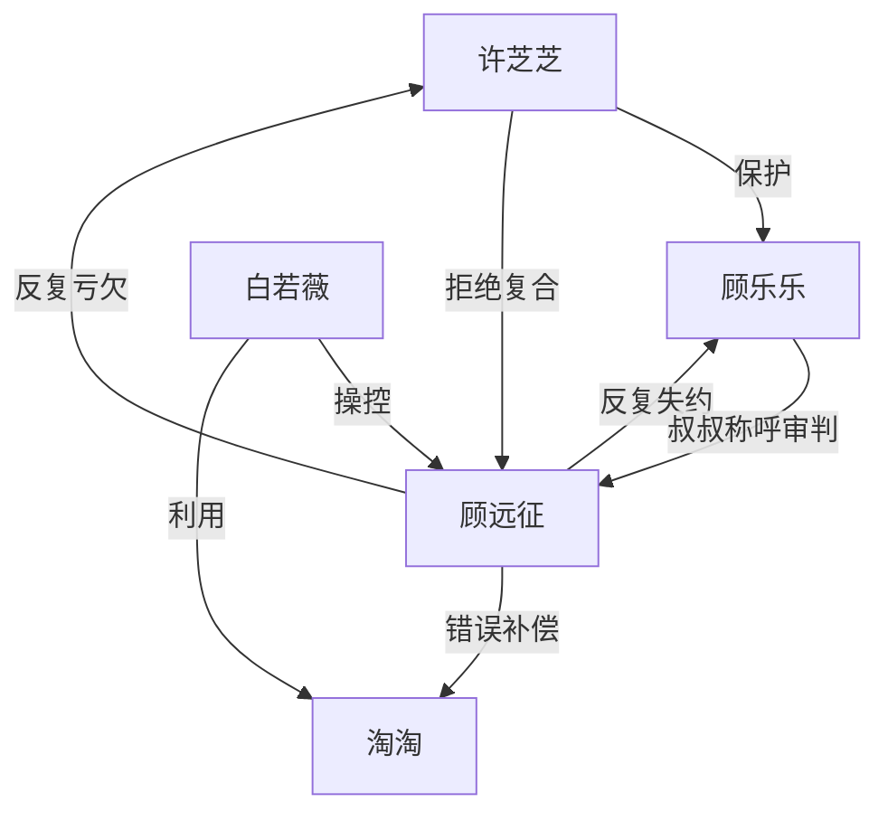

# 角色标签图谱

## 角色清单

### 许芝芝 — 清醒止损型前妻
- 叙事功能: 主视角、情绪债记录者、孩子保护者。
- 核心标签: 清醒、克制、决绝
- 弧光: 等丈夫回头 → 设计脱敏 → 带孩子新生
- 台词风格: 短句、冷静、拒绝解释
- 关键行为: 骗签离婚协议、记录脱敏过程、带儿子离开、拒绝复合
- 读者情绪关系: 心疼、认同、爽

### 顾乐乐 — 被迫懂事的受伤孩子
- 叙事功能: 全文心疼核心与审判者。
- 核心标签: 懂事、敏感、慢慢脱敏
- 弧光: 依赖爸爸 → 犹豫喊叔叔 → 主动拒绝爸爸
- 台词风格: 童真但克制，句子短，杀伤力强
- 关键行为: 主动喊叔叔、删除相册、酒店门口逐条控诉
- 读者情绪关系: 强心疼、强保护欲、最终痛快

### 顾远征 — 迟来悔恨的失格父亲
- 叙事功能: 施害者、追妻火葬场承受者。
- 核心标签: 心软自私、迟钝、追悔
- 弧光: 偏心白月光 → 第一次回头 → 被拒绝后长期追悔
- 台词风格: 前期辩解，后期哀求
- 关键行为: 反复失约、签下离婚协议、看见脱敏记录、跪求复合
- 读者情绪关系: 恨、解气、有限怜悯

### 白若薇 — 工具化孩子的白月光
- 叙事功能: 外部诱因与直接反派。
- 核心标签: 绿茶、算计、母职失格
- 弧光: 装可怜争夺资源 → 自爆利用 → 被法律清算
- 台词风格: 哭诉、挑衅、后期尖刻
- 关键行为: 频繁来电、朋友圈挑衅、逼淘淘吃芒果
- 读者情绪关系: 厌恶、希望受罚

### 淘淘 — 被利用的工具孩子
- 叙事功能: 白若薇操控顾远征的载体。
- 核心标签: 可怜、被利用、非罪魁
- 弧光: 被包装成“缺父爱” → 过敏事件受害 → 被亲生父亲接走
- 台词风格: 哭求、依赖
- 关键行为: 哭喊顾爸爸、说出吃芒果真相
- 读者情绪关系: 同情，但不转移对乐乐的心疼

## 关系网络

## 角色功能对照表（供改编参考）

| 原角色 | 极致标签 | 叙事功能 | 读者情绪功能 | 改编时必须保留的 |
|--------|---------|---------|-------------|---------------|
| 许芝芝 | 清醒止损前妻 | 主控离开线 | 认同与爽 | 不回头、不崩溃、保护孩子 |
| 顾乐乐 | 被迫懂事儿子 | 心疼核心 | 催泪与审判 | “称呼变化”指标 |
| 顾远征 | 失格父亲 | 被清算对象 | 憋屈偿还 | 迟来悔恨必须无效 |
| 白若薇 | 绿茶白月光 | 外部反派 | 厌恶 | 利用孩子争夺男主 |
| 淘淘 | 工具孩子 | 反派工具受害者 | 复杂同情 | 不能写成纯恶小孩 |
