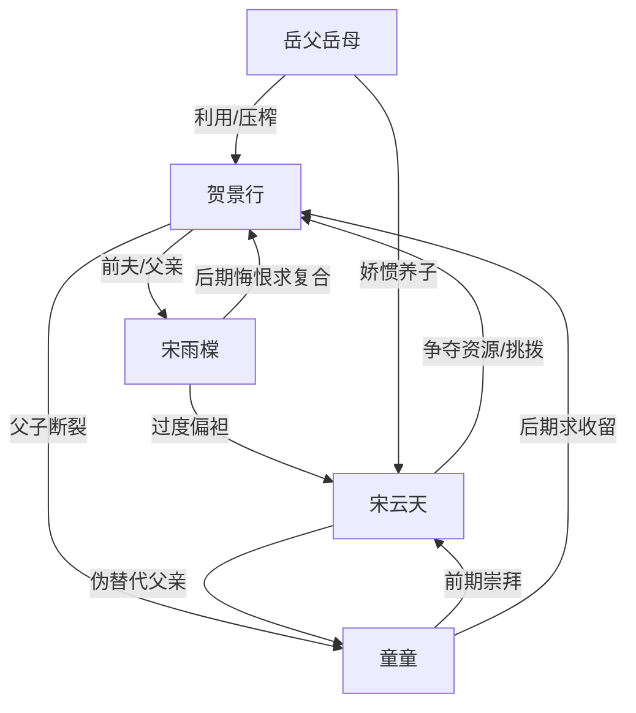

# 角色标签图谱

## 角色清单

### 贺景行 — 清醒反杀型前赘婿
- 叙事功能: 被压迫者、家庭系统真实支柱、后半打脸执行者。
- 核心标签: 隐忍、能干、清醒断亲
- 弧光: 讨好型赘婿 → 决绝离婚 → 年薪百万/三百万新生活
- 台词风格: 冷静短句，后半带讽刺回旋
- 关键行为: 提离婚、交接家务系统、卖 AI 系统、报警、拒绝复合和认回
- 读者情绪关系: 前半心疼，后半爽

### 宋雨橖 — 扶弟魔式悔恨前妻
- 叙事功能: 主要施压者，羞辱母句发出者，后半悔恨承受者。
- 核心标签: 扶弟、势利、迟来悔悟
- 弧光: 高位贬低丈夫 → 失业落魄 → 下跪求复合失败
- 台词风格: 前期软刀子，后期哽咽求饶
- 关键行为: 酒后贬低、签离婚、打男主、下跪
- 读者情绪关系: 恨、期待她悔疯

### 宋云天 — 绿茶吸血养弟
- 叙事功能: 资源掠夺者、婚姻挑拨者、终局反讽对象。
- 核心标签: 绿茶、妈宝、寄生
- 弧光: 被全家娇宠 → 自曝恶意 → 傍富婆受辱 → 回归寄生
- 台词风格: 装委屈、撒娇、轻蔑挑衅
- 关键行为: 吃榴莲、戴金表、抢买房钱、害童童过敏
- 读者情绪关系: 强恨点，打脸爽点来源

### 童童/贺子童 — 被养歪的白眼狼儿子
- 叙事功能: 加重男主伤害，提供亲情债，终局拒绝制造高阶爽感。
- 核心标签: 白眼狼、趋利、失宠后求回头
- 弧光: 嫌父亲丢脸 → 被小舅伤害 → 求原谅 → 失宠求收留被拒
- 台词风格: 童稚但残忍，后期求饶
- 关键行为: 骂父亲、打父亲、道歉、求跟随
- 读者情绪关系: 前期心寒，后期复杂爽

### 岳父岳母 — 家庭压迫共同体
- 叙事功能: 制造道德围剿，维护养弟优先权，后半承受系统崩塌。
- 核心标签: 偏心、虚伪、势利
- 弧光: 维护宋云天 → 发现养弟害外孙 → 被迫打工
- 台词风格: 岳父强硬，岳母软硬兼施
- 关键行为: 扇耳光、翻行李、阻止离婚、隐瞒豆浆真相
- 读者情绪关系: 厌恶，期待报应

## 关系网络

## 角色功能对照表（供改编参考）

| 原角色 | 极致标签 | 叙事功能 | 读者情绪功能 | 改编时必须保留的 |
|--------|---------|---------|-------------|---------------|
| 贺景行 | 清醒前赘婿 | 被压迫后翻身 | 心疼→爽 | 先忍后断、能力伏笔、拒绝回头 |
| 宋雨橖 | 扶弟魔前妻 | 主羞辱者 | 恨→看她悔 | “没本事”母句与迟来忏悔 |
| 宋云天 | 绿茶养弟 | 寄生反派 | 强恨点 | 装委屈+夺资源+自曝恶意 |
| 童童 | 白眼狼儿子 | 亲情刀 | 心寒→冷爽 | 站队外人、失宠求回 |
| 岳父岳母 | 偏心长辈 | 家庭围剿 | 厌恶 | 道德绑架与后期生活崩塌 |
