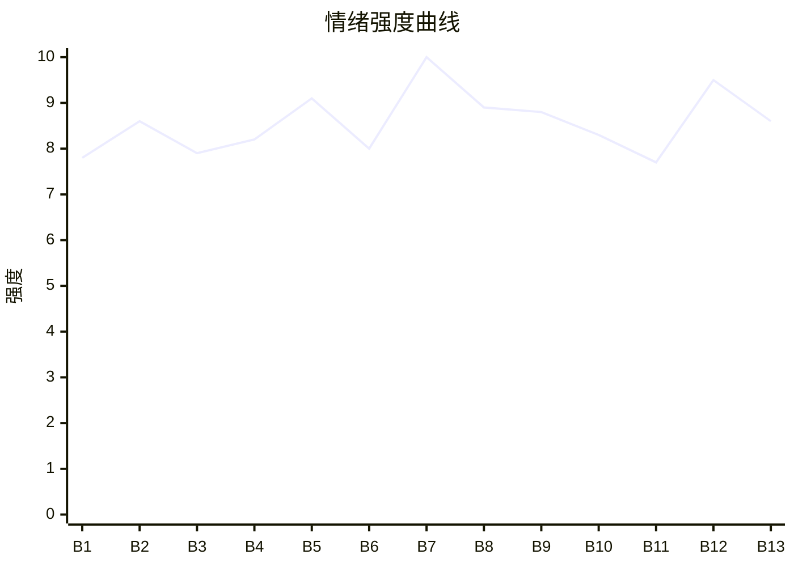

# Beat Sheet 节拍器

## 全文概况

- 总字数: 约 16500 字
- 节拍数: 13 幕
- 核心母题（Logline）: 一个被母亲与小叔共同伤害的孩子，为了守住病逝父亲用命换来的爱与财产，隐忍长大并用法律证据清算施害者。
- 情绪模式: 违和开局 → 连环打压 → 父亲护崽赴死 → 遗嘱反制 → 长线隐忍 → 成年清算 → 冷静不原谅

## 节拍详表

### Beat 1: 咳血与谈钱的违和开局 [简介-第1章前段]
- **字数**: 约 900 字（占比 5.5%）
- **核心事件**: 母亲从小叔房间出来，父亲咳血，将死前向母亲索要巨额财产。
- **情绪标签**: 震惊、疑惑、心疼
- **情绪强度**: 7.8/10
- **情绪方向**: ⚡突变
- **冲突类型**: 大转折
- **悬念钩子**: 父亲为什么突然不闹，只开始要钱？
- **叙事速度**: 快
- **对话占比**: 25%
- **reversal_mechanism**: [M5]
- **hook_strength**: 8.5/10
- **关键句**: “给我一个亿，我就不闹。”
- **原文摘录**: 妈妈又一次从小叔的房间出来后，爸爸不再闹了。而我看见了他手里捏着咳满血的纸。我知道爸爸要离开我了。因为爷爷就是不停的咳血然后去世的。妈妈警告爸爸：“殷淮，你也不想满满在残缺的环境里长大吧。”爸爸只是淡淡道：“给我一个亿，我就不闹。”妈妈愣住，却还是打了一个亿。那天之后，妈妈总是不归家，而爸爸的账户总是响起钱到账的声音。爸爸头发掉了好多，再也吃不下东西，却找了很多穿西装的叔叔教我签字，说要为我铺好路。

### Beat 2: 蛋挞过敏与第一次错位惩罚 [第1章中段]
- **字数**: 约 1500 字（占比 9.1%）
- **核心事件**: 小叔给孩子含芒果蛋挞导致过敏，母亲却打父亲，指责他利用孩子。
- **情绪标签**: 憋屈、心疼、愤怒
- **情绪强度**: 8.6/10
- **情绪方向**: ↑上升
- **冲突类型**: 微冲突升级为大转折
- **悬念钩子**: 父亲为什么不再解释，只冷漠看着母亲？
- **叙事速度**: 快
- **对话占比**: 38%
- **reversal_mechanism**: [M5]
- **hook_strength**: null
- **关键句**: “殷淮，你就是故意想让我误会阿钰才不早点说，你连自己的儿子都利用！”
- **原文摘录**: 妈妈给我买蛋挞，小叔拿出来。我没有接，妈妈大吼爸爸把孩子教坏了。我害怕得说不出话。为了不让妈妈再推爸爸，我接过蛋挞一个又一个吃下。爸爸挣脱阻拦扑过来打掉蛋挞，喊：“满满不能吃蛋挞上的芒果，他过敏。”我全身瘙痒，嘴巴刺痛。小叔急着哭喊自己不是故意的，妈妈却心疼他，凶狠打了爸爸一巴掌。爸爸脸上窜上巴掌印，可这次没有解释，只冷漠平静地看着妈妈。

### Beat 3: 医院漏针与童言曝光 [第1章末-第2章开]
- **字数**: 约 900 字（占比 5.5%）
- **核心事件**: 母亲在医院陪小叔亲密，孩子漏针后童言说破二人关系。
- **情绪标签**: 荒诞、羞耻、愤怒
- **情绪强度**: 7.9/10
- **情绪方向**: ↑上升
- **冲突类型**: 微冲突
- **悬念钩子**: 童言揭穿会带来什么后果？
- **叙事速度**: 快
- **对话占比**: 30%
- **reversal_mechanism**: [M3]
- **hook_strength**: null
- **关键句**: “妈妈和小叔刚刚去阳台玩亲亲游戏去了，不是故意让我漏针的。”
- **原文摘录**: 医生给我打针后让我睡觉。我疼醒时发现输液输完，血液倒流。我想叫妈妈，可她和小叔在阳台亲亲。我只能按呼叫铃。医生赶来责问家长怎么管孩子。我对医生解释：“妈妈和小叔刚刚去阳台玩亲亲游戏去了，不是故意让我漏针的。”周围人的眼神变了，妈妈狠狠攥住我的嘴，警告我：“小孩子，别乱说。”

### Beat 4: 热搜爆发与别墅转让 [第2章]
- **字数**: 约 1500 字（占比 9.1%）
- **核心事件**: 母亲与小叔亲密照上热搜，小叔事业受损，母亲把账算到父亲头上并再次伤害他；父亲趁机要海边别墅。
- **情绪标签**: 屈辱、压迫、疑惑
- **情绪强度**: 8.2/10
- **情绪方向**: ↑上升
- **冲突类型**: 大转折
- **悬念钩子**: 父亲索要财产的真实意图越来越明显但仍未揭晓。
- **叙事速度**: 中快
- **对话占比**: 35%
- **reversal_mechanism**: [M1, M5]
- **hook_strength**: null
- **关键句**: “阮意，想补偿我就把海边那套别墅转我名下吧。”
- **原文摘录**: 妈妈和小叔亲密照片冲上热搜，“两兄弟争一妻”“亲弟弟撬墙角”等新闻让小叔事业尽毁。妈妈掀翻茶几，将报纸甩在爸爸脸上，骂他恶毒。她疯狂摇晃爸爸，又把他推到玻璃碎片上。小叔委屈说以后不能做记者了。妈妈命令爸爸道歉。爸爸平静说可以去查。鲜血蔓延后，妈妈想扶他，爸爸避开她的手，轻声说：“阮意，想补偿我就把海边那套别墅转我名下吧。”他们走后，爸爸预约了天葬服务，说半个月后可以让人变成星星。

### Beat 5: 雨夜送药与生日彻底破碎 [第3章]
- **字数**: 约 2400 字（占比 14.5%）
- **核心事件**: 父亲为了给孩子一个有母亲的生日，冒雨送药，却发现母亲在会所给小叔剥虾，最终失去最后期待。
- **情绪标签**: 心疼、羞辱、绝望
- **情绪强度**: 9.1/10
- **情绪方向**: ↓下降
- **冲突类型**: 大转折
- **悬念钩子**: 父亲还能撑多久？
- **叙事速度**: 中
- **对话占比**: 42%
- **reversal_mechanism**: [M5]
- **hook_strength**: null
- **关键句**: “那一刻，爸爸最后一丝对妈妈的期盼，也彻底碎了。”
- **原文摘录**: 爸爸给妈妈打很多电话，请她回来陪我吃一块蛋糕。妈妈在陪小叔吃饭，小叔故意装头疼，让爸爸十五分钟内送药。外面下倾盆大雨，爸爸护着我，自己半边身子被雨水浇透，嘴角溢血却悄悄擦掉。推开会所门，妈妈正面色红润地给小叔剥虾。药被随手丢到茶几上。周围人嘲笑爸爸，让他跪下求阮总。爸爸牵着我转身走进更大的风雨里。回家后，我们吃凉透的生日饭，爸爸点蜡烛。妈妈过了十二点才回来，砸水杯、奖杯、台灯，爸爸挡在我前面，被砸得满脸是血，最后吐血。

### Beat 6: 股份分离与临终铺路 [第4章前半]
- **字数**: 约 1400 字（占比 8.5%）
- **核心事件**: 父亲继续通过“原谅换股份/配合换财产分离协议”将母亲财产切割到孩子名下。
- **情绪标签**: 悲伤、敬意、隐忍爽
- **情绪强度**: 8.0/10
- **情绪方向**: →平稳蓄力
- **冲突类型**: 微冲突
- **悬念钩子**: 父亲的财产局是否能保护孩子？
- **叙事速度**: 中
- **对话占比**: 36%
- **reversal_mechanism**: [M1]
- **hook_strength**: null
- **关键句**: “爸爸给你安排好了，所有的财产、房产都转到了你的名下。”
- **原文摘录**: 妈妈酒醒后心虚道歉，爸爸递过去转让协议：“好，我原谅你，把你名下股份转10%给我。”妈妈赌气签字。爸爸的一辈子只剩不到七天。他摸着我的头，告诉我所有财产、房产都转到我名下，找了靠谱律师，以后没人能欺负我。妈妈又逼爸爸去国外参加采访，帮小叔洗白。爸爸答应，但要求签财产分离协议，保证他手上一切都跟她没关。妈妈骂他现在只能谈钱，最终还是签了字。

### Beat 7: 地震弃救与父亲赴死 [第4章后半]
- **字数**: 约 2200 字（占比 13.3%）
- **核心事件**: 国外采访突发地震，母亲优先救小叔，父亲用身体护住孩子并被水泥板砸死。
- **情绪标签**: 恐惧、崩溃、极致心疼
- **情绪强度**: 10.0/10
- **情绪方向**: ⚡突变
- **冲突类型**: 最大转折
- **悬念钩子**: 父亲死亡后，母亲和小叔会如何面对后果？
- **叙事速度**: 快
- **对话占比**: 22%
- **reversal_mechanism**: [M5, M6]
- **hook_strength**: null
- **关键句**: “他已经没气了。”
- **原文摘录**: 采访当天突发地震，建筑和采访棚坍塌。妈妈第一反应不是找我，也没有看身边虚弱的爸爸，而是扑向小叔，拉着小叔躲到安全地带。爸爸把我护在身下，用瘦弱身体挡碎石，喊：“满满别怕，爸爸在。”妈妈远远喊让爸爸自己带孩子跑。巨大的水泥板朝我们砸下，爸爸用最后力气把我推到安全角落，自己用后背扛下水泥板。我听见骨头碎裂的声音。地震结束后，我擦不干爸爸身上的血，搜救队摸了摸爸爸的脖颈，红着眼说：“他已经没气了。”

### Beat 8: 天葬合同与孩子拒母 [第5章]
- **字数**: 约 1700 字（占比 10.3%）
- **核心事件**: 母亲第一次痛哭并责怪小叔，孩子拿出天葬合同，拒绝母亲与小叔。
- **情绪标签**: 悲怆、冷醒、厌弃
- **情绪强度**: 8.9/10
- **情绪方向**: ↓后转冷
- **冲突类型**: 大转折
- **悬念钩子**: 孩子从此不再信任母亲，后续如何自保？
- **叙事速度**: 中
- **对话占比**: 30%
- **reversal_mechanism**: [M5]
- **hook_strength**: null
- **关键句**: “阳光刺眼，可我觉得我的世界，不会再亮了。”
- **原文摘录**: 妈妈扑在爸爸身边，第一次哭了。我不懂，为什么爸爸活着时她不肯好好看他，爸爸护我时她带小叔跑，现在爸爸死了她哭什么。小叔假哭安慰，妈妈推开他，骂如果不是为了帮他洗白，殷淮不会出事。我从爸爸口袋里掏出被血浸透的天葬合同，递给搜救员，说爸爸说这个能让他变成星星。妈妈这才知道爸爸早就病了。她想抱我，我往后退避开。小叔也说以后照顾我，我甩开他的手，跟着搜救员走出废墟。

### Beat 9: 葬礼夺产与遗嘱锁死 [第6章-第7章前段]
- **字数**: 约 2600 字（占比 15.8%）
- **核心事件**: 母亲和小叔企图侵占父亲财产，陈律师带着遗嘱、信托和撤销监护权条款出现，彻底锁死他们。
- **情绪标签**: 压抑、期待、痛快
- **情绪强度**: 8.8/10
- **情绪方向**: ↑上升
- **冲突类型**: 大转折
- **悬念钩子**: 财产保住后，孩子是否会继续复仇？
- **叙事速度**: 中快
- **对话占比**: 48%
- **reversal_mechanism**: [M1, M3]
- **hook_strength**: null
- **关键句**: “阮女士您作为监护人，只有抚养权，没有任何处置权。”
- **原文摘录**: 葬礼后，妈妈把我叫到书房，说爸爸名下所有东西都是她的，会帮我保管。小叔眼里满是贪婪。我学着爸爸说，所有东西都转到我名下了，你们不能动。妈妈威胁要把我送到乡下。门铃响起，陈律师进来，拿出遗嘱、公证文件和信托条款，明确爸爸名下所有存款、房产、股份全部由殷满继承，任何人不得侵占、挪用、代管。十八岁前由信托机构管理，阮女士只有抚养权，没有处置权；若虐待伤害满满，信托机构可撤销监护权并追究法律责任。每一句话都砸在妈妈和小叔心上。

### Beat 10: 守住遗产后的复仇种子 [第7章后半]
- **字数**: 约 900 字（占比 5.5%）
- **核心事件**: 孩子抱着父亲文件痛哭，立誓让欺负父亲的人付出代价。
- **情绪标签**: 悲伤、坚定、复仇期待
- **情绪强度**: 8.3/10
- **情绪方向**: ↑上升
- **冲突类型**: 微冲突
- **悬念钩子**: 复仇将以何种方式发生？
- **叙事速度**: 慢
- **对话占比**: 10%
- **reversal_mechanism**: [M6]
- **hook_strength**: null
- **关键句**: “我会让那些欺负过你的人，付出最惨痛的代价。”
- **原文摘录**: 妈妈和小叔没想到殷淮死了还摆他们一道。妈妈翻文件，念叨不可能。小叔的贪婪变成气愤。陈律师走后，妈妈盯着我，像要把我生吞活剥，却不敢动我。我捡起地上的文件，抱在怀里，回房裹进被子，抱着爸爸留下的抱枕哭。爸爸，谢谢您，您做得真好。我会好好长大，守护好你留给我的一切，也会让那些欺负过你的人付出最惨痛的代价。

### Beat 11: 多年隐忍与证据积累 [第8章-第9章前半]
- **字数**: 约 2600 字（占比 15.8%）
- **核心事件**: 满满沉默长大，记录母亲和小叔的出轨、转移财产、做假账证据，等待清算时机。
- **情绪标签**: 压抑、蓄势、期待
- **情绪强度**: 7.7/10
- **情绪方向**: →平稳蓄力
- **冲突类型**: 微冲突
- **悬念钩子**: 成年那天证据会如何引爆？
- **叙事速度**: 中慢
- **对话占比**: 18%
- **reversal_mechanism**: [M6]
- **hook_strength**: null
- **关键句**: “但不代表我记不住。”
- **原文摘录**: 妈妈几乎不回家，小叔搬进爸爸住过的主卧，用爸爸的衣服，把自己当成男主人。我像沉默的影子，每天上学吃饭写作业，从不惹事。他们觉得我是胆小怕事的孩子，却不知道我每天都在回忆。我有应激失语症，争吵时说不出话，但不代表我记不住。我偷偷记录他们做过的每件事，拍下亲密照片和转移财产、做假账证据，存在加密 U 盘。学校里我拼命学习，每次全班第一，却从没开心过，因为爸爸再也看不到。陈律师周末来看我，告诉我爸爸生前如何强撑病体为我铺路。

### Beat 12: 十八岁报警清算 [第9章后半-第10章前半]
- **字数**: 约 2200 字（占比 13.3%）
- **核心事件**: 母亲破产，小叔准备逃跑，满满拦下他，拨通律师和警察电话，提交全部证据。
- **情绪标签**: 爽、冷静、解恨
- **情绪强度**: 9.5/10
- **情绪方向**: ↑上升
- **冲突类型**: 大转折
- **悬念钩子**: 母亲和小叔将受到怎样的判罚？
- **叙事速度**: 快
- **对话占比**: 46%
- **reversal_mechanism**: [M1, M3, M6]
- **hook_strength**: null
- **关键句**: “妈妈，你欠爸爸的，欠我的，今天，该还了。”
- **原文摘录**: 我十八岁那天，妈妈公司破产，债主堵门。殷钰收拾值钱东西想逃。我拦住他，冷笑问小叔想去哪。他说出去买东西。我揭穿他想抛弃破产的妈妈。殷钰推我，承认和阮意在一起只会受苦，当然要走。我告诉他，是他和妈妈害死了爸爸，毁了我的家。我拿出手机拨通陈律师和警察电话，举报阮意偷税漏税、挪用公款，报案有人婚内出轨、蓄意伤害、企图侵占财产。妈妈冲向我想打我，我侧身躲开，冷冷地说：“妈妈，你欠爸爸的，欠我的，今天，该还了。”警察赶到，我交出假账记录、偷税凭证、流水、出轨照片视频和证人证言。

### Beat 13: 判刑、不原谅与余生自救 [第10章后半]
- **字数**: 约 1800 字（占比 10.9%）
- **核心事件**: 母亲和小叔入狱，满满继承产业、考上大学，探监时拒绝原谅。
- **情绪标签**: 释然、余痛、冷爽
- **情绪强度**: 8.6/10
- **情绪方向**: ↓回落
- **冲突类型**: 结尾清算
- **悬念钩子**: 无，情绪收束为“不原谅但自救”。
- **叙事速度**: 中
- **对话占比**: 40%
- **reversal_mechanism**: [M3, M5]
- **hook_strength**: null
- **关键句**: “我不恨你了，但我永远不会原谅你。”
- **原文摘录**: 妈妈和殷钰被警察带走时哭着求我放过。妈妈被判十五年，殷钰被判八年。我带着爸爸遗照和遗物离开痛苦的家，住进爸爸生前最喜欢的海边别墅。站在阳台上，我放声大哭：爸爸，我做到了。我考入最好的大学，选择金融专业，接手爸爸产业。去监狱看妈妈时，她苍老悔恨，一遍遍道歉，说如果时间重来一定做个好妻子好妈妈。我平静地说：“时间不能重来，做错了事，就要承担后果。我不恨你了，但我永远不会原谅你。”我又告诉殷钰，他永远比不上爸爸。走出监狱那刻，我轻轻笑了。此恨此身非我有，不惹其债。请永远活在自救清醒中。

## 情绪曲线可视化

## 节拍密度检测

- 平均每 1269 字一个节拍
- 微冲突密度: 每约 1100 字一次
- 大转折密度: 每约 1800 字一次
- 判定: 符合高频节拍器标准；中后段多年成长 Beat 稍长，但用证据积累维持期待。

## 反转机制清单(Reversal Mechanisms)

| 机制 ID | 机制名 | 承载 Beat | 关键段落/金句 | 等价改编提示 |
|--------|--------|-----------|--------------|-------------|
| M1 | 死环反杀 | Beat 4, 6, 9, 12 | “阮女士您作为监护人，只有抚养权，没有任何处置权。” | 固化载体可换为遗嘱、信托、诊断书、协议、录像，但“对方越想侵占越触发法律惩罚”的死环结构不换。 |
| M3 | 因果回旋反讽 | Beat 3, 9, 12, 13 | “妈妈，你欠爸爸的，欠我的，今天，该还了。” / “我不恨你了，但我永远不会原谅你。” | 必须保留施害者规则反向应用：他们曾用亲情绑架孩子，结尾孩子用法律与后果回敬。 |
| M5 | 温度反转曲线 | Beat 1-8, 13 | “为什么爸爸活着的时候，她从来不肯好好看他一眼？” | 必须有曾经在乎或至少婚姻关系的正温度基线，再写归零、死亡、悔恨负值。 |
| M6 | 多层递进反转 | Beat 7, 10, 11, 12 | “我会让那些欺负过你的人，付出最惨痛的代价。” | 层数不能少：死亡触底、遗嘱保命、长线证据、成年清算必须按阶梯递进。 |
