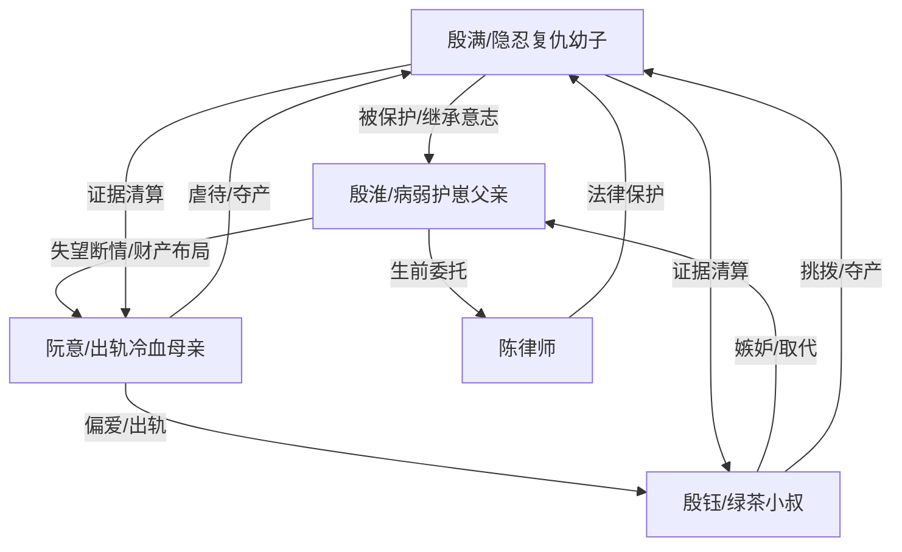

# 角色标签图谱

## 角色清单

### 殷满 — 隐忍复仇幼子
- 叙事功能: 第一人称见证者、情绪承载者、后半清算执行者。
- 核心标签: 天真见证、应激失语、长线复仇
- 弧光: 被保护的五岁孩子 → 沉默记录者 → 成年合法清算者
- 台词风格: 前半童言直白，后半冷静短句。
- 关键行为: 童言曝光母亲出轨；保管名片与文件；多年记录证据；十八岁报警。
- 读者情绪关系: 前半心疼，后半期待他替父反击并自救。

### 殷淮 — 病弱护崽父亲
- 叙事功能: 情绪核心、牺牲者、复仇布局者。
- 核心标签: 病弱、隐忍、护崽
- 弧光: 爱而不得的丈夫 → 放弃挽回的父亲 → 用命铺路的保护者
- 台词风格: 克制、轻、平静，多用条件句。
- 关键行为: 要一个亿、别墅、股份和财产分离协议；设立信托和遗嘱；地震中救子而死。
- 读者情绪关系: 极致心疼与敬重，是所有复仇爽点的道德来源。

### 阮意 — 出轨冷血母亲
- 叙事功能: 主要施害者、情绪债来源、悔恨承受者。
- 核心标签: 偏心、冷血、迟来悔恨
- 弧光: 高位傲慢妻子 → 夺产失败的监护人 → 入狱悔恨者
- 台词风格: 命令、指责、情绪化，后期转为哭求。
- 关键行为: 出轨殷钰；误伤孩子反打父亲；雨夜羞辱；地震弃救；夺产和虐待；最终被判刑。
- 读者情绪关系: 主要恨点，读者期待她失去一切并长期悔恨。

### 殷钰 — 绿茶小叔/寄生第三者
- 叙事功能: 引爆婚姻背叛、挑拨母亲、推动父亲受辱。
- 核心标签: 绿茶、贪婪、懦弱
- 弧光: 被偏爱的第三者 → 妄图取代男主人 → 破产逃跑失败的囚犯
- 台词风格: 委屈装无辜，关键处露出自私。
- 关键行为: 给过敏蛋挞；装头疼诱父子冒雨送药；抢主卧；做假账转财产；破产时想逃。
- 读者情绪关系: 次要恨点，承担“贱”和“虚伪”的情绪出口。

### 陈律师 — 父亲意志的执行者
- 叙事功能: 法律反杀工具人、保护者、证据链护栏。
- 核心标签: 专业、可靠、父亲托付
- 弧光: 父亲生前委托者 → 孩子成长守护者 → 清算协助者
- 台词风格: 正式、精确、法律化。
- 关键行为: 公布遗嘱和信托；给满满名片；协助报警清算。
- 读者情绪关系: 安全感和爽点可信度来源。

## 关系网络

## 角色功能对照表（供改编参考）

| 原角色 | 极致标签 | 叙事功能 | 读者情绪功能 | 改编时必须保留的 |
|--------|---------|---------|-------------|---------------|
| 殷满 | 隐忍复仇幼子 | 见证与清算 | 心疼→期待→爽 | 孩童误读成人罪恶、成年合法复仇 |
| 殷淮 | 病弱护崽父亲 | 牺牲与布局 | 极致心疼 | 临终“谈钱”实为护崽，死亡前置 |
| 阮意 | 出轨冷血母亲 | 主要施害 | 恨与看悔恨 | 活着不珍惜、死后才悔 |
| 殷钰 | 绿茶小叔 | 挑拨与贪婪 | 厌恶与打脸 | 装无辜、寄生、逃跑失败 |
| 陈律师 | 法律守护者 | 清算背书 | 安全感 | 遗嘱/信托/证据链落地 |
