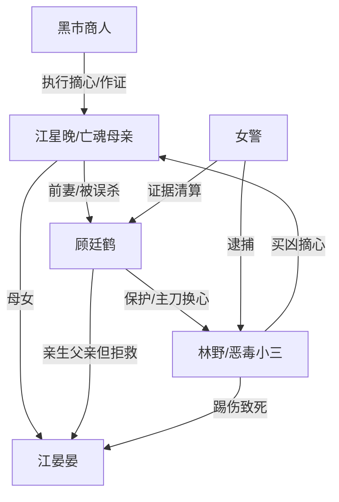

# 角色标签图谱

## 角色清单

### 江星晚 — 亡魂母亲/被献祭的正妻
- 叙事功能: 第一人称视角、情绪锚点、冤案承载者。
- 核心标签: 清白被毁、母性极强、死后旁观。
- 弧光: 被污名化驱逐 → 被活摘心脏 → 看见真相清算 → 与女儿转世重逢。
- 台词风格: 内心独白冷静，痛感集中在身体化描写。
- 关键行为: 生前保留证据、为女儿攒医药费、死后见证全案。
- 读者情绪关系: 心疼、愤怒、替她等报应。

### 顾廷鹤 — 愚蠢护短前夫/迟来悔恨者
- 叙事功能: 最大误判源、亲情债制造者、后半清算对象。
- 核心标签: 医学教授、偏执护小三、亲手害妻女。
- 弧光: 高高在上护林野 → 否认一切 → DNA砸脸 → 太平间崩溃 → 与林野互杀。
- 台词风格: 前期审判式指责，后期破碎悔恨。
- 关键行为: 毁证、逼道歉、净身出户、主刀移植、拒绝输血、杀林野。
- 读者情绪关系: 恨大于爽，悔恨只负责偿债，不负责洗白。

### 林野 — 恶毒小三/伪装病弱者
- 叙事功能: 直接凶手、绿茶压迫源、互噬终局触发者。
- 核心标签: 篡论文、买凶摘心、装病卖惨。
- 弧光: 被保护的“病人” → 罪证暴露 → 承认作恶 → 反杀顾廷鹤后同死。
- 台词风格: 前期楚楚可怜，后期怨毒尖刻。
- 关键行为: 篡改论文、造黄谣、买凶活摘、踩骨灰、踢伤晏晏。
- 读者情绪关系: 极致憎恶，期待她被剥夺心脏/生命。

### 江晏晏 — 病弱幼女/情绪债放大器
- 叙事功能: 把婚姻背叛升级为血脉伦理审判。
- 核心标签: 四岁、病弱、抱骨灰、亲生女儿。
- 弧光: 守着妈妈骨灰 → 被踢伤失血 → 因父亲拒绝输血死亡 → 转世重逢。
- 台词风格: 童真直白，一句话破局。
- 关键行为: 说出妈妈心脏真相、护骨灰、咬林野。
- 读者情绪关系: 心疼峰值，推动读者要求等价报应。

### 女警 — 公权力见证者/道德审判口
- 叙事功能: 推动调查、传递证据、替读者表达愤怒。
- 核心标签: 正义、愤怒、证据执行者。
- 弧光: 救孩子 → 求顾廷鹤献血 → 宣告死亡 → 甩出证据。
- 台词风格: 直接、克制、带公权力重量。
- 关键行为: 抱走晏晏、要求输血、出示 DNA 和亲子鉴定。
- 读者情绪关系: 代替读者质问顾廷鹤。

### 黑市商人 — 残酷证人/真相引爆器
- 叙事功能: 以恶人证词还原活摘过程，打破顾廷鹤幻想。
- 核心标签: 无悔、讥讽、知道细节。
- 弧光: 审判甩锅 → 审讯补刀 → 曝出林野买凶。
- 台词风格: 冷血调侃，越恶越可信。
- 关键行为: 说出无麻药活摘、烫伤疤、“阿鹤”小名、三百万交易。
- 读者情绪关系: 厌恶但承担证据功能。

## 关系网络

## 角色功能对照表（供改编参考）

| 原角色 | 极致标签 | 叙事功能 | 读者情绪功能 | 改编时必须保留的 |
|--------|---------|---------|-------------|---------------|
| 江星晚 | 亡魂母亲 | 受害视角与情绪锚 | 心疼、代偿 | 死后旁观、无法触碰孩子 |
| 顾廷鹤 | 护小三前夫 | 误判和亲手伤害 | 恨、等悔恨 | 拒救亲生骨肉的罪证句 |
| 林野 | 恶毒小三 | 直接凶手 | 恨、期待报应 | 伪装无辜+亲口承认 |
| 晏晏 | 病弱幼女 | 情绪债放大 | 心疼峰值 | 护母、死亡、转世补偿 |
| 女警 | 正义见证 | 证据落锤 | 爽、信任 | DNA/亲子鉴定宣告 |
| 黑市商人 | 冷血证人 | 暴露真相 | 生理痛、证据压迫 | 活摘细节和交易供词 |
