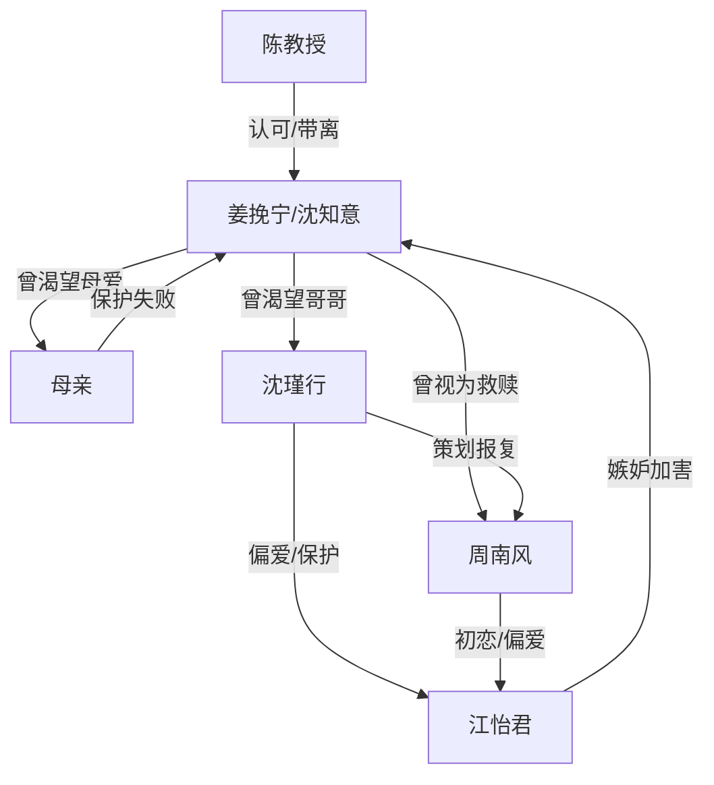

# 角色标签图谱

## 角色清单

### 姜挽宁/沈知意 — 受虐后清醒离场的大女主
- 叙事功能: 情绪债承载者、最终价值判断者、不可逆离开的执行者
- 核心标签: 渴望被爱、隐忍优秀、冷静切断
- 弧光: 讨好求认可 → 被彻底伤透 → 出国重建自我 → 不再原谅
- 台词风格: 前期少说、哽咽请求；后期冷静短句、边界清晰
- 关键行为: 答应出国、回校办手续、为镯子下跪、三年后拒绝复合
- 读者情绪关系: 心疼、代入、最终爽

### 沈瑾行/沈景修 — 迁怒成性的疯批继兄
- 叙事功能: 原生家庭压迫源、报复局发起者、后半追悔主体
- 核心标签: 傲慢、迁怒、迟来悔恨
- 弧光: 主动欺辱 → 纵容伤害 → 发现失去 → 崩溃补偿
- 台词风格: 刻薄羞辱、命令式、后期慌乱自责
- 关键行为: 推女主下楼、策划周南风欺骗、夺镯送人、命人磕头、三年后求回家
- 读者情绪关系: 恨、爽在看他失控

### 周南风 — 伪救赎男友
- 叙事功能: 爱情线背叛源、私密照伤害源、追悔火葬场主体
- 核心标签: 伪温柔、懦弱、迟钝
- 弧光: 假意追求 → 拍照羞辱 → 抛下女主 → 后悔求复合
- 台词风格: 前期轻佻伪善，后期哀求解释
- 关键行为: 灌醉女主、拍私密照、为江怡君离开病房、查真相、三年后求重新开始
- 读者情绪关系: 恶心、愤怒、看他求而不得的爽

### 江怡君 — 恶毒青梅/白月光反派
- 叙事功能: 嫉妒放大器、幕后加害者、推动真相曝光的反讽工具
- 核心标签: 绿茶、嫉妒、恶毒
- 弧光: 被偏爱者 → 暗中加害 → 曝光失宠 → 被送精神病院
- 台词风格: 表面柔弱，私下狠毒
- 关键行为: 散播照片、泄露号码、收买流氓、故意摔碎镯子、揭露女主已走
- 读者情绪关系: 恨、清算爽点

### 母亲 — 懦弱自保型亲人
- 叙事功能: 家庭保护失效的证明、亲情温度归零对象
- 核心标签: 自私、软弱、迟来后悔
- 弧光: 指责女儿 → 不敢得罪周家 → 后知后觉离婚道歉
- 台词风格: 指责、推责、后期愧疚
- 关键行为: 砸照片、怪女主没拒绝、只给住院费、后期离婚道歉
- 读者情绪关系: 失望、钝痛、无法完全爽

### 陈教授 — 外部救援/新世界入口
- 叙事功能: 提供离开路径，代表能力认可与新生活
- 核心标签: 认可、专业、安全
- 弧光: 竞赛导师 → 项目邀请者 → 带女主出国
- 台词风格: 简洁、功能性
- 关键行为: 邀请研究项目、提前带女主离开
- 读者情绪关系: 安心、补偿

## 关系网络

## 角色功能对照表（供改编参考）

| 原角色 | 极致标签 | 叙事功能 | 读者情绪功能 | 改编时必须保留的 |
|--------|---------|---------|-------------|---------------|
| 姜挽宁/沈知意 | 清醒离场女主 | 承债与裁决 | 心疼到爽 | 她必须主动离开，结尾不原谅 |
| 沈瑾行 | 迁怒继兄 | 家庭压迫源 | 恨与追悔爽 | 先羞辱足够，后悔才成立 |
| 周南风 | 伪救赎男友 | 爱情背叛源 | 恶心与求不得爽 | “救赎是假”的反转必须保留 |
| 江怡君 | 恶毒青梅 | 幕后加害器 | 被清算爽 | 表面柔弱、暗中下死手 |
| 母亲 | 懦弱亲人 | 保护失败 | 钝痛 | 不能早早站女主 |
| 陈教授 | 外部认可者 | 离开通道 | 补偿 | 必须给女主一个真实新世界 |
