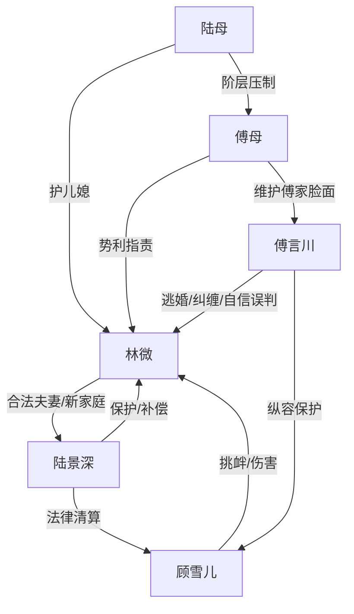

# 角色标签图谱

## 角色清单

### 林微 — 清醒孕妻/彻底切割型大女主
- 叙事功能: 第一视角承债者与清算者。
- 核心标签: 清醒、克制、有边界
- 弧光: 被逃婚羞辱的新娘 → 拥有新家庭并完成切割的母亲
- 台词风格: 短句、反问、冷静否认
- 关键行为: 拒绝求婚、否认傅言川家属身份、保留录像、拒绝和解
- 读者情绪关系: 心疼、代入、爽

### 傅言川 — 傲慢前任/追妻火葬场反派
- 叙事功能: 压迫源与火葬场承受者。
- 核心标签: 自恋、傲慢、迟钝
- 弧光: 笃定女主离不开他 → 亲眼看女主新家庭幸福而崩溃
- 台词风格: 命令式、恩赐式、质问式
- 关键行为: 逃婚、堵公司求婚、强行跟产检、默认青梅羞辱
- 读者情绪关系: 恨、厌恶、等他后悔

### 顾雪儿 — 绿茶青梅/伪装受害者
- 叙事功能: 现任冲突加速器与旧伤具象化。
- 核心标签: 装可怜、恶意、嫉妒
- 弧光: 被傅言川保护的小青梅 → 监控下露馅的故意伤害者
- 台词风格: 娇弱、委屈、挑拨
- 关键行为: 订婚宴赌约、摘头纱、白玫瑰挑衅、撞孕肚
- 读者情绪关系: 恨、期待被揭穿

### 陆景深 — 补偿型护妻霸总/稳定丈夫
- 叙事功能: 安全感兑现者，反衬傅言川缺位。
- 核心标签: 稳、护短、行动派
- 弧光: 旧日学长 → 合法丈夫与新家庭支柱
- 台词风格: 冷静、克制、带讽刺
- 关键行为: 风险书签字、出示证件、请律师调监控、挡开傅言川
- 读者情绪关系: 安全感、甜、爽

### 陆母 — 高位护短婆婆/公道代言人
- 叙事功能: 家族补偿与社会层级反转。
- 核心标签: 体面、护儿媳、有分寸
- 弧光: 登场即撑腰 → 让女主拥有真正家人
- 台词风格: 温和威严、字字落点
- 关键行为: 拒绝五百万和解，承诺陆家顶着
- 读者情绪关系: 温暖、补偿

### 傅母 — 势利豪门母亲/倒打一耙者
- 叙事功能: 傅家压迫系统代表。
- 核心标签: 刻薄、势利、利己
- 弧光: 指责女主 → 被陆家身份压制
- 台词风格: 尖酸、交易式
- 关键行为: 骂女主缠人、开支票求和解
- 读者情绪关系: 厌恶、等被打脸

## 关系网络

## 角色功能对照表（供改编参考）

| 原角色 | 极致标签 | 叙事功能 | 读者情绪功能 | 改编时必须保留的 |
|--------|---------|---------|-------------|---------------|
| 林微 | 清醒孕妻 | 承债与清算 | 心疼、代入、爽 | 不回头、不崩溃、合法新关系 |
| 傅言川 | 傲慢前任 | 火葬场对象 | 恨、等后悔 | 笃定女主离不开他 |
| 顾雪儿 | 绿茶青梅 | 恶意加码 | 恨、等揭穿 | “玩笑/不小心”的伪装 |
| 陆景深 | 护妻丈夫 | 安全感补偿 | 甜、爽 | 证件、签字、律师行动 |
| 陆母 | 护短婆婆 | 家庭补偿 | 暖、撑腰 | 不缺钱只要公道 |
| 傅母 | 势利长辈 | 社会压迫 | 厌恶 | 倒打一耙与利益和解 |
