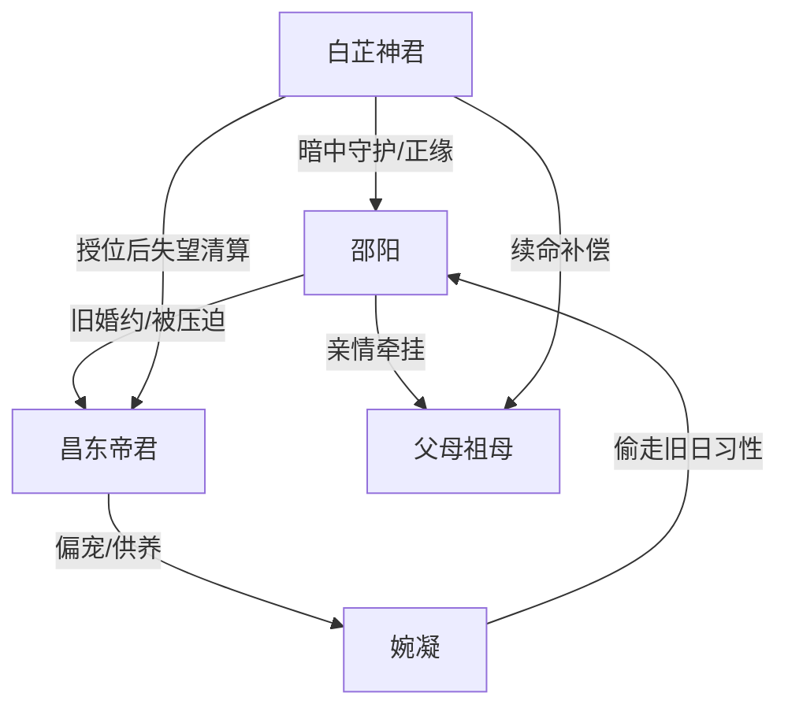

# 角色标签图谱

## 角色清单

### 邵阳 — 清醒受虐后退场大女主

- 叙事功能: 情绪承压核心、退婚反击者、最终被补偿对象
- 核心标签: 隐忍千年、精血成珠、清醒抽身
- 弧光: 为婚约耗尽心血 → 认清背叛 → 退婚另嫁 → 被真正珍视
- 台词风格: 前期哑忍质问，后期冷静拒绝
- 关键行为: 说珍珠少一颗试探昌东；拒绝交珠；摘下玉佩；嫁给白芷
- 读者情绪关系: 心疼、代入、期待她被补偿

### 昌东帝君 — 双标伪君子旧爱

- 叙事功能: 主要压迫者、情绪债制造机、悔恨反衬
- 核心标签: 伪温和、规矩压人、认知迟钝
- 弧光: 高位掌控 → 双标暴露 → 真相打脸 → 留任受罚
- 台词风格: 温和训诫、道德绑架、后期失控求复合
- 关键行为: 偷毁珍珠；供养婉凝；用雷威胁邵阳；隐瞒白芷真相
- 读者情绪关系: 厌恶、愤怒、等他崩塌

### 婉凝 — 绿茶噬心狐情敌

- 叙事功能: 第三者、真相反转载体、昌东认知崩塌触发器
- 核心标签: 装弱、夺爱、偷影子
- 弧光: 被宠小狐 → 得意竞争者 → 魔界噬心狐现形
- 台词风格: 娇弱哭诉、暗中挑衅、得意炫耀
- 关键行为: 自毁金丹嫁祸；索要珍珠；挑拨昌东杀邵阳
- 读者情绪关系: 恨、恶心、期待扒皮

### 白芷神君 — 隐忍守护型正缘

- 叙事功能: 更高权威救场、真相揭露者、甜宠补偿者
- 核心标签: 清冷神君、暗恋千年、强势护妻
- 弧光: 被误以为仙陨 → 归来撑腰 → 揭露真相 → 成为夫君
- 台词风格: 冷静威压与温柔直给并存
- 关键行为: 镇压忘川；暗中补金珠；年年提亲；救邵阳并续祖母命
- 读者情绪关系: 爽、安心、甜

### 邵阳父母与祖母 — 亲情锚点

- 叙事功能: 证明邵阳仍有人爱；制造婚期紧迫感
- 核心标签: 心疼女儿、等待婚事、寿命倒计时
- 弧光: 盼婚 → 失望心疼 → 接受另嫁 → 获得续命补偿
- 台词风格: 朴素关切
- 关键行为: 劝放弃；拿出庚帖；支持另嫁
- 读者情绪关系: 心疼、希望她回到真正爱她的人身边

## 关系网络

## 角色功能对照表（供改编参考）

| 原角色 | 极致标签 | 叙事功能 | 读者情绪功能 | 改编时必须保留的 |
|--------|---------|---------|-------------|---------------|
| 邵阳 | 清醒受虐女主 | 承压与退场 | 心疼、代入、爽 | 千年消耗物、退婚动作、拒绝旧爱 |
| 昌东 | 双标伪君子 | 制造压迫 | 恨、等报应 | “规矩”双标、偷取成果、后悔无用 |
| 婉凝 | 绿茶噬心狐 | 情敌与反转载体 | 恶心、期待扒皮 | 装弱夺爱、夺取女主成果、真实身份 |
| 白芷 | 隐忍守护正缘 | 救场补偿 | 安心、甜 | 更高权威、暗中守护、炽热告白 |
| 家人 | 亲情锚点 | 紧迫与补偿 | 心疼 | 祖母寿命倒计时、父母支持 |
