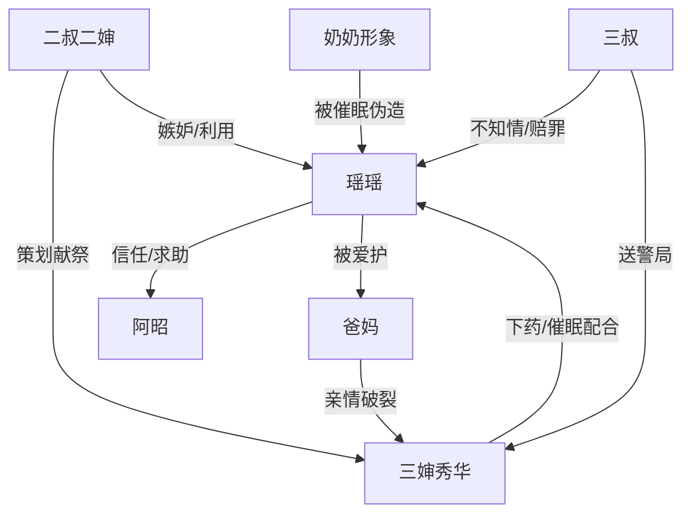

# 角色标签图谱

## 角色清单

### 瑶瑶 — 被献祭的清醒高考生
- 叙事功能: 第一视角受害者、谜题追查者、最终清算触发者。
- 核心标签: 高压考生、重生者、逻辑自救。
- 弧光: 被 0 分命运碾压 → 怀疑托梦 → 用常识破局 → 重新掌控高考。
- 台词风格: 急促追问，后期冷静质问。
- 关键行为: 熬夜躲梦、找阿昭验卷、公开真题、医院检查、逼问三婶。
- 读者情绪关系: 心疼、代入、期待她翻案。

### 阿昭 — 清醒推理型闺蜜
- 叙事功能: 侦探助手，提供“0 分不可能”和“省三诊旧卷”两个关键破局点。
- 核心标签: 可信闺蜜、逻辑锚点、情绪支撑。
- 弧光: 不信重生 → 被旧卷证据说服 → 立刻站队保护女主。
- 台词风格: 口语化、直接、带轻松感。
- 关键行为: 批改模拟卷、指出 0 分常识漏洞、认出省三诊卷、通知爸妈。
- 读者情绪关系: 安全感、爽感、友谊补偿。

### 三婶秀华 — 伪善背刺亲戚
- 叙事功能: 近身施害者，亲情信任的污染源。
- 核心标签: 慈眉善目、欠债自私、伪善求饶。
- 弧光: 好婶婶面具 → 倒打一耙 → 腿软求饶 → 供出献祭真相。
- 台词风格: 先关心式推脱，后哭求式自保。
- 关键行为: 调包心理咨询师、长期投喂安神茶和致幻药、配合催眠、欺骗查卷。
- 读者情绪关系: 恨、恶心、期待报应。

### 爸妈 — 被连带伤害的家庭后盾
- 叙事功能: 情绪债承载者，证明女主不是孤立无援。
- 核心标签: 爱女、善良、被亲情伤害。
- 弧光: 不知情安慰 → 震惊真相 → 坚定送警局 → 送女儿高考。
- 台词风格: 家常、疼惜，清算时激烈。
- 关键行为: 配合医院检查、逼问三婶、决定报警。
- 读者情绪关系: 心疼与补偿。

### 二叔二婶 — 幕后恶意源
- 叙事功能: 真正动机来源，把家庭嫉妒推到邪术献祭。
- 核心标签: 白眼狼、嫉妒、迷信恶毒。
- 弧光: 记忆中看笑话 → 被供出 → 被传唤。
- 台词风格: 正文直接出场少，以他人供述呈现恶。
- 关键行为: 找大师、威胁三婶、策划献祭。
- 读者情绪关系: 恨点终点。

### 三叔 — 无辜亲族与道德补偿
- 叙事功能: 区分“恶人”和“亲族整体”，防止故事滑向无差别仇亲。
- 核心标签: 愧疚、正直、护亲但不包庇。
- 弧光: 不知情 → 暴怒羞愧 → 送妻入警局 → 考场送别。
- 台词风格: 哭诉、赔罪、决断。
- 关键行为: 带三婶赔罪，主动交赔偿，送警局。
- 读者情绪关系: 释放、残余温情。

### 奶奶 — 被利用的亲情符号
- 叙事功能: 伪玄学载体，前期误导源，后期成为被恶人亵渎的亲情记忆。
- 核心标签: 托梦假象、最深信任、被利用。
- 弧光: 疑似害人者 → 被证伪 → 被恶人利用。
- 台词风格: 梦中强迫与威胁由催眠制造。
- 关键行为: 作为催眠幻象反复出现。
- 读者情绪关系: 从恐惧转为替她愤怒。

## 关系网络

## 角色功能对照表（供改编参考）

| 原角色 | 极致标签 | 叙事功能 | 读者情绪功能 | 改编时必须保留的 |
|--------|---------|---------|-------------|---------------|
| 瑶瑶 | 被献祭的清醒高考生 | 受害者兼追查者 | 心疼、代入、爽 | 她必须靠逻辑和求助破局 |
| 阿昭 | 清醒推理闺蜜 | 关键证据识别者 | 安全感 | 至少两次关键提示 |
| 三婶 | 伪善亲戚 | 近身施害者 | 恨、恶心 | 前期温情伪装和后期自保求饶 |
| 爸妈 | 家庭后盾 | 情绪债承载者 | 补偿 | 真心爱女且被亲族伤害 |
| 二叔二婶 | 幕后恶源 | 动机源 | 终极恨点 | 嫉妒/利益驱动不可弱化 |
| 三叔 | 无辜亲族 | 道德分层 | 释然 | 不包庇，主动清算 |
