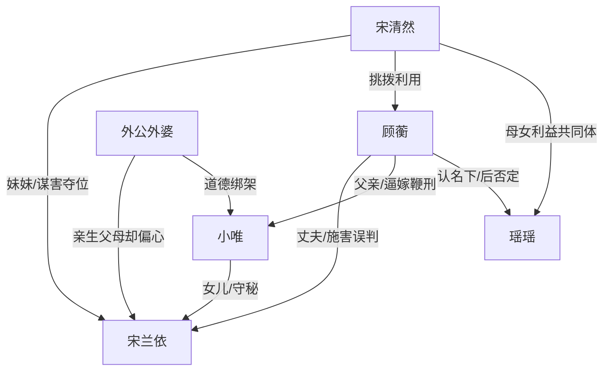

# 角色标签图谱

## 角色清单

### 小唯 — 受难守秘女儿 / 童年幸存者
- 叙事功能: 第一人称受害视角，承担读者心疼和最终补偿。
- 核心标签: 七岁、守秘五年、替嫁牺牲。
- 弧光: 被迫守住母亲死亡秘密 → 被鞭打替嫁死亡 → 穿越重逢母亲并放下。
- 台词风格: 少说、直问、伦理命中。
- 关键行为: 撕结婚证、藏遗物、立灵位、替母守秘、选择成为新宿主。
- 读者情绪关系: 极度心疼，期待她被救赎和补偿。

### 宋兰依 / 妈妈 — 被逼死的真千金母亲 / 另世强者
- 叙事功能: 情绪债源头和最终补偿来源。
- 核心标签: 真千金、系统宿主、温柔母亲。
- 弧光: 被顾家和宋清然逼至任务失败 → 死前保护女儿 → 在本世界重建人生并接回女儿。
- 台词风格: 前世隐忍简短，现世温柔稳定。
- 关键行为: 喝下打胎药、临终要求守秘、攒积分接走小唯。
- 读者情绪关系: 心疼、敬重、替她不值。

### 顾蘅 / 爸爸 — 偏执误判渣爹 / 迟到悔恨者
- 叙事功能: 最大施害者之一，也是悔恨反噬的主要承载体。
- 核心标签: 偏袒、傲慢、悔疯。
- 弧光: 偏信宋清然 → 逼女儿替嫁并鞭打 → 女儿死亡后发现真相 → 崩溃跪灵。
- 台词风格: 命令式、审判式，后期重复道歉。
- 关键行为: 砸婚纱照、迎宋清然、停水电、过继小唯、下令五十鞭。
- 读者情绪关系: 前期恨，后期看他悔恨偿债。

### 宋清然 — 白莲假千金小姨 / 蓄意谋害者
- 叙事功能: 连续挑拨器，推动父亲每次作恶。
- 核心标签: 假千金、白莲、毒妇。
- 弧光: 装弱夺爱 → 害死兰依 → 推小唯替嫁 → 罪证暴露被清算。
- 台词风格: 柔弱、委屈、以退为进。
- 关键行为: 割腕威胁、关监控、指使灌药、平安符撒谎、发现灵位反咬。
- 读者情绪关系: 强恨点，期待法律和家族共同清算。

### 瑶瑶 — 冒名姐姐 / 小白莲继承者
- 叙事功能: 替嫁冲突的直接受益人，映衬小唯被牺牲。
- 核心标签: 外来女儿、表演懂事、被保护者。
- 弧光: 被认进顾家 → 由小唯替嫁 → 身份被顾蘅否定。
- 台词风格: 童声牺牲式表演。
- 关键行为: 戴头纱跪下主动“请嫁”，逼出父亲惩罚小唯。
- 读者情绪关系: 厌恶与警惕。

### 外公外婆 — 失格亲生父母 / 迟来悔恨者
- 叙事功能: 扩大家庭伦理压迫面，证明兰依被全族抛弃。
- 核心标签: 偏心、规训、迟悔。
- 弧光: 偏宠宋清然 → 打骂小唯 → 真相后跪地崩溃。
- 台词风格: 长辈审判式、道德绑架。
- 关键行为: 逼兰依给冒牌货下跪、认同替嫁、掌掴小唯、审判宋清然。
- 读者情绪关系: 前期恨，后期悔恨偿债但不可完全洗白。

## 关系网络

## 角色功能对照表（供改编参考）

| 原角色 | 极致标签 | 叙事功能 | 读者情绪功能 | 改编时必须保留的 |
|--------|---------|---------|-------------|---------------|
| 小唯 | 受难守秘女儿 | 受害视角与补偿对象 | 心疼、盼救 | 年幼、守秘、被替嫁/牺牲 |
| 宋兰依 | 被逼死母亲 | 情绪债源头 | 心疼、敬重 | 被亲人背叛、临终保护女儿 |
| 顾蘅 | 偏执渣爹 | 施害与悔恨载体 | 恨、看报应 | 亲手造成女儿死亡 |
| 宋清然 | 白莲毒妇 | 连续挑拨反派 | 恨、盼清算 | 主动谋害证据链 |
| 瑶瑶 | 冒名受益者 | 替嫁动因 | 厌恶 | 以“懂事”衬托小唯被牺牲 |
| 外公外婆 | 失格长辈 | 家族压迫 | 憋屈、看迟悔 | 亲生却偏假千金 |
