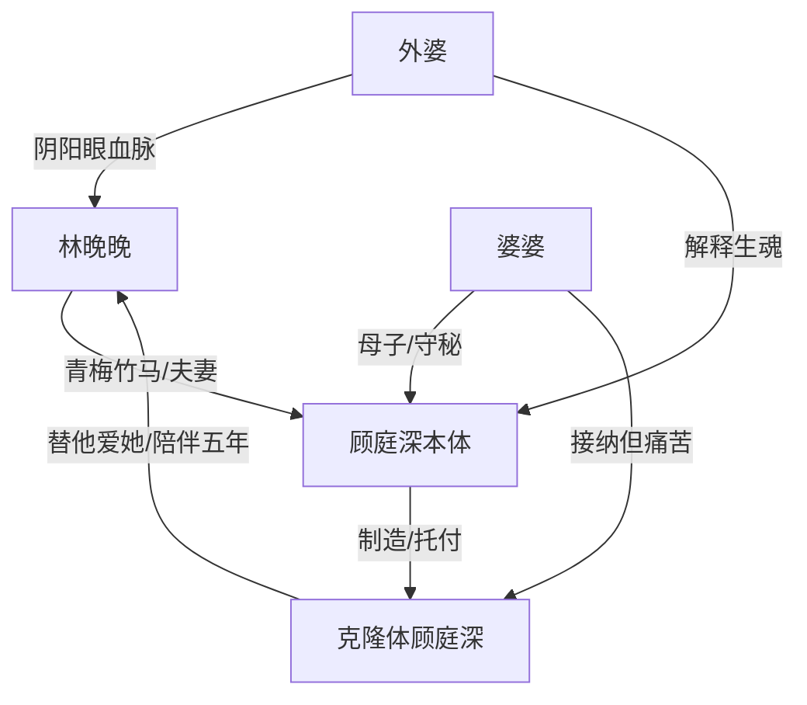

# 角色标签图谱

## 角色清单

### 林晚晚 — 阴阳眼妻子 / 被爱隐瞒者
- 叙事功能: 视角承载者，通过试探带读者进入身份谜团。
- 核心标签: 敏感、执着、被保护也被欺骗
- 弧光: 恐惧怀疑 → 追查真相 → 承受丧失 → 暂时接纳不确定
- 台词风格: 追问式、克制式，关键处短句
- 关键行为: 用私密记忆试探“顾庭深”；马尔代夫连夜返程；墓园与克隆体对话
- 读者情绪关系: 心疼、代入、替她纠结

### 顾庭深（本体） — 献祭型深情丈夫
- 叙事功能: 缺席的情感核心，所有悬念最终指向他的爱与欺骗。
- 核心标签: 病弱天才、深情、隐瞒者
- 弧光: 童年病弱封闭 → 被女主拯救 → 自私结婚 → 制造替身 → 死亡退场
- 台词风格: 信件中坦白、低姿态、反复道歉
- 关键行为: 隐瞒病情；制造克隆体；留下遗书
- 读者情绪关系: 心疼与责备并存

### 克隆体顾庭深 — 爱的替身 / 伦理灰区
- 叙事功能: 悬疑表层对象和结尾伦理难题。
- 核心标签: 无破绽、温柔、替代者
- 弧光: 疑似伪装者 → 被验证为“另一个他” → 承担照顾使命 → 等待女主定义
- 台词风格: 温柔、克制、小心翼翼
- 关键行为: 陪伴女主五年；支走女主；交出遗书；墓园告白
- 读者情绪关系: 从怀疑到怜惜，再到复杂接受

### 婆婆 — 知情母亲 / 痛苦见证人
- 叙事功能: 真相解释者和亲情债承载者。
- 核心标签: 愧疚、失子、守秘
- 弧光: 隐瞒真相 → 病房崩溃 → 向女主道歉
- 台词风格: 哽咽叙述、母亲式自责
- 关键行为: 病房哭喊；讲述顾庭深病史和克隆计划
- 读者情绪关系: 心疼、理解、压抑

### 外婆 — 灵异规则解释者
- 叙事功能: 解释“生魂”规则，给开篇鬼魂现象闭环。
- 核心标签: 通灵、清醒、宿命感
- 弧光: 短暂登场完成世界观闭合
- 台词风格: 平静、带人生判断
- 关键行为: 解释生魂；提出“人生不是拼长度，是拼密度”
- 读者情绪关系: 释然、余味

## 关系网络

## 角色功能对照表（供改编参考）

| 原角色 | 极致标签 | 叙事功能 | 读者情绪功能 | 改编时必须保留的 |
|--------|---------|---------|-------------|---------------|
| 林晚晚 | 阴阳眼妻子 | 试探者/承受者 | 代入、心疼 | 她必须主动试探，不能被动等解释 |
| 顾庭深本体 | 献祭型丈夫 | 真相核心 | 心疼、责备、泪点 | 隐瞒源于爱但造成伤害 |
| 克隆体 | 爱的替身 | 悬疑对象/伦理难题 | 怀疑转复杂 | 无破绽、真爱、非反派 |
| 婆婆 | 失子母亲 | 真相讲述 | 加重悲剧 | 母亲视角必须让死亡更痛 |
| 外婆 | 灵异解释者 | 规则闭环 | 释然 | 生魂/执念规则必须解释开篇异象 |
