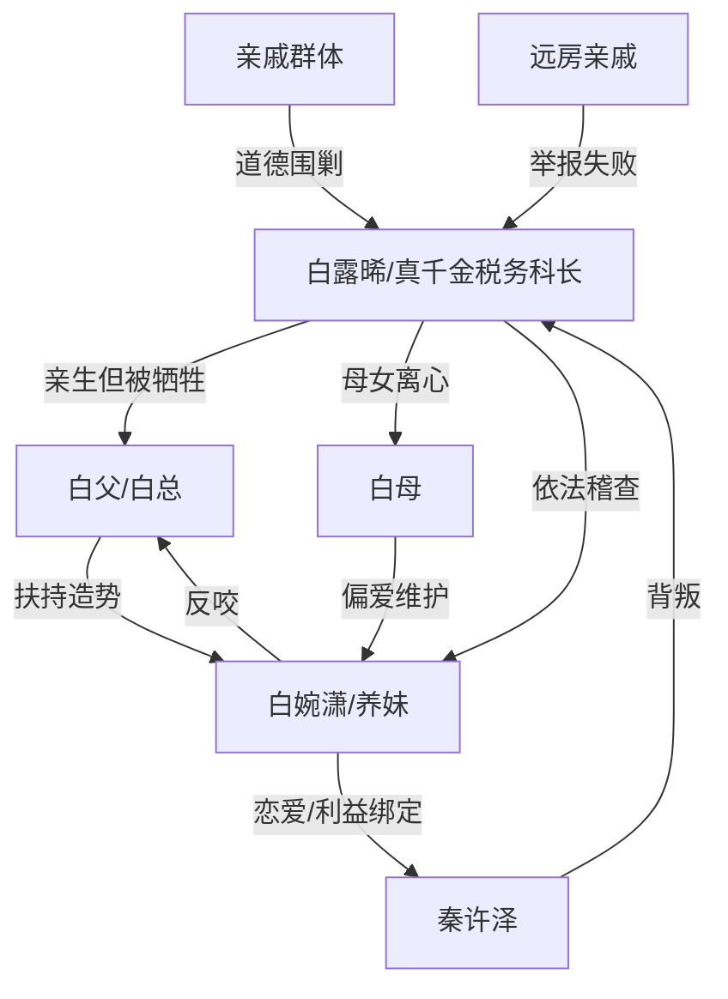

# 角色标签图谱

## 角色清单

### 白露晞 — 清醒执法型真千金

- 叙事功能: 第一人称主角，承受家庭与爱情双重背叛，并以合法职业权力完成清算。
- 核心标签: 清醒、克制、留痕意识强
- 弧光: 渴望父母认可 → 认清自己是真外人 → 依法反杀 → 尽责但不原谅
- 台词风格: 短句质问，冷静反讽，关键处引用对方原话
- 关键行为: 启动税务稽查，亮证带走白婉潇，保留录音录像自证清白
- 读者情绪关系: 心疼、代入、爽

### 白父/白总 — 功利偏心型父权反派

- 叙事功能: 核心压迫源，把“避嫌”和“知恩图报”包装成道德叙事，实际服务个人升迁。
- 核心标签: 双标、算计、爱面子
- 弧光: 掌控家庭规则 → 被规则回旋 → 被养女反咬撤职 → 迟来认错
- 台词风格: 命令式、道德绑架、脸面优先
- 关键行为: 增加 700 分门槛卡亲女儿，取消养妹门槛，向女主求情
- 读者情绪关系: 恨、厌恶、后段产生有限复杂感

### 白母 — 迟钝和稀泥型母亲

- 叙事功能: 家庭压迫的帮腔者，负责“懂事”“一家人”话术。
- 核心标签: 软弱、偏心、迟醒
- 弧光: 拉偏架 → 逼女儿回家 → 看见真相后补偿 → 小心翼翼
- 台词风格: 劝和、哄骗、道德化
- 关键行为: 让女主别闹、带女主回家、后段补生日
- 读者情绪关系: 怨、失望、轻微心酸

### 白婉潇 — 白莲攀附型养妹

- 叙事功能: 表层竞争者和导火索，吸走父母资源并用柔弱姿态占据道德高地。
- 核心标签: 白莲、攀附、反咬
- 弧光: 被宠上位 → 偷税漏税被查 → 求救无效 → 反咬白父
- 台词风格: 委屈、退让式进攻、喊救命
- 关键行为: 庆功宴装懂事，挽住秦许泽，偷税漏税，审讯室反咬
- 读者情绪关系: 恨、想看打脸

### 秦许泽 — 功利攀高枝前男友

- 叙事功能: 爱情线背叛者，证明女主失去的不只是工作，还有被父亲间接摧毁的未来。
- 核心标签: 精致利己、阶级焦虑、迟来后悔
- 弧光: 出轨攀附 → 轻视女主身份 → 发现真相 → 辞职道歉
- 台词风格: 自我合理化，后段忏悔
- 关键行为: 靠白婉潇关系进公司，求女主放过养妹，后段求复合
- 读者情绪关系: 恨、鄙夷、结尾少量惋惜

### 亲戚群体 — 舆论审判合唱团

- 叙事功能: 放大家庭伦理压力，逼女主下跪，后被真相反噬。
- 核心标签: 站队强者、道德绑架、势利
- 弧光: 围剿女主 → 被女主反问噎住 → 远亲举报反证女主清白
- 台词风格: “父爱无声”“你不懂事”式套话
- 关键行为: 逼跪、替白父洗白、举报女主
- 读者情绪关系: 厌烦、打脸爽

## 关系网络

## 角色功能对照表（供改编参考）

| 原角色 | 极致标签 | 叙事功能 | 读者情绪功能 | 改编时必须保留的 |
|--------|---------|---------|-------------|---------------|
| 白露晞 | 清醒执法型真千金 | 主角/反杀执行者 | 心疼与爽 | 合法职业身份、留痕、拒绝和解 |
| 白父 | 功利父权反派 | 核心规则制定者 | 恨与反噬爽 | “规则压女儿，特权给外人”的双标 |
| 白母 | 和稀泥母亲 | 家庭压力放大器 | 怨与酸涩 | 后段迟醒但补偿无效 |
| 白婉潇 | 白莲养妹 | 资源掠夺者 | 打脸期待 | 装退让、偷拿资源、最终反咬 |
| 秦许泽 | 攀附前男友 | 爱情债制造者 | 鄙夷与拒绝爽 | 出轨理由必须和阶级利益绑定 |
| 亲戚群体 | 道德审判团 | 舆论压力 | 群体打脸爽 | 逼跪/洗白话术与反问破局 |
