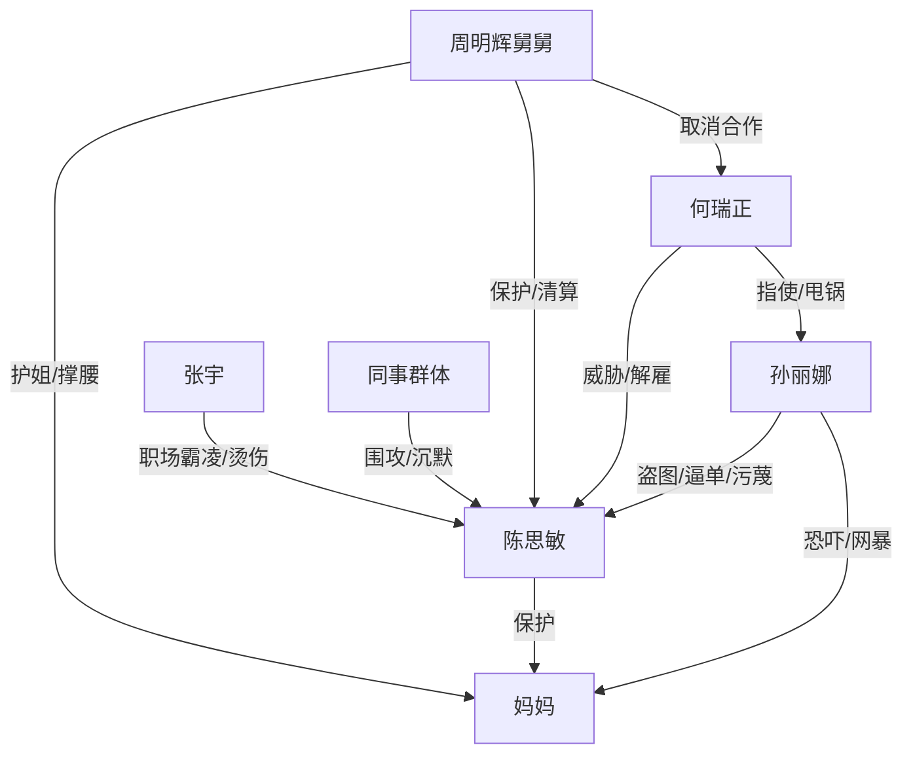

# 角色标签图谱

## 角色清单

### 陈思敏 — 清醒硬刚型女主
- 叙事功能: 第一视角承压者与反击者，负责把所有压迫转化为证据链。
- 核心标签: 护母、清醒、有证据意识
- 弧光: 被迫卷入低价逼单 → 公开拒绝 → 借身份与法律完成清算
- 台词风格: 短句、反问、证据型陈述
- 关键行为: 拒单、发截图、要求调监控、报警、公开证据
- 读者情绪关系: 心疼、代入、爽

### 孙丽娜 — 老油条绿茶型职场反派
- 叙事功能: 施害起点，负责制造低价剥削、道德绑架、网暴敲诈。
- 核心标签: 贪便宜、会甩锅、会装委屈
- 弧光: 盗图邀功 → 逼单霸凌 → 跪地求饶 → 网暴反扑 → 被通报传唤
- 台词风格: 假善良、施舍口吻、受害者叙事
- 关键行为: 盗图发接龙、编造困难家庭、恐吓母亲、发帖污蔑
- 读者情绪关系: 恨、厌恶、期待报应

### 何瑞正 — 和稀泥压榨型领导
- 叙事功能: 把个人矛盾升级为组织压迫，并在身份反转后崩塌。
- 核心标签: 慷他人之慨、威胁饭碗、见风使舵
- 弧光: 维护公司形象 → 威胁女主 → 当众解雇 → 跪地求合作
- 台词风格: 官腔、威胁、巴结
- 关键行为: 要求先做后补差价、威胁饭碗、甩锅孙丽娜、下跪自扇
- 读者情绪关系: 恨、鄙夷、爽点对象

### 周明辉/舅舅 — 护姐降维支援者
- 叙事功能: 付费节点的身份爆点与制度资源提供者。
- 核心标签: 护姐、强势、讲规则
- 弧光: 客户旁观 → 身份揭露 → 取消合作 → 证照反杀
- 台词风格: 冷硬、短句、有压迫感
- 关键行为: 质问“送我姐去坐牢”、取消合作、拿出证照、推动法律清算
- 读者情绪关系: 安全感、爽、期待

### 妈妈 — 劳动尊严核心
- 叙事功能: 情绪债核心承载者，代表被低价羞辱的亲情与手作价值。
- 核心标签: 热爱手作、心软、被保护者
- 弧光: 开心做粽子 → 被恐吓哭泣 → 被网暴退单 → 订单暴增并自主定价
- 台词风格: 朴素、生活化
- 关键行为: 做粽子、被恐吓后想妥协、结尾 3 元庆祝
- 读者情绪关系: 心疼、保护欲、温暖

### 张宇 — 跟风霸凌型小反派
- 叙事功能: 职场霸凌具体执行者，让群体恶意落到身体伤害。
- 核心标签: 爱甩锅、嘴欠、欺软怕硬
- 弧光: 污蔑女主拖累加班 → 烫伤女主 → 身份反转后磕头
- 台词风格: 大声嚷嚷、挑衅
- 关键行为: 造谣加班、撞翻开水、下跪求饶
- 读者情绪关系: 厌恶、期待打脸

## 关系网络

## 角色功能对照表（供改编参考）

| 原角色 | 极致标签 | 叙事功能 | 读者情绪功能 | 改编时必须保留的 |
|--------|---------|---------|-------------|---------------|
| 陈思敏 | 清醒硬刚型女主 | 证据反击者 | 代入与爽 | 不求饶、不圣母、用证据说话 |
| 孙丽娜 | 绿茶老油条 | 主施害者 | 恨点 | 先装好人，后暴露贪婪 |
| 何瑞正 | 压榨领导 | 组织压迫 | 权力反噬爽点 | 威胁饭碗、身份反转后跪求 |
| 周明辉 | 护姐大佬 | 身份爆点 | 安全感 | 付费节点一句话翻盘 |
| 妈妈 | 手作劳动者 | 情绪债核心 | 心疼与温暖 | 她的热爱必须被尊重 |
| 张宇 | 跟风霸凌者 | 身体伤害执行 | 小清算爽点 | 必须有具体霸凌行为 |
