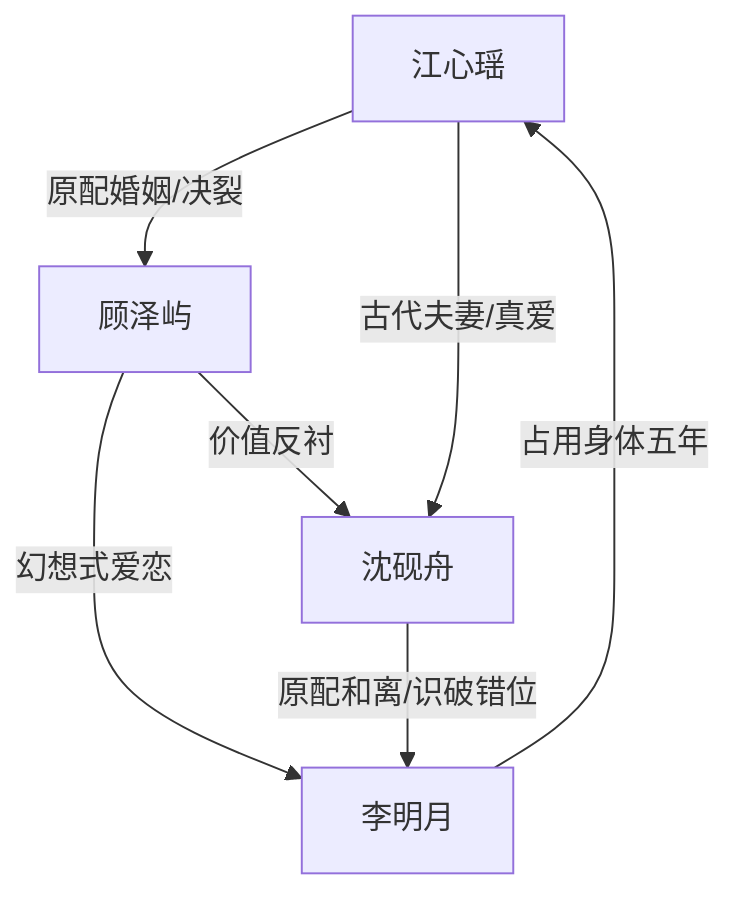

# 角色标签图谱

## 角色清单

### 江心瑶 — 清醒失位原配/反向成全者
- 叙事功能: 第一人称主角，承载被替代的痛与最终选择权
- 核心标签: 清醒、克制、有精神洁癖
- 弧光: 被丈夫失望凝视 → 表面理解 → 主动成全穿越 → 选择真正爱自己的人
- 台词风格: 短句、平静、带终局感
- 关键行为: 不阻止穿越，确认身体互换规则，最终拒绝顾泽屿
- 读者情绪关系: 心疼、代入、爽

### 顾泽屿 — 颜控伪深情渣夫
- 叙事功能: 主压迫者与被反噬对象
- 核心标签: 颜控、自欺、执念
- 弧光: 思念李明月 → 强迫换回 → 嫌弃真李明月 → 后悔失去江心瑶
- 台词风格: 前期深情自辩，后期崩溃嘶吼
- 关键行为: 研究穿越、收集古鼎、送走原配、求换回
- 读者情绪关系: 恨、鄙夷、看他崩溃的爽

### 沈砚舟 — 君子夫君/灵魂识别者
- 叙事功能: 顾泽屿的价值对照组，女主终局补偿
- 核心标签: 克己、深情、尊重
- 弧光: 识破女主非原身 → 仍护她爱她 → 战乱中送她回现代 → 重逢后册封皇后
- 台词风格: 温柔、克制、古意
- 关键行为: 新婚不冒犯、挡箭、用命护送女主、重逢拥抱
- 读者情绪关系: 安全感、补偿、理想爱人投射

### 李明月 — 错位郡主/被皮囊剥夺者
- 叙事功能: 情感错位的核心载体，后半揭露顾泽屿伪爱
- 核心标签: 单纯、依赖、真身反差
- 弧光: 被顾泽屿幻想美化 → 真身现世 → 遭嫌弃 → 清醒离开
- 台词风格: 娇憨、委屈、后期清醒
- 关键行为: 以真身穿越现代，证明顾泽屿只爱江心瑶的脸
- 读者情绪关系: 前期隐性情敌，后期也让人心疼

## 关系网络

## 角色功能对照表（供改编参考）

| 原角色 | 极致标签 | 叙事功能 | 读者情绪功能 | 改编时必须保留的 |
|--------|---------|---------|-------------|---------------|
| 江心瑶 | 清醒失位原配 | 主角/反杀执行者 | 心疼到爽 | 克制、成全式反杀、最终不回头 |
| 顾泽屿 | 颜控伪深情渣夫 | 压迫与崩塌对象 | 恨与爽 | 自称爱灵魂，实际爱皮囊 |
| 沈砚舟 | 君子灵魂爱人 | 补偿与对照 | 安全感 | 先识别灵魂再爱，尊重边界 |
| 李明月 | 错位真身郡主 | 反转载体 | 讽刺与二次心疼 | 真身揭露必须击碎顾泽屿幻想 |
