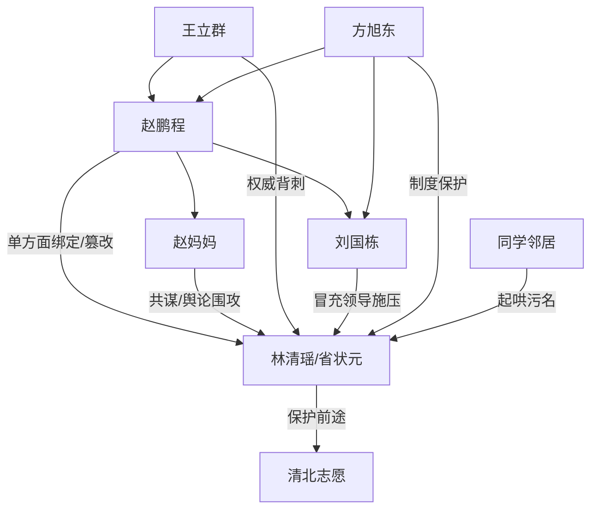

# 角色标签图谱

## 角色清单

### 林清瑶 — 清醒状元大女主
- 叙事功能: 被压迫者、反击执行者、公义落点。
- 核心标签: 高考状元、清醒、急中生智。
- 弧光: 被造谣围困 → 多次求助取证 → 最后一分钟保住清北 → 完成清算。
- 台词风格: 短句澄清、直接质问、关键时刻冷静设局。
- 关键行为: 打电话给教育局、识破假工牌、用监控逼退、定位手机、骗回手机改志愿。
- 读者情绪关系: 心疼、代入、期待她反杀。

### 赵鹏程 — 普信偏执男反派
- 叙事功能: 核心施害者，制造恋爱绑定和志愿篡改。
- 核心标签: 普信、偏执、违法操控。
- 弧光: 单方面官宣 → 当众造谣 → 偷手机改志愿 → 连大专都读不成。
- 台词风格: 自我感动、道德绑架、威胁式亲密。
- 关键行为: 发朋友圈官宣、抢手机、展示 AI 假证、偷手机篡改志愿、最后摔手机。
- 读者情绪关系: 恨、厌恶、等待报应。

### 赵妈妈 — 婚恋脑共犯母亲
- 叙事功能: 家庭压迫升级器，把个人骚扰扩成家族围猎。
- 核心标签: 控制欲、泼妇式碰瓷、儿子至上。
- 弧光: 彩礼叙事绑架 → 小区发传单 → 偷改志愿共谋 → 被抓。
- 台词风格: 高高在上、撒泼、伪善。
- 关键行为: 发传单造谣、假摔碰瓷、藏手机、庆祝篡改成功。
- 读者情绪关系: 恨、恶心、期待法律惩罚。

### 王立群 — 失职班主任
- 叙事功能: 权威背刺，让谣言从学生纠纷升级为“品德审判”。
- 核心标签: 爹味、失职、助纣为虐。
- 弧光: 替赵鹏程背书 → 阻止女主报警 → 被网络追责解雇。
- 台词风格: 伪教育口吻、婚恋规训。
- 关键行为: 证明“赵鹏程对她好”、按住女主报警的手、帮假领导站台。
- 读者情绪关系: 恨、对权威失职的愤怒。

### 刘国栋 — 假权威小丑
- 叙事功能: 假公权力压迫载体，付费节点反转对象。
- 核心标签: 冒充领导、狐假虎威、怯懦。
- 弧光: 教育局领导姿态登场 → 被叫“刘师傅” → 跪地求饶。
- 台词风格: 装腔作势，暴露后结巴求饶。
- 关键行为: 穿制服戴工牌、替外甥做主、冒充公职人员。
- 读者情绪关系: 先恐惧后痛快。

### 方旭东 — 真权威救援者
- 叙事功能: 制度正义的代表，推动 M1 清算。
- 核心标签: 严肃、公正、教育保护者。
- 弧光: 到场调查 → 揭穿刘国栋 → 记录在案 → 金句回旋。
- 台词风格: 简短、严正、制度化。
- 关键行为: 识破刘国栋、上报处分、支持女主报警取证。
- 读者情绪关系: 安心、爽、信任。

### 围观同学/邻居 — 舆论帮凶群像
- 叙事功能: 放大压迫，制造“所有人都不信我”的窒息感。
- 核心标签: 起哄、偏听偏信、道德绑架。
- 弧光: 帮腔污名 → 群聊刷屏 → 被截图曝光后付出代价。
- 台词风格: 短促八卦、幸灾乐祸。
- 关键行为: 传播谣言、劝女主从了他、刷“新婚快乐”。
- 读者情绪关系: 憋屈、愤怒、希望他们被清算。

## 关系网络

## 角色功能对照表（供改编参考）

| 原角色 | 极致标签 | 叙事功能 | 读者情绪功能 | 改编时必须保留的 |
|--------|---------|---------|-------------|---------------|
| 林清瑶 | 清醒状元大女主 | 受害与反击中心 | 心疼、代入、爽 | 高价值前途被剥夺，关键时刻能智斗 |
| 赵鹏程 | 普信偏执男 | 核心压迫者 | 恨、恶心 | 单方面关系绑定+篡改选择 |
| 赵妈妈 | 婚恋脑共犯 | 家庭升级 | 恨、焦虑 | 家族合谋与碰瓷舆论 |
| 王立群 | 失职权威 | 谣言背书 | 憋屈 | 老师/上级背刺 |
| 刘国栋 | 假公权力 | 假权威反转 | 先压迫后痛快 | 冒充身份必须被真权威揭穿 |
| 方旭东 | 真制度保护者 | 公义落点 | 安心、补偿 | 权威金句与记录在案 |
| 同学邻居 | 舆论帮凶 | 群体围猎 | 窒息、恨 | 刷屏/围观/二次传播 |
