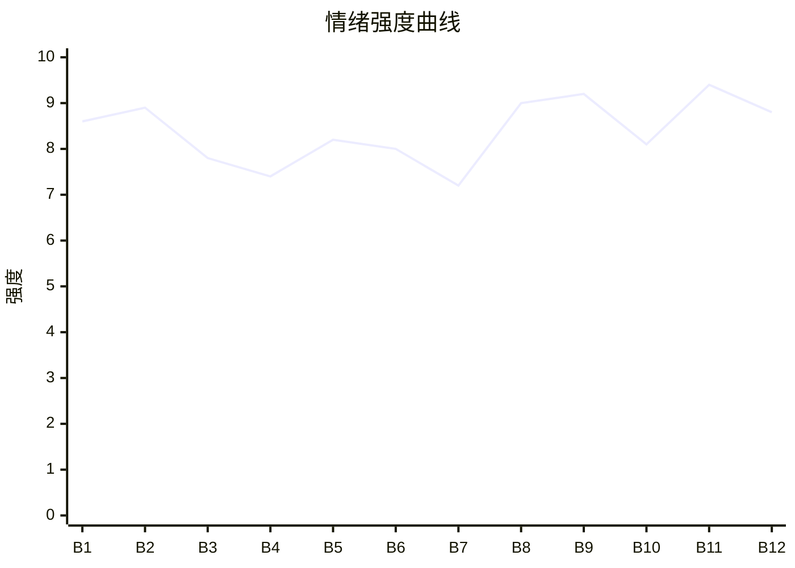

# Beat Sheet 节拍器

## 全文概况

- 总字数: 约 22500 字
- 节拍数: 12 幕
- 核心母题（Logline）: 穿越成窝囊上门女婿的商界大佬，为了保护被压抑的儿子，面对总裁妻家族的羞辱和商业围剿，逐步亮出遗产、产业链和父亲姿态，最终重建尊严与家庭。
- 情绪模式: 极致憋屈 → 带娃出走 → 隐藏财富觉醒 → 连环打脸 → 妻子回暖 → 家庭复位

## 节拍详表

### Beat 1: 十块钱皮肤引爆父权觉醒 [开篇-第1章]
- **字数**: 约 2400 字（占比 10.7%）
- **核心事件**: 儿子因十块钱游戏皮肤被沈若棠训哭，苏铮穿越后硬气给卡，父子被赶出家门。
- **情绪标签**: 憋屈、护崽、突变
- **情绪强度**: 8.6/10
- **情绪方向**: ⚡突变
- **冲突类型**: 大转折
- **悬念钩子**: 父子被踹出豪宅后要如何活下去？
- **叙事速度**: 快
- **对话占比**: 42%
- **reversal_mechanism**: [M2, M7]
- **hook_strength**: 8.3/10
- **关键句**: "男人得硬气！"
- **原文摘录**: 儿子想充十块钱游戏皮肤，被总裁老婆沈若棠骂哭了。我刚穿过来，就碰上这窝囊事？掏出副卡塞给儿子："拿着，想充多少充多少！"下一秒，行李箱从二楼飞下来。我跟儿子，一起被踹出了家门。沈若棠说："既然觉得我管得多，那你带着儿子出去过你的硬气日子。"

### Beat 2: 长椅上查出三百八十七亿 [第2章]
- **字数**: 约 2600 字（占比 11.6%）
- **核心事件**: 苏铮带儿子离开，在路边查到爷爷留下的巨额账户，第一次兑现“好日子”。
- **情绪标签**: 触底、惊喜、补偿
- **情绪强度**: 8.9/10
- **情绪方向**: ↑上升
- **冲突类型**: 大转折
- **悬念钩子**: 这笔遗产背后还有多少资源？
- **叙事速度**: 快
- **对话占比**: 36%
- **reversal_mechanism**: [M2, M7]
- **hook_strength**: null
- **关键句**: "余额显示：￥38,700,000,000。"
- **原文摘录**: 三年前，原主的爷爷苏老爷子去世前，给他留了一封信和一个银行账户。信里只有一句话："铮儿，什么时候你站直了腰杆做人，这笔钱就是你的。"页面加载了两秒。余额显示：￥38,700,000,000。三百八十七亿。我盯着屏幕上那串数字，眨了眨眼。

### Beat 3: 拒绝丈母娘下跪命令，住进总统套房 [第2章后半]
- **字数**: 约 1900 字（占比 8.4%）
- **核心事件**: 丈母娘命令苏铮回去道歉，苏铮拒绝，并带儿子吃日料、住总统套房。
- **情绪标签**: 爽、温暖、反叛
- **情绪强度**: 7.8/10
- **情绪方向**: ↑上升
- **冲突类型**: 微冲突
- **悬念钩子**: 沈家下一步会怎样反扑？
- **叙事速度**: 中
- **对话占比**: 45%
- **reversal_mechanism**: [M3]
- **hook_strength**: null
- **关键句**: "以后没人能对你吼了。"
- **原文摘录**: 王丽华在电话里吼："你现在立刻给我滚回去，跪在若棠面前道歉！"我说："不回去。还有，以后别用这种语气跟我说话。"苏念小声问："爸爸，外婆生气了。"我揉了揉他的头发："没事。以后没人能对你吼了。"

### Beat 4: 翡翠湾新家落地，沈家威胁升级 [第3章]
- **字数**: 约 1900 字（占比 8.4%）
- **核心事件**: 周叔帮苏铮买下翡翠湾学区房，沈浩然用孩子上学威胁，苏铮正面回怼。
- **情绪标签**: 安定、威胁、硬气
- **情绪强度**: 7.4/10
- **情绪方向**: ↑上升
- **冲突类型**: 微冲突
- **悬念钩子**: 沈浩然会如何报复？
- **叙事速度**: 中
- **对话占比**: 38%
- **reversal_mechanism**: [M2, M3]
- **hook_strength**: null
- **关键句**: "这是咱们的家，你说了算。"
- **原文摘录**: 翡翠湾小区，一百四十平，精装修，对口实验小学。苏念选了有飘窗的小房间："我可以在墙上贴贴纸吗？"我说："随便贴。""真的？妈妈以前不让。""这是咱们的家，你说了算。"

### Beat 5: 同学聚会房产证打脸 [第4章]
- **字数**: 约 2400 字（占比 10.7%）
- **核心事件**: 沈浩然在同学聚会嘲讽苏铮穷，苏铮亮出翡翠湾房产证。
- **情绪标签**: 羞辱、打脸、暗战
- **情绪强度**: 8.2/10
- **情绪方向**: ↑上升
- **冲突类型**: 大转折
- **悬念钩子**: 沈浩然开始查资产，下一轮冲突升级。
- **叙事速度**: 快
- **对话占比**: 48%
- **reversal_mechanism**: [M2, M3]
- **hook_strength**: null
- **关键句**: "房产证上，户主一栏写着：苏铮。"
- **原文摘录**: 沈浩然笑："你一个月工资三千块，在这个城市能买个厕所？"我说："翡翠湾，一百四十平。"我打开相册，把房产证照片往桌上一放。房产证上，户主一栏写着：苏铮。包间里安静了三秒。

### Beat 6: 物业、丈母娘、4S 店三连压迫与消费反打 [第5-6章]
- **字数**: 约 3100 字（占比 13.8%）
- **核心事件**: 沈家试图通过物业、幼儿园、丈母娘施压，苏铮稳住儿子生活，并买下卡宴。
- **情绪标签**: 烦躁、轻蔑、痛快
- **情绪强度**: 8.0/10
- **情绪方向**: ↑上升
- **冲突类型**: 微冲突组
- **悬念钩子**: 沈若棠亲眼看到车后，会如何判断苏铮？
- **叙事速度**: 快
- **对话占比**: 40%
- **reversal_mechanism**: [M2, M7]
- **hook_strength**: null
- **关键句**: "你们沈家全部家产加起来，还不够我一个零头。"
- **原文摘录**: 王丽华说："没有沈家，你什么都不是！"我心里平静得像一潭死水。净身出户？我口袋里躺着三百八十七个亿。你们沈家全部家产加起来，还不够我一个零头。后来苏念看中卡宴，我问销售："有现车吗？"她说加价五万。我点头："行。刷卡。"

### Beat 7: 沈若棠首次软化，抚养权与婚姻议题浮出 [第6-7章]
- **字数**: 约 2500 字（占比 11.1%）
- **核心事件**: 沈若棠看到房车后开始怀疑，随后约谈苏铮，露出疲惫与母亲身份。
- **情绪标签**: 警惕、试探、回暖
- **情绪强度**: 7.2/10
- **情绪方向**: →平稳转暖
- **冲突类型**: 微冲突
- **悬念钩子**: 夫妻关系是离婚还是修复？
- **叙事速度**: 中
- **对话占比**: 52%
- **reversal_mechanism**: [M5倾向, M2]
- **hook_strength**: null
- **关键句**: "他需要妈妈。"
- **原文摘录**: 沈若棠说："我想知道你有没有做违法的事。如果有，我现在就去申请念念的独立抚养权。"我说："我没打算让念念离开你。他需要妈妈。"她的肩膀微微松了一下，像是卸掉了一块石头。

### Beat 8: 沈浩然商业项目爆雷 [第7-8章]
- **字数**: 约 2800 字（占比 12.4%）
- **核心事件**: 苏铮截断沈浩然融资渠道，沈浩然用母亲偷来的担保交保证金，项目因规划变更爆雷。
- **情绪标签**: 设局、快意、崩塌
- **情绪强度**: 9.0/10
- **情绪方向**: ⚡突变
- **冲突类型**: 大转折
- **悬念钩子**: 沈浩然会不会来求苏铮？
- **叙事速度**: 快
- **对话占比**: 28%
- **reversal_mechanism**: [M3, M6, M7]
- **hook_strength**: null
- **关键句**: "我没有主动害他。我只是没有救他。"
- **原文摘录**: 新方案里，那块地的用途从"商业用地"变更为"市政绿化用地"。沈浩然花三个亿买的，是一块不能开发的废地。这个消息，我是怎么知道的？因为城南新区那三块地皮里，有一块就是苏老爷子留给我的。商场如战场，信息就是武器。我没有主动害他。我只是没有救他。

### Beat 9: 沈浩然上门借钱，被原话回旋拒绝 [第8章后半]
- **字数**: 约 1500 字（占比 6.7%）
- **核心事件**: 沈浩然负债后求苏铮借三亿，苏铮引用其羞辱话语拒绝。
- **情绪标签**: 清算、痛快、克制
- **情绪强度**: 9.2/10
- **情绪方向**: ↑上升
- **冲突类型**: 大转折
- **悬念钩子**: 沈若棠会如何处理母亲和弟弟？
- **叙事速度**: 快
- **对话占比**: 55%
- **reversal_mechanism**: [M3]
- **hook_strength**: null
- **关键句**: "你是那个骂我儿子野种的小舅子。"
- **原文摘录**: 沈浩然说："借我。三个亿。"我问："你说什么来着？'你一个月工资三千块，在这个城市能买个厕所'？还有，'你那个野种儿子别想在这个城市上学'。这话是你说的吧？"他说："我是你小舅子！"我说："你是那个骂我儿子野种的小舅子。"

### Beat 10: 沈若棠承认疲惫，家庭甜宠线启动 [第9-10章]
- **字数**: 约 3000 字（占比 13.3%）
- **核心事件**: 沈若棠处理弟弟债务，承认自己很累，随后一家三口去游乐园，婚姻关系缓和。
- **情绪标签**: 心疼、暧昧、回暖
- **情绪强度**: 8.1/10
- **情绪方向**: ↑上升
- **冲突类型**: 情感转折
- **悬念钩子**: 苏铮真正资产何时坦白？
- **叙事速度**: 中
- **对话占比**: 50%
- **reversal_mechanism**: [M5倾向]
- **hook_strength**: null
- **关键句**: "念念跟着你这段时间，比以前开朗多了。"
- **原文摘录**: 沈若棠低头说："累。我十八岁接手公司，到现在十二年了。每天睁开眼就是报表、会议、谈判。回到家还要处理我妈和浩然的烂摊子。"她看着我："念念跟着你这段时间，比以前开朗多了。谢谢你照顾他。"

### Beat 11: 三百八十七亿完全摊牌，产业链压制沈家 [第11章]
- **字数**: 约 2800 字（占比 12.4%）
- **核心事件**: 沈浩然举报苏铮失败，苏铮用青山资本供应链律师函逼沈家面对真相，并向沈若棠坦白三百八十七亿资产。
- **情绪标签**: 震惊、降维、正名
- **情绪强度**: 9.4/10
- **情绪方向**: ⚡突变
- **冲突类型**: 大转折
- **悬念钩子**: 沈浩然必须向孩子道歉。
- **叙事速度**: 快
- **对话占比**: 48%
- **reversal_mechanism**: [M2, M6, M7]
- **hook_strength**: null
- **关键句**: "三百八十七亿。现金、股权、地皮加在一起。"
- **原文摘录**: 我说："我爷爷叫苏鹤年。三十年前做矿产生意起家，巅峰时期身家超过五百亿。"沈若棠问："多少？"我说："三百八十七亿。现金、股权、地皮加在一起。"她轻声说："若棠集团全部身家，满打满算，不到八十亿。我拼了十二年，不到你的一个零头。"

### Beat 12: 道歉清算与家庭完整 [第11章后半-第12章]
- **字数**: 约 2400 字（占比 10.7%）
- **核心事件**: 沈浩然向苏念道歉，沈若棠逐步搬入翡翠湾，夫妻关系复合，家庭完整。
- **情绪标签**: 补偿、甜、圆满
- **情绪强度**: 8.8/10
- **情绪方向**: ↑上升后平稳
- **冲突类型**: 结局清算
- **悬念钩子**: 无，圆满收束。
- **叙事速度**: 中
- **对话占比**: 46%
- **reversal_mechanism**: [M3, M5倾向]
- **hook_strength**: null
- **关键句**: "这个家，终于完整了。"
- **原文摘录**: 沈浩然弯下腰，对着苏念深深鞠了一躬："念念，舅舅之前说了很过分的话。对不起。"一个月后，翡翠湾的房子里，多了一双女人的拖鞋。沈若棠说："我不住客房了。"我握住她的手指："好。"这个家，终于完整了。

## 情绪曲线可视化

## 节拍密度检测

- 平均每 1875 字一个节拍
- 微冲突密度: 每 1200-1800 字一次
- 大转折密度: 每 3500-4500 字一次
- 判定: 符合高频节拍器标准，甜宠缓冲 Beat 不空，承担情绪回暖功能。

## 反转机制清单(Reversal Mechanisms)

| 机制 ID | 机制名 | 承载 Beat | 关键段落/金句 | 等价改编提示 |
|--------|--------|-----------|--------------|-------------|
| M2 | 身份反差爆发 | Beat 2, 5, 11 | "余额显示：￥38,700,000,000。" / "三百八十七亿。现金、股权、地皮加在一起。" | 身份载体可换，但“低位窝囊→隐藏巨富/资源方”的层级反差不可降。 |
| M3 | 因果回旋反讽 | Beat 3, 5, 9, 12 | "你一个月工资三千块，在这个城市能买个厕所？" 后被房产证和拒借三亿回敬 | 必须保留施害者羞辱句，并在清算 Beat 用同句式回敬。 |
| M6 | 多层递进反转 | Beat 2, 5, 8, 11 | 账户余额→房产证→项目爆雷→青山资本和苏鹤年身份 | 层数不能少，且每层量级递增：钱、资产、商业信息、产业链权力。 |
| M7 | 降维打击 | Beat 2, 6, 8, 11 | "我爷爷留给我的不只是钱。" | 不能只写“有钱”，要写主角进入更高商业坐标系，使沈家的旧规则失效。 |
