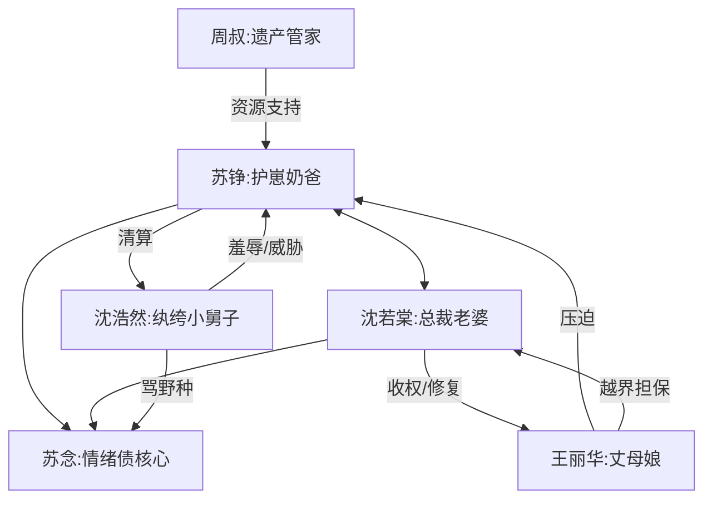

# 角色标签图谱

## 角色清单

### 苏铮 — 穿越商界大佬/护崽硬气奶爸
- 叙事功能: 主视角、反击执行者、家庭秩序重建者。
- 核心标签: 隐藏巨富、护子、克制反杀。
- 弧光: 窝囊上门女婿外壳 → 掌控三百八十七亿的家庭核心。
- 台词风格: 短句、平静回怼、数字砸脸。
- 关键行为: 给儿子副卡、离家、查出遗产、买房买车、截断沈浩然融资、亮出产业链。
- 读者情绪关系: 爽、代入、安心。

### 苏念 — 被压抑的小孩/情绪债核心
- 叙事功能: 激发主角反击的原点，也是家庭修复的桥。
- 核心标签: 敏感、乖巧、缺安全感。
- 弧光: 连十块钱都不敢要 → 敢笑、敢贴贴纸、敢表达愿望。
- 台词风格: 奶声奶气、短问句、反复确认。
- 关键行为: 要游戏皮肤、抱住爸爸、选择新房间、促成游乐园和复合。
- 读者情绪关系: 心疼、保护欲、补偿欲。

### 沈若棠 — 冷面总裁老婆/可修复压迫者
- 叙事功能: 开局压迫源、后期甜宠对象、家庭秩序共同重建者。
- 核心标签: 强势、疲惫、清醒。
- 弧光: 冷硬控制 → 警惕试探 → 承认疲惫 → 主动靠近。
- 台词风格: 前期命令式，后期克制坦白。
- 关键行为: 赶走父子、质疑资金、保护抚养权、处理弟弟、主动留宿。
- 读者情绪关系: 前期微恨，后期心疼和磕糖。

### 沈浩然 — 纨绔小舅子/打脸靶子
- 叙事功能: 主要反派、羞辱源、商业清算承载者。
- 核心标签: 傲慢、贪婪、无能。
- 弧光: 威胁苏铮 → 聚会羞辱 → 项目爆雷 → 上门求钱 → 向孩子道歉。
- 台词风格: 粗暴、轻蔑、威胁式。
- 关键行为: 骂苏念野种、查资产、借高利贷、举报苏铮。
- 读者情绪关系: 恨、期待报应、打脸爽。

### 王丽华 — 势利丈母娘/家族压迫放大器
- 叙事功能: 强化沈家对上门女婿的羞辱体系。
- 核心标签: 刻薄、势利、越界。
- 弧光: 命令下跪 → 幼儿园堵人 → 偷用印章担保 → 被女儿收权。
- 台词风格: 尖锐、命令、身份压制。
- 关键行为: 要苏铮跪着道歉、威胁离婚净身出户、帮沈浩然担保。
- 读者情绪关系: 反感、期待被收拾。

### 周叔 — 遗产管家/降维资源接口
- 叙事功能: 负责把隐藏财富变成可执行资源。
- 核心标签: 忠诚、稳、老派。
- 弧光: 等少爷觉醒 → 协助买房、查股权、动用资本。
- 台词风格: 恭敬、简洁、执行力强。
- 关键行为: 交钥匙、查恒远股权、截断融资、准备律师材料。
- 读者情绪关系: 安心、期待下一张底牌。

## 关系网络

## 角色功能对照表（供改编参考）

| 原角色 | 极致标签 | 叙事功能 | 读者情绪功能 | 改编时必须保留的 |
|--------|---------|---------|-------------|---------------|
| 苏铮 | 隐藏巨富奶爸 | 主角/反杀执行 | 爽、代入 | 护孩子先于炫富 |
| 苏念 | 被压抑小孩 | 情绪债锚点 | 心疼、补偿欲 | 十块钱级别的小愿望 |
| 沈若棠 | 冷面总裁妻 | 压迫与回暖双功能 | 先气后磕 | 不能纯恶，必须有母亲软肋 |
| 沈浩然 | 纨绔小舅子 | 打脸靶子 | 恨、爽 | 必须辱骂孩子，触发清算 |
| 王丽华 | 势利丈母娘 | 家庭压迫体系 | 反感 | 越界干预婚姻和财务 |
| 周叔 | 资源接口 | 金手指落地 | 安心 | 负责把财富具体化 |
