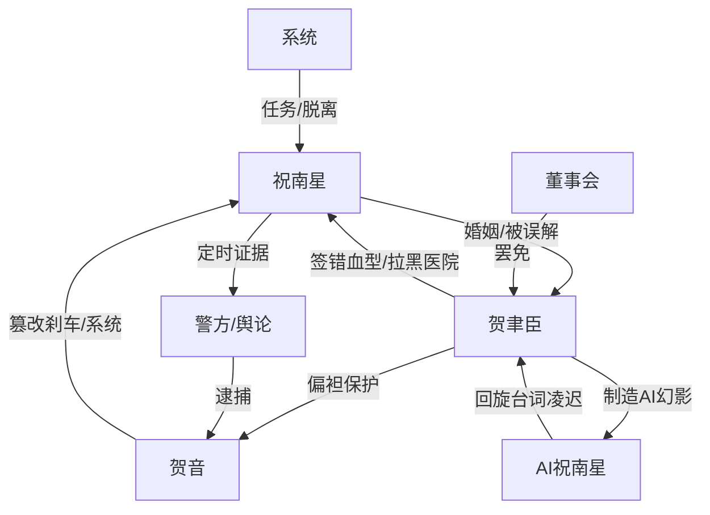

# 角色标签图谱

## 角色清单

### 祝南星 — 清醒赴死型任务女主
- 叙事功能: 承受极限压迫，主动接受死亡流程，并在死前布置证据清算。
- 核心标签: 冷静、厌弃、脱离者
- 弧光: 忍让妻子 → 主动赴死者 → 灵魂旁观者 → 现实新生者
- 台词风格: 短句、冷讽、拒绝解释
- 关键行为: 接受错血型输血；打包犯罪证据；定时全网引爆；撕碎原稿
- 读者情绪关系: 前半心疼，后半代入爽，结尾获得补偿感

### 贺聿臣 — 迟来悔恨型财阀男主
- 叙事功能: 主要道德责任人，提供压迫、误判、悔恨、最终死亡清算。
- 核心标签: 傲慢、偏袒、疯悔
- 弧光: 高高在上的丈夫 → 杀妻事实承担者 → 失权疯子 → 灰飞烟灭
- 台词风格: 命令式、指责式、后期乞求式
- 关键行为: 签错血型；拉黑医院；包庇贺音；囚存女主遗体；制造 AI 祝南星
- 读者情绪关系: 前半恨，后半看他崩溃得到偿还

### 贺音 — 天才黑客疯批养妹
- 叙事功能: 直接施害者，制造车祸、仪器警报、公共安全灾难，并在审讯中反咬男主。
- 核心标签: 恶毒、装乖、无底线
- 弧光: 被宠坏的天才养妹 → 犯罪曝光者 → 反咬失败者 → 无期徒刑
- 台词风格: 茶言茶语与疯批挑衅切换
- 关键行为: 篡改刹车；篡改监护仪；篡改智能驾驶系统；审讯室反咬
- 读者情绪关系: 纯恨点，负责前半压迫和后半被抓爽点

### 系统 — 冷静流程型超叙事工具
- 叙事功能: 提供任务规则、死亡倒计时、痛觉屏蔽、证据截取和世界线收束。
- 核心标签: 机械、规则、出口
- 弧光: 死亡任务触发器 → 灵魂旁观辅助 → 回归现实确认器
- 台词风格: 方括号提示、精确、无情绪
- 关键行为: 提示死法；倒计时；锁定邮件；宣布回归
- 读者情绪关系: 提供安全感和“女主不是白死”的保障

### 医生/护士 — 现实见证者
- 叙事功能: 证明女主死亡真实性，公开指认贺聿臣过错。
- 核心标签: 见证、愤怒、规则
- 弧光: 抢救者 → 死亡证明传达者
- 台词风格: 专业、冷硬、控诉
- 关键行为: 抢救女主；指出签错血型和拉黑电话
- 读者情绪关系: 替读者骂醒男主，辅助打脸

## 关系网络

## 角色功能对照表（供改编参考）

| 原角色 | 极致标签 | 叙事功能 | 读者情绪功能 | 改编时必须保留的 |
|--------|---------|---------|-------------|---------------|
| 祝南星 | 清醒赴死女主 | 承债与清算发动机 | 心疼、代入、爽 | 主动接受死亡/脱离，死前布证 |
| 贺聿臣 | 疯悔财阀男主 | 责任承担者 | 恨、看报应 | 签下致命错误并拉黑求救 |
| 贺音 | 疯批黑客养妹 | 直接施害者 | 纯恨 | 装乖+实质犯罪+反咬 |
| 系统 | 规则工具 | 保证死后不虚无 | 安全感 | 倒计时与回归出口 |
| 医护 | 见证者 | 公开打脸 | 替读者发声 | 死亡证明和责任指认 |
