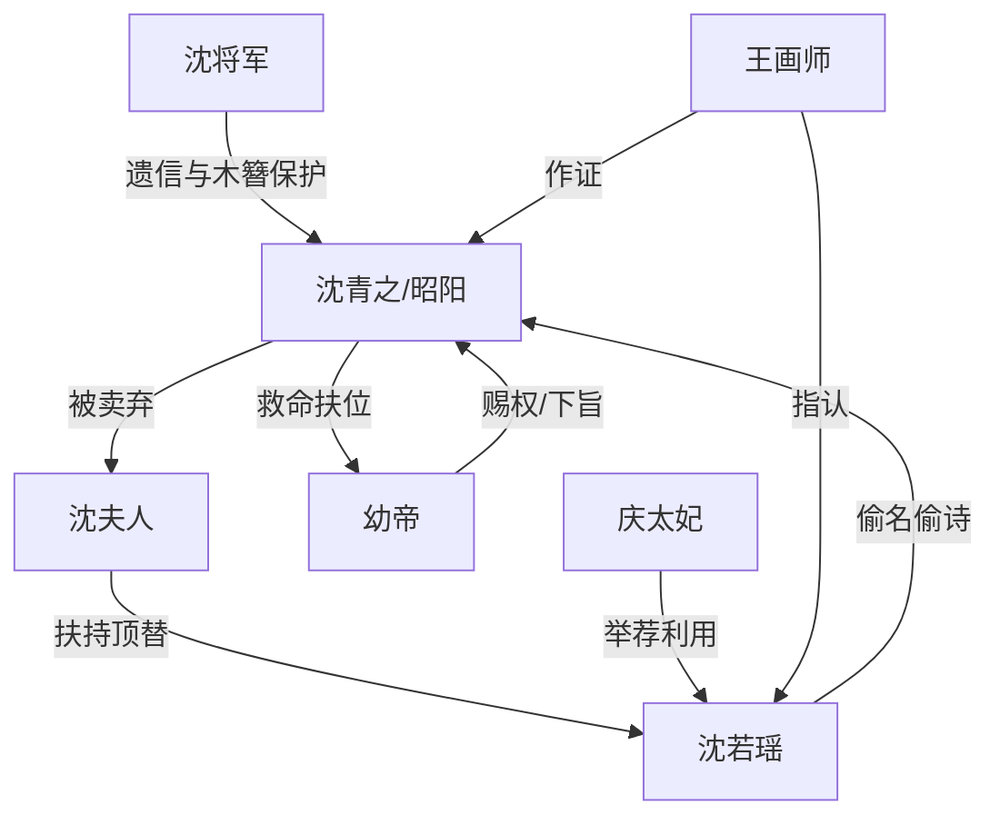

# 角色标签图谱

## 角色清单

### 沈青之 / 昭阳长公主 — 地狱归来的清算型大女主
- 叙事功能: 主视角、复仇执行者、身份反转核心。
- 核心标签: 摄政长公主、被弃亲女、冷面复仇者。
- 弧光: 被卖入地狱的沈青之 → 扶帝登基的昭阳 → 承认沈青之已死的江山守门人。
- 台词风格: 短句、冷讽、审判式反问。
- 关键行为: 划掉表妹名单、封案存档、寿宴拿旧稿、当众露腕伤、抄家流放沈家。
- 读者情绪关系: 心疼、爽、敬畏、最后带一点苍凉。

### 沈若瑶 — 偷命才女 / 伪嫡女
- 叙事功能: 表层对手，承载“偷名偷诗偷人生”的直观恨点。
- 核心标签: 冒名者、绿茶才女、既得利益者。
- 弧光: 京中才女 → 寿宴光芒万丈 → 偷诗冒名败露 → 贱籍流放。
- 台词风格: 委屈、谦卑、大义凛然式表演。
- 关键行为: 顶替身份、请罪诗造势、宫门长跪、寿宴献艺。
- 读者情绪关系: 厌恶、期待被打脸、看她崩塌。

### 沈夫人 — 弃女生母 / 荣光执念者
- 叙事功能: 终极情绪债来源，亲情背叛的具象化。
- 核心标签: 毒母、伪慈母、家族荣光狂信徒。
- 弧光: 诰命华服的体面夫人 → 殿上恶辩 → 天牢疯妇 → 北境黑暗。
- 台词风格: 先谄媚卖惨，后疯魔咒骂。
- 关键行为: 卖掉亲女、扶持外甥女顶名、杀证人嫌疑、诬称女儿克家。
- 读者情绪关系: 极恨、愤怒、要求重罚。

### 幼帝 — 被女主扶起的权力见证者
- 叙事功能: 女主权力合法性的来源，也是结尾情感托底。
- 核心标签: 年少帝王、受恩者、旁观心疼者。
- 弧光: 依赖长姐判断 → 见证身份揭露 → 配合清算 → 关心女主代价。
- 台词风格: 稚嫩但克制，带尊敬与心疼。
- 关键行为: 允许寿宴传人、下旨流放、结尾询问是否后悔。
- 读者情绪关系: 缓冲女主狠戾，提供被理解感。

### 沈将军 — 迟到的父爱 / 情感补偿源
- 叙事功能: 后段情绪反转核心，证明女主不是没人爱。
- 核心标签: 战死父亲、保护者、迟来的真相。
- 弧光: 被沈夫人污蔑为弃女共谋 → 遗信揭示他早想救女。
- 台词风格: 信中温柔凝重。
- 关键行为: 留下旧稿、写和离书、刻凤凰木簪。
- 读者情绪关系: 心疼、补偿、加深对沈夫人的恨。

### 庆太妃 — 权力场助攻型反派
- 叙事功能: 把私人恩怨推上朝堂公开舞台。
- 核心标签: 后宫政敌、借刀挑衅、看错局势。
- 弧光: 举荐沈若瑶 → 被旧稿打脸。
- 台词风格: 和善外壳、暗藏挑衅。
- 关键行为: 寿宴提议沈若瑶献艺。
- 读者情绪关系: 厌烦、看她脸色难看时获得附带爽点。

### 王画师 — 证据型见证人
- 叙事功能: 坐实偷诗偷名，牵出当年灭口嫌疑。
- 核心标签: 老仆、证人、旧事钥匙。
- 弧光: 上殿辨认手稿 → 指认沈若瑶。
- 台词风格: 悲愤、直接。
- 关键行为: 证明诗稿属于真正沈青之，指出小厮石头死亡。
- 读者情绪关系: 增强真相可信度，推动爽点成立。

## 关系网络

## 角色功能对照表（供改编参考）

| 原角色 | 极致标签 | 叙事功能 | 读者情绪功能 | 改编时必须保留的 |
|--------|---------|---------|-------------|---------------|
| 沈青之/昭阳 | 地狱归来的长公主 | 主角、清算者 | 心疼+爽 | 被夺身份、强权归来、冷静复仇 |
| 沈若瑶 | 偷命才女 | 表层反派 | 恨、期待打脸 | 冒名享福、公开表演、才名造假 |
| 沈夫人 | 弃女毒母 | 终极反派 | 极恨 | 亲手抛弃、道德狡辩、偏爱替代品 |
| 沈将军 | 迟到父爱 | 情感补偿 | 心痛 | 遗物/遗信证明主角被爱过 |
| 幼帝 | 权力见证者 | 合法性支撑 | 安全感 | 女主曾扶持他，他反过来支撑清算 |
| 庆太妃 | 政敌助攻 | 搭建公开舞台 | 附带打脸 | 把反派推到高光处再摔下 |
| 王画师 | 旧证人 | 真相落地 | 可信度 | 证明旧物和冒名链条 |
