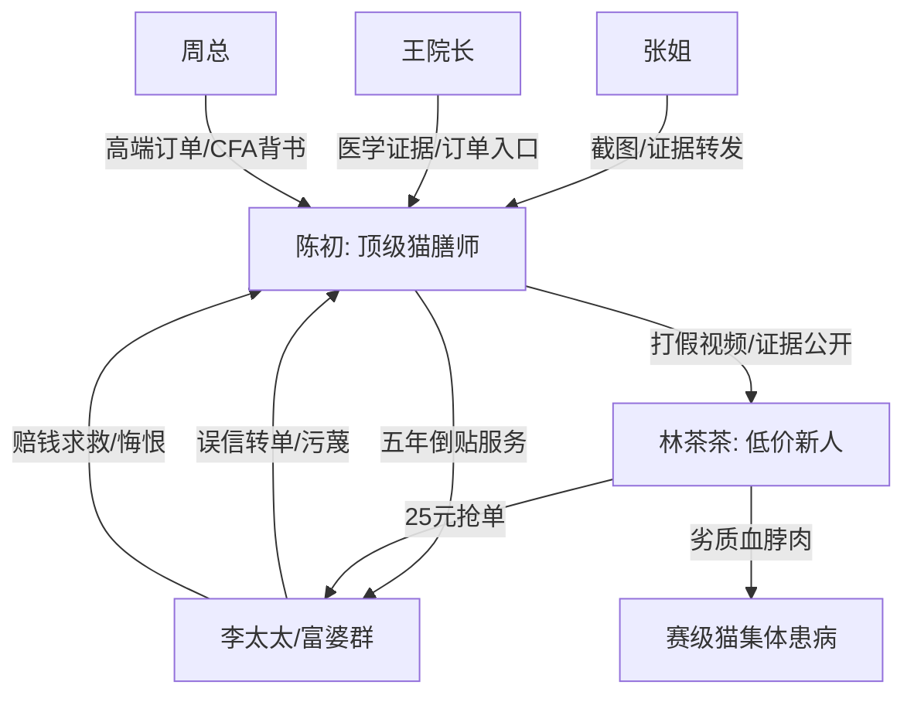

# 角色标签图谱

## 角色清单

### 陈初 — 清醒专业型大女主
- 叙事功能: 主视角、专业真相持有者、反转执行者。
- 核心标签: 顶级猫膳师、冷静、边界感强。
- 弧光: 倒贴服务富婆圈 → 被误解退出 → 专业身份公开 → 顶级工作室老板。
- 台词风格: 短句、冷、报价式。
- 关键行为: 拉黑退群、发真实供货渠道、接周总订单、打包证据、发布打假视频、拒绝道德绑架。
- 读者情绪关系: 爽、信任、替她憋屈后获得补偿。

### 林茶茶 — 装嫩低价搅局者
- 叙事功能: 第一反派、错误规则制造者、灾难源头。
- 核心标签: 夹子音、无资质、贪流量。
- 弧光: 25 元抢单炫耀 → 用血脖肉投喂 → 甩锅退群 → 被起诉赔偿。
- 台词风格: “姐姐们”“啦”“呀”高频，卖萌中带轻蔑。
- 关键行为: 公开指责 60 元骗钱、索要资源、宣称血脖肉营养、把病症说成排毒、退 25 元跑路。
- 读者情绪关系: 恨、恶心、期待报应。

### 李太太 — 贪便宜且高高在上的富婆
- 叙事功能: 群体压迫代表、被反噬的重点样本。
- 核心标签: 傲慢、势利、道德绑架。
- 弧光: 骂陈初捞钱 → 追捧茶茶 → 雪球报废 → 低价求救 → 展会悔恨崩溃。
- 台词风格: 命令式、威胁式、求救时仍理所当然。
- 关键行为: 带头转单、带头污蔑、要求 60 元救命、在停车场跪求。
- 读者情绪关系: 恨、解气、少量对猫的心疼转化为对她的厌恶。

### 张姐 — 清醒见证者
- 叙事功能: 信息传递者、证据公开代理、读者嘴替。
- 核心标签: 谨慎、清醒、敢骂。
- 弧光: 唯一未退群 → 询问风险 → 公开证据 → 宣判富婆活该。
- 台词风格: 直接、爆发式。
- 关键行为: 给陈初发截图、倒掉危险猫饭、把单据化验单发群、艾特所有人。
- 读者情绪关系: 代替读者骂醒反派，提供爽感。

### 周总 — 高端市场背书者
- 叙事功能: 女主价值证明、商业升维通道。
- 核心标签: CFA 顶级繁育人、识货、不差钱。
- 弧光: 试吃验货 → 定金合作 → 冠军公开致谢。
- 台词风格: 专业、干脆。
- 关键行为: 给订单、让海神试吃、颁奖台感谢陈初。
- 读者情绪关系: 安全感、权威背书带来的爽。

### 王院长 — 医学权威证据源
- 叙事功能: 病理判断和专业证明。
- 核心标签: 宠物医院院长、权威、理性。
- 弧光: 推荐高端订单 → 出具化验结果 → 确认雪球废了。
- 台词风格: 事实陈述。
- 关键行为: 介绍周总、发化验单、说明不可逆后果。
- 读者情绪关系: 增强可信度。

## 关系网络

## 角色功能对照表（供改编参考）

| 原角色 | 极致标签 | 叙事功能 | 读者情绪功能 | 改编时必须保留的 |
|--------|---------|---------|-------------|---------------|
| 陈初 | 清醒专业大女主 | 持有真相并完成升维 | 爽、信任 | 专业成本信息差+拒绝道德绑架 |
| 林茶茶 | 装嫩低价骗子 | 制造错误规则 | 恨、等报应 | 低价承诺+无资质+甩锅 |
| 李太太 | 傲慢富婆 | 群体误判代表 | 憋屈后解气 | 先骂贵，后买不起 |
| 张姐 | 清醒旁观者 | 信息桥梁 | 嘴替 | 替主角发证据 |
| 周总 | 高端客户 | 价值背书 | 补偿爽 | 真识货且愿付高价 |
| 王院长 | 权威医生 | 证据源 | 可信度 | 专业化验和病理判断 |
