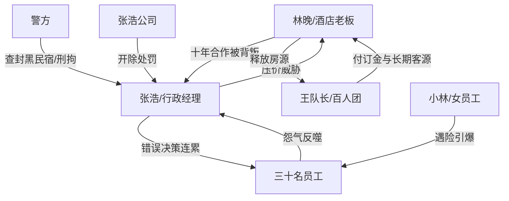

# 角色标签图谱

## 角色清单

### 林晚 — 冷静经营型大女主
- 叙事功能: 承受压迫、提供道德坐标、执行冷处理反击。
- 核心标签: 诚信经营、冷静算账、有边界感
- 弧光: 念十年客情 → 被打后切断关系 → 坚守规则并获得长期客源
- 台词风格: 短、稳、不给情绪口子
- 关键行为: 退房、联系百人团、拒绝张浩回头、报警
- 读者情绪关系: 让读者心疼、代入、爽

### 张浩 — 抠门蛮横型反派
- 叙事功能: 制造压迫、输出错误规则、被规则反噬。
- 核心标签: 占便宜、蛮不讲理、甩锅
- 弧光: 老客户姿态压人 → 退房得意 → 流落狼狈 → 员工反噬 → 被开除刑拘
- 台词风格: 质问、威胁、辱骂、求饶
- 关键行为: 打林晚、威胁差评、退房、砍价、住黑民宿、持刀报复
- 读者情绪关系: 让读者恨、厌恶、期待报应

### 王队长 — 正向价值验证者
- 叙事功能: 证明 500 全包价确实划算，并替代张浩形成打脸。
- 核心标签: 急需救场、懂价值、长期合作
- 弧光: 订不到房濒临崩盘 → 得到房源 → 感激并转化长期客源
- 台词风格: 激动、感谢、直接付钱
- 关键行为: 秒付订金、带百人团入住、承诺长期合作
- 读者情绪关系: 让读者松一口气，证明主角善有善报

### 前台小姑娘 — 读者嘴替
- 叙事功能: 替读者表达愤怒，增强张浩无耻感。
- 核心标签: 正义感、护老板、年轻直接
- 弧光: 忍不住反驳 → 见证打脸
- 台词风格: 情绪外露、直白
- 关键行为: 反驳张浩、协助退房、提醒报警
- 读者情绪关系: 释放读者憋屈

### 张浩员工群体 — 反派内部反噬力量
- 叙事功能: 从帮腔者变成受害者，再变成清算者。
- 核心标签: 盲从、受苦、觉醒
- 弧光: 跟着张浩起哄 → 狼狈受罪 → 集体指责 → 离职
- 台词风格: 前期附和，后期抱怨和控诉
- 关键行为: 威胁差评、露宿奔波、指责张浩、离职
- 读者情绪关系: 前期招厌，后期部分转为同情

### 小林 — 风险升级触发者
- 叙事功能: 将“住得差”升级为“安全事故”，推动员工彻底爆发。
- 核心标签: 无辜受害、导火索
- 弧光: 普通员工 → 雨夜遇险 → 离职第一人
- 台词风格: 哭腔、求助
- 关键行为: 雨夜买药遇险，回公司后提交离职
- 读者情绪关系: 激发愤怒和对张浩的彻底厌恶

## 关系网络

## 角色功能对照表（供改编参考）

| 原角色 | 极致标签 | 叙事功能 | 读者情绪功能 | 改编时必须保留的 |
|--------|---------|---------|-------------|---------------|
| 林晚 | 冷静经营大女主 | 受压与反击主体 | 代入、心疼、爽 | 冷静拒绝，不主动害人 |
| 张浩 | 占便宜反派 | 错误规则发起者 | 恨、等报应 | 嫌贵、威胁、甩锅三连 |
| 王队长 | 正向客户 | 价值证明 | 松快、补偿 | 秒付/感谢/长期合作 |
| 员工群体 | 反噬群体 | 见证者转清算者 | 前厌后怜 | 从帮腔到反噬 |
| 小林 | 无辜导火索 | 升级风险 | 心疼、愤怒 | 安全事故引爆群体 |
| 警方/公司 | 制度清算 | 终局惩罚 | 正义落地 | 非私刑式收束 |
