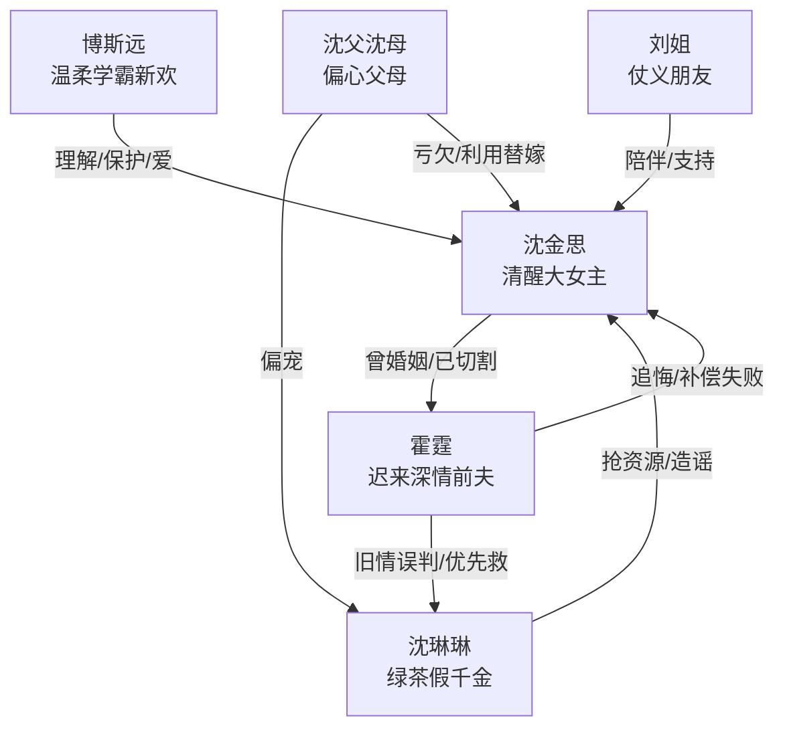

# 角色标签图谱

## 角色清单

### 沈金思 — 清醒重生型大女主

- 叙事功能: 承受亲情与爱情压迫，完成切割、自我重建和价值反证。
- 核心标签: 真千金、学术天才、清醒离婚
- 弧光: 被替代的妻子/女儿 → 耶鲁才女/被坚定爱着的人
- 台词风格: 冷静短句，反问犀利，不纠缠。
- 关键行为: 落水后离婚；拉黑沈母；出国求学；发证据澄清；拒绝复婚。
- 读者情绪关系: 心疼、爽、替她扬眉吐气。

### 霍霆 — 迟来深情前夫

- 叙事功能: 主要爱情债务制造者，后半火葬场承载者。
- 核心标签: 冷面总裁、错认白月光、追妻失败
- 弧光: 被照顾而不自知 → 弃救妻子 → 迟来醒悟 → 终身悔恨
- 台词风格: 前期理直气壮，后期卑微破碎。
- 关键行为: 落水先救沈琳琳；同意离婚；打电话求关注；封杀沈琳琳；赴 M 国求复婚。
- 读者情绪关系: 前期恨，后期看他痛苦获得清算爽感。

### 沈琳琳 — 白月光绿茶假千金

- 叙事功能: 亲情、爱情、事业三线掠夺者，后半塌房对象。
- 核心标签: 假千金、绿茶小花、拜金伪装
- 弧光: 被偏爱者/清纯小花 → 黑料爆出 → 封杀入狱
- 台词风格: 人前柔弱，人后粗俗恶毒。
- 关键行为: 嫌弃霍霆腿瘸出国；回国蹭霍霆；抢资源；造谣女主；偷拍视频中自曝恶行。
- 读者情绪关系: 强恨点，塌房时提供高爽。

### 沈父沈母 — 偏心伪善父母

- 叙事功能: 家庭伦理债务制造者，证明女主长期被系统性亏欠。
- 核心标签: 偏心、势利、伪亲情
- 弧光: 操控女主替嫁 → 维护沈琳琳 → 被舆论讨伐/破产死亡
- 台词风格: 道德绑架式，“为了你好”式。
- 关键行为: 让女主住保姆房；让女主休学联姻；撮合沈琳琳和霍霆。
- 读者情绪关系: 厌恶、愤怒、期待破产报应。

### 博斯远 — 温柔坚定学霸新欢

- 叙事功能: 提供女主新的情感坐标，反衬霍霆的迟钝与自私。
- 核心标签: 学术强者、情绪识别者、坚定保护者
- 弧光: 实验室学长 → 理解女主创伤 → 正牌男友/幸福归宿
- 台词风格: 温柔但直接，判断清晰。
- 关键行为: 看出女主付出；安慰她；宣示女朋友身份；婚后持续爱她。
- 读者情绪关系: 补偿、安心、甜爽。

### 刘姐 — 清醒外援型经纪人

- 叙事功能: 女主低谷期的旁观证人与支持者。
- 核心标签: 仗义、嘴替、朋友
- 弧光: 经纪人 → 知情朋友 → 出国送行者
- 台词风格: 口语化、直接骂人、情绪外放。
- 关键行为: 医院陪护；支持解约；大骂霍霆和沈琳琳。
- 读者情绪关系: 代替读者骂醒局面，提供暖意。

## 关系网络

## 角色功能对照表（供改编参考）

| 原角色 | 极致标签 | 叙事功能 | 读者情绪功能 | 改编时必须保留的 |
|--------|---------|---------|-------------|---------------|
| 沈金思 | 清醒重生型大女主 | 承债、撤离、重建、拒绝 | 心疼到爽 | 不回头；有真实专业能力 |
| 霍霆 | 迟来深情前夫 | 制造爱情债、承担火葬场 | 恨与清算 | 生死关头做错选择；追悔无用 |
| 沈琳琳 | 白月光绿茶假千金 | 掠夺者与塌房对象 | 强恨点 | 人前柔弱人后恶毒；自曝黑料 |
| 沈父沈母 | 偏心伪善父母 | 制造亲情债 | 伦理愤怒 | 亲生女儿被亏待，假千金被偏宠 |
| 博斯远 | 温柔坚定新欢 | 情感补偿 | 安心甜爽 | 看见女主价值，公开保护 |
| 刘姐 | 嘴替朋友 | 陪护与支持 | 暖场解压 | 在女主最孤立时站她 |
