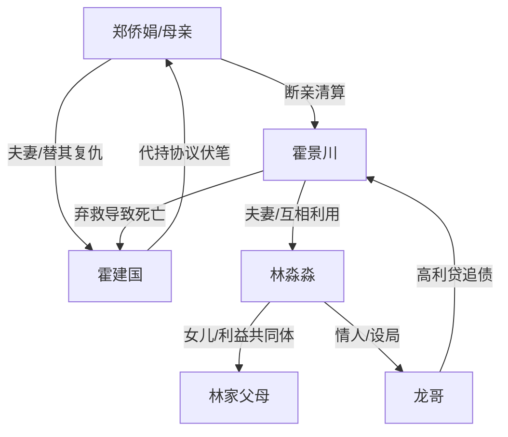

# 角色标签图谱

## 角色清单

### 郑侨娟 / “我” — 清醒狠母
- 叙事功能: 受害者、复仇执行者、道德审判者
- 核心标签: 丧偶母亲、冷静设局、亲情断舍离
- 弧光: 被儿子压榨的农村母亲 → 花钱救自己、养老、复仇的清醒女人
- 台词风格: 短、冷、反问多
- 关键行为: 假风控、收回代持房、花掉赔偿金、揭DNA、立遗嘱
- 读者情绪关系: 心疼前半，爽后半

### 霍景川 — 极致白眼狼儿子
- 叙事功能: 第一反派、伦理倒置制造机、被清算对象
- 核心标签: 贪婪、无孝、软饭男
- 弧光: 拿父亲命钱享乐 → 断臂断腿、无期徒刑、精神崩溃
- 台词风格: 粗暴、索取、威胁
- 关键行为: 签放弃抢救、给狗买墓地、借高利贷、伤害林淼淼
- 读者情绪关系: 恨，期待其被彻底打烂

### 林淼淼 — 恋狗绿茶儿媳
- 叙事功能: 催化儿子作恶、制造“人不如狗”的羞辱
- 核心标签: 娇纵、虚伪、出轨设局
- 弧光: 被宠成“宝贝妈妈” → 流产、失去生育能力、入狱
- 台词风格: 尖叫式辱骂
- 关键行为: 要狗墓地、逼买海景房、与龙哥合谋
- 读者情绪关系: 厌恶，期待反噬

### 霍建国 — 被牺牲的老伴
- 叙事功能: 情绪债源头、道德坐标锚点
- 核心标签: 苦命工人、疼儿父亲、沉默受害者
- 弧光: 为儿子扛水泥买房 → 死后被妻子重新安葬
- 台词风格: 主要通过回忆存在
- 关键行为: 留下代持协议、临死仍惦记儿子
- 读者情绪关系: 心疼、替他不平

### 龙哥 — 高利贷恶犬
- 叙事功能: 反派工具人、执行肉体清算
- 核心标签: 暴力、贪婪、设局者
- 弧光: 放贷追债 → 被霍景川捅成废人并被立案
- 台词风格: 江湖粗口
- 关键行为: 放高利贷、追债、与林淼淼有染
- 读者情绪关系: 厌恶但承担“恶人咬恶人”的爽点

### 林家父母 — 贪婪帮凶
- 叙事功能: 增加压迫阵营人数，提升被清算覆盖面
- 核心标签: 势利、贪财、嫌贫
- 弧光: 上门逼钱 → 债务缠身、家破人亡
- 台词风格: 指责、算计、羞辱
- 关键行为: 逼赔偿金、担保借贷、包庇女儿
- 读者情绪关系: 恨，期待连坐

## 关系网络

## 角色功能对照表（供改编参考）

| 原角色 | 极致标签 | 叙事功能 | 读者情绪功能 | 改编时必须保留的 |
|--------|---------|---------|-------------|---------------|
| 郑侨娟 | 清醒狠母 | 受害与复仇主体 | 心疼转爽 | 冷静花钱救自己，不心软 |
| 霍景川 | 白眼狼儿子 | 核心反派 | 恨点中心 | 亲手放弃至亲生命 |
| 林淼淼 | 绿茶儿媳 | 恶意放大器 | 厌恶 | 把狗/替代物置于人命之上 |
| 霍建国 | 苦命父亲 | 情绪债源 | 心疼 | 生前付出与死后寒酸形成对比 |
| 龙哥 | 暴力债主 | 清算执行器 | 恶人互咬 | 借贷合同反噬 |
| 林家父母 | 贪婪帮凶 | 群体压迫 | 连坐爽点 | 上门逼钱、嫌贫爱富 |
