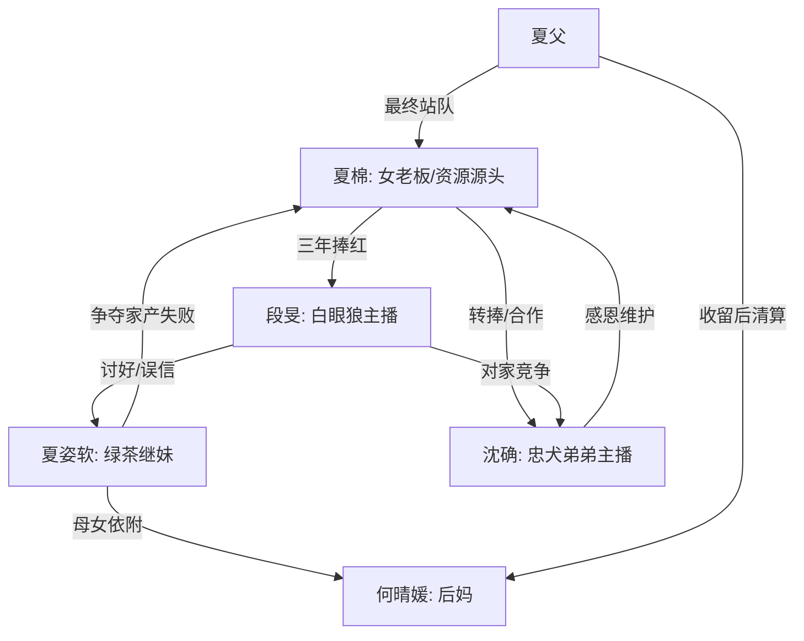

# 角色标签图谱

## 角色清单

### 夏棉 — 清醒资源型女老板

- 叙事功能: 第一人称主角、资源掌控者、复仇执行者。
- 核心标签: 有钱有权、冷静清醒、吃过亏但不恋战。
- 弧光: 掏心掏肺捧人 → 被羞辱断念 → 撤资反击 → 稳坐权力中心。
- 台词风格: 短句、反问、事实压制。
- 关键行为: 撤千万订单、转捧沈确、发律师函、揭开夏家产权。
- 读者情绪关系: 心疼她前期付出，爽她后期收回资源。

### 段旻 — 白眼狼顶流男主播

- 叙事功能: 主要施害者，承载“被供养却反咬”的恨点。
- 核心标签: 傲慢、自恋、忘恩负义。
- 弧光: 顶流主播 → 寒酸直播 → 侵权被告 → 职业断崖。
- 台词风格: 高高在上、倒打一耙、自我感动。
- 关键行为: 羞辱夏棉、讨好继妹、放任网暴、擅发品牌海报、法庭发疯。
- 读者情绪关系: 强恨点，越嘴硬越想看他崩。

### 沈确 — 专业忠犬型弟弟主播

- 叙事功能: 正向补偿、替代价值证明、甜宠尾巴。
- 核心标签: 感恩、专业、温柔。
- 弧光: 万年老二 → 被看见 → 破纪录新一哥 → 长期合作伙伴。
- 台词风格: 真诚、尊重、带一点小心翼翼的可爱。
- 关键行为: 维护夏棉、两万七千字计划表、破纪录直播、签终生合同。
- 读者情绪关系: 补偿、安心、甜。

### 夏姿软 — 绿茶继妹/假资源继承人

- 叙事功能: 家庭线施害者、误导段旻、推动产权反转。
- 核心标签: 嫉妒、贪婪、爱装大度。
- 弧光: 夏家小姐姿态 → 被揭无权无份 → 搬出豪宅 → 普通文员。
- 台词风格: 姐妹茶言茶语，公开装善良，私下命令。
- 关键行为: 炫耀聊天记录、逼夏棉道歉、索要股份、让夏棉滚出家。
- 读者情绪关系: 恨与鄙夷，期待她身份破产。

### 夏父 — 家庭权力见证者

- 叙事功能: 揭示产权真相、执行家庭线清算。
- 核心标签: 沉默、护女、掌握家务裁决。
- 弧光: 前期旁观不明 → 后期明确站队夏棉。
- 台词风格: 平静但压迫感强。
- 关键行为: 打夏姿软、揭开房产和公司归属、逼何晴媛搬走或离婚。
- 读者情绪关系: 提供迟来的站队爽点。

### 何晴媛 — 依附型后妈

- 叙事功能: 继妹贪婪来源，家庭清算对象。
- 核心标签: 依附、哭诉、失势。
- 弧光: 住进夏家享受资源 → 被要求搬走 → 求回被拒。
- 台词风格: 哭诉、示弱。
- 关键行为: 纵容女儿、被夏父清算、后期求回。
- 读者情绪关系: 低强度恨点，承担“母女一起跌落”的余波。

## 关系网络

## 角色功能对照表（供改编参考）

| 原角色 | 极致标签 | 叙事功能 | 读者情绪功能 | 改编时必须保留的 |
|--------|---------|---------|-------------|---------------|
| 夏棉 | 清醒资源型女老板 | 资源源头、反击者 | 心疼转爽 | 资源归属必须在她手里 |
| 段旻 | 白眼狼顶流 | 主恨点 | 恨、想看跌落 | 被捧红后反咬与自恋误判 |
| 沈确 | 忠犬专业弟弟 | 补偿位 | 甜、安心 | 专业能力+公开维护 |
| 夏姿软 | 绿茶继妹 | 家庭恨点 | 恨、期待揭底 | 假装拥有女主资源 |
| 夏父 | 产权揭示者 | 家庭清算 | 爽 | 最终明确女主才是主人 |
| 何晴媛 | 依附后妈 | 余波清算 | 鄙夷 | 跟女儿一起失去豪门生活 |
