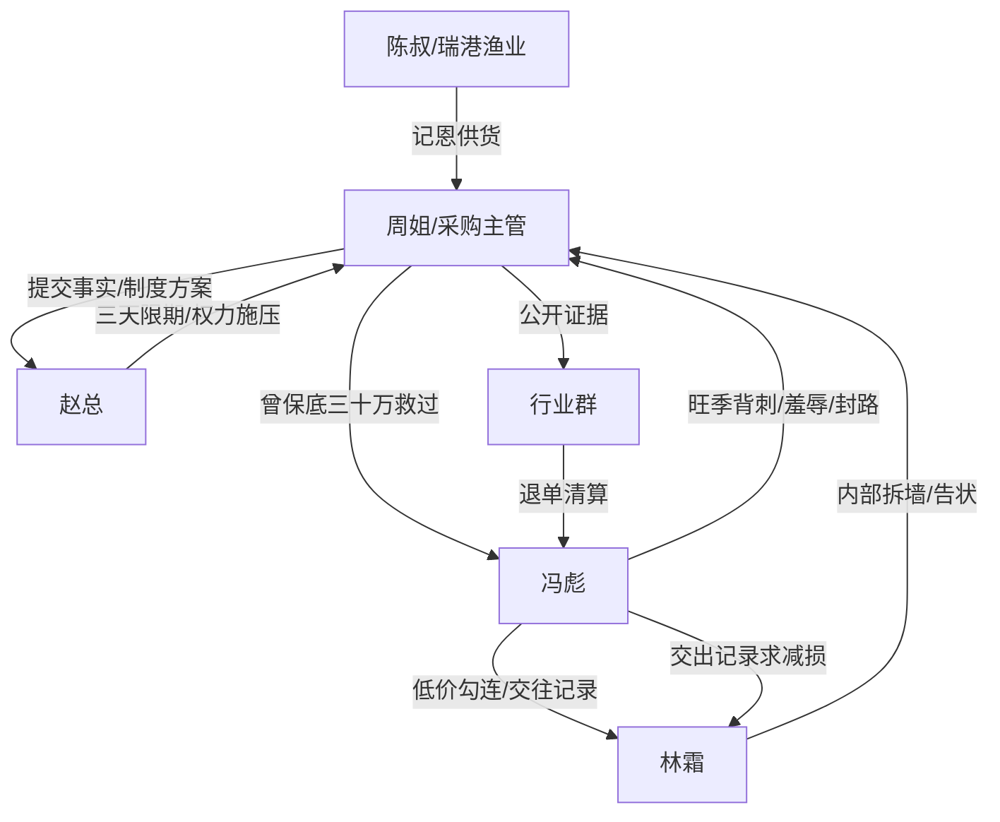

# 角色标签图谱

## 角色清单

### 周姐/小周 — 冷静证据型采购大女主
- 叙事功能: 主角、受害者、反杀执行者、制度改革推动者
- 核心标签: 克制、留证、讲规矩
- 弧光: 被供应商轻视的采购主管 → 掌控八店供应链的采购总监
- 台词风格: 短句、反问少、结论狠
- 关键行为: 拒收冯彪货、联系瑞港、公开证据、推动公开比价制度
- 读者情绪关系: 心疼前期被羞辱，爽于后期冷静打脸

### 冯彪 — 忘恩负义投机供应商
- 叙事功能: 外部主反派、压迫源、因果报应承受者
- 核心标签: 贪利、傲慢、翻脸快
- 弧光: 被救档口老板 → 旺季背刺者 → 货压仓破产求删证据
- 台词风格: 粗粝、威胁、事后服软
- 关键行为: 抢女主锁货、三档报价、行业群封路、抵押囤货
- 读者情绪关系: 强恨点，结尾提供报应爽感

### 林霜 — 温柔刀内鬼店长
- 叙事功能: 内部反派、团队拆墙者、职位争夺者
- 核心标签: 假大局、吃差价、会做表面功夫
- 弧光: “为大家好”的店长 → 暗中接货夺权 → 账目败露离职
- 台词风格: 不紧不慢、温和包装攻击
- 关键行为: 私收冯彪低价货、向赵总告状、参与采购会议、吃差价
- 读者情绪关系: 阴湿恨点，清算时提供二次爽点

### 赵总 — 利益优先的摇摆老板
- 叙事功能: 权力压力源、裁判位、制度转向见证者
- 核心标签: 算账、现实、灰色
- 弧光: 听信两边、压女主三天 → 认可瑞港方案 → 承认误判并接受制度改革
- 台词风格: 商业判断、短指令
- 关键行为: 设三天期限、取消林霜配合、查账、批准制度改革
- 读者情绪关系: 前期憋屈，后期勉强认可

### 陈国海/陈叔 — 记恩的高势能贵人
- 叙事功能: 主角底牌、身份反差爆发载体、价值对照物
- 核心标签: 体量大、记恩、靠谱
- 弧光: 两年未拨的号码 → 瑞港供应链降维入场 → 长期合作伙伴
- 台词风格: 爽快、朴实
- 关键行为: 次日调瑞港冷链车、稳定供货、结尾回旋“我一直记着”
- 读者情绪关系: 给读者安全感和价值补偿

### 张美芬 — 反派家庭后果承接者
- 叙事功能: 展示冯彪报应对家庭资产的牵连
- 核心标签: 求情、惊慌、后知后觉
- 弧光: 提水果求情 → 得知抵押和许总泡沫 → 哭诉退单
- 台词风格: 软求情、回避核心
- 关键行为: 替冯彪求和、打电话哭诉
- 读者情绪关系: 不主要被恨，但承载“报应已伤筋动骨”的体感

## 关系网络

## 角色功能对照表（供改编参考）

| 原角色 | 极致标签 | 叙事功能 | 读者情绪功能 | 改编时必须保留的 |
|--------|---------|---------|-------------|---------------|
| 周姐 | 冷静证据型大女主 | 受压与反杀执行 | 心疼、爽、信服 | 克制留证、按规则反杀 |
| 冯彪 | 忘恩投机供应商 | 外部压迫源 | 恨、报应期待 | 先受恩后背刺、公开羞辱 |
| 林霜 | 温柔刀内鬼 | 内部背刺 | 憋屈、二次清算 | “大局”包装私利 |
| 赵总 | 利益裁判 | 施压和认可 | 职场压迫感 | 以经营风险逼主角限时解决 |
| 陈叔 | 记恩高势能贵人 | 底牌和价值对照 | 安全感、补偿 | 主角过去善因换来当下救场 |
