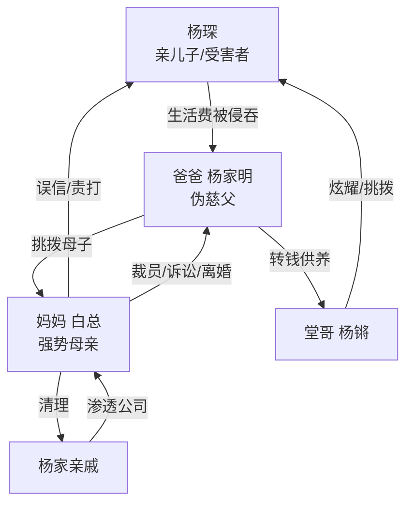

# 角色标签图谱

## 角色清单

### 杨琛 — 隐忍清醒受害者
- 叙事功能: 第一视角受害者，承载读者心疼与反击期待。
- 核心标签: 饥饿、克制、证据意识
- 弧光: 被动解释 → 当众触底 → 主动追查 → 克制留白
- 台词风格: 前期低声请求，后期短句质问。
- 关键行为: 回家对账、指出跑车疑点、打印银行流水。
- 读者情绪关系: 心疼、憋屈、期待他翻盘。

### 妈妈/白总 — 偏听偏信的强势母亲
- 叙事功能: 前期压迫执行者，后期清算执行者。
- 核心标签: 好面子、强势、迟来清醒
- 弧光: 误信丈夫 → 当众惩罚儿子 → 发现真相 → 清理杨家
- 台词风格: 高压、命令式、公开宣判式。
- 关键行为: 冻结银行卡、当众殴打、查流水、裁撤杨家人、离婚诉讼。
- 读者情绪关系: 前期恨，后期复杂，不完全原谅。

### 爸爸/杨家明 — 伪慈父吸血者
- 叙事功能: 隐藏主反派，制造最大背叛。
- 核心标签: 伪善、转移矛盾、软饭硬吃
- 弧光: 温和劝解假象 → 露怯 → 被揭穿 → 净身出户落魄
- 台词风格: 装可怜、和稀泥、道德绑架。
- 关键行为: 办卡设置定时转账、挑拨母子关系、拿钱供侄子。
- 读者情绪关系: 最核心恨点，结尾报应最爽。

### 杨锵 — 吸血堂哥
- 叙事功能: 偏心对照物，展示被侵吞资源的去向。
- 核心标签: 得意、虚荣、心虚
- 弧光: 坐享跑车 → 露怯 → 被追偿
- 台词风格: 表面关心，句句扣帽子。
- 关键行为: 开跑车刺激男主、在家门口挑拨、配合父亲甩锅。
- 读者情绪关系: 厌恶、想看他吐出钱。

### 奶奶/杨家人 — 家族吸血群像
- 叙事功能: 将私人侵占升级为家族与公司权力侵占。
- 核心标签: 贪婪、撒泼、理直气壮
- 弧光: 上门闹事 → 媒体前自爆 → 舆论反噬
- 台词风格: 撒泼、霸占逻辑、亲戚道德绑架。
- 关键行为: 带媒体闹公司，说出“你的东西就是我们陈家的”。
- 读者情绪关系: 群体性厌恶，放大清算爽感。

### 张季/辅导员/邻居张姨 — 见证者
- 叙事功能: 让男主困境公开化，承担社会目光。
- 核心标签: 旁观、见证、舆论
- 弧光: 不明真相 → 听见冲突 → 见证反转
- 台词风格: 生活化。
- 关键行为: 室友看见男主吃剩饭，辅导员催学费，邻居追问跑车。
- 读者情绪关系: 增强羞辱感与公开打脸感。

## 关系网络

## 角色功能对照表（供改编参考）

| 原角色 | 极致标签 | 叙事功能 | 读者情绪功能 | 改编时必须保留的 |
|--------|---------|---------|-------------|---------------|
| 杨琛 | 隐忍清醒受害者 | 承压与查证 | 心疼、代入、期待 | 长期具体受苦 + 后期证据反击 |
| 妈妈 | 强势误伤者 | 前压迫后清算 | 恨与复杂 | 她必须亲手伤害，也必须亲手清算 |
| 爸爸 | 伪慈父吸血者 | 隐藏主反派 | 最大恨点 | 温和面具 + 实际侵吞 |
| 杨锵 | 吸血受益者 | 资源去向具象化 | 厌恶 | 奢侈消费必须对应主角贫困 |
| 杨家人 | 吸血家族 | 冲突升维 | 群体清算爽 | 公开闹事自爆价值观 |
