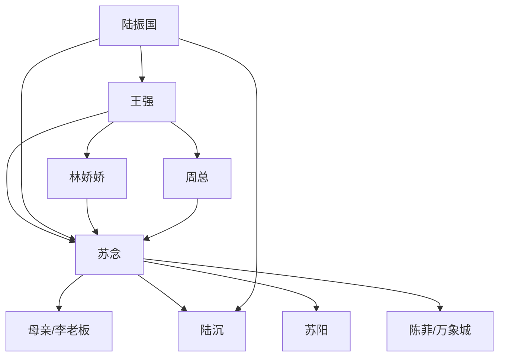

# 角色标签图谱

## 角色清单

### 苏念 — 清醒商业大女主

- 叙事功能: 第一视角主角，承受压迫并设计商业反杀。
- 核心标签: 冷静、能扛、会算账
- 弧光: 被逼迁的租户 → 万象城股东与新商业核心
- 台词风格: 短句、冷静、带反讽
- 关键行为: 宣布四店撤场、公开会员群、拒绝周总、反杀陆振国
- 读者情绪关系: 心疼、代入、爽

### 王强 — 贪婪傲慢物业经理

- 叙事功能: 第一压迫者，制造涨租、断电、封货梯等直接冲突。
- 核心标签: 贪、蠢、欺软怕硬
- 弧光: 拿捏租户 → 被证据锁死 → 被开除报警
- 台词风格: 油腻、威胁、阴阳怪气
- 关键行为: 涨租 40%、断电、扣押金、收回扣
- 读者情绪关系: 恨、等他报应

### 李老板/苏念母亲 — 豪横护短金店妈

- 叙事功能: 家族资源第一支点，提供资金与老江湖气场。
- 核心标签: 有钱、护女、硬气
- 弧光: 被拦货车的租户 → 大摇大摆退场的赢家
- 台词风格: 粗粝、江湖、压迫感强
- 关键行为: 当场订万象城一楼、轮椅假条反制保安
- 读者情绪关系: 爽、安心

### 陆沉 — 暂时软弱但可修正的丈夫

- 叙事功能: 前期武力与证据支援，后期婚姻价值考题。
- 核心标签: 护妻、有能力、父权阴影
- 弧光: 帮妻反击但隐瞒真相 → 脱离父亲重新选择妻子
- 台词风格: 少话、行动派
- 关键行为: 查账、拿照片、辞职自立
- 读者情绪关系: 前期可靠，后期失望，结尾可接受

### 苏阳 — 网感弟弟/电竞资源位

- 叙事功能: 年轻客流与录像证据支点。
- 核心标签: 嘴碎、讲义气、能动员
- 弧光: 打游戏的弟弟 → 客流生态关键角色
- 台词风格: 网感、直接、粗口
- 关键行为: 搬电竞馆、录像王强、办对抗赛
- 读者情绪关系: 轻松、爽

### 林娇娇 — 空壳网红新租户

- 叙事功能: 替代品反讽，证明流量不等于商业粘性。
- 核心标签: 虚荣、势利、空壳
- 弧光: 香奈儿羞辱苏念 → 跑路求和解
- 台词风格: 装腔作势、贬低底层
- 关键行为: 羞辱苏念、泼油漆、试营业扑街、爆料陆总
- 读者情绪关系: 恨、看笑话

### 陈菲 — 新商场理性盟友

- 叙事功能: 承接女主资源，提供舞台与平台认可。
- 核心标签: 雷厉风行、识货、商业理性
- 弧光: 招商经理 → 与苏念形成互利同盟
- 台词风格: 干脆、专业
- 关键行为: 给免租折扣、提供 LED 屏
- 读者情绪关系: 信任、助爽

### 周总 — 失职傲慢老板

- 叙事功能: 第二层压迫者，证明烂系统不止王强一人。
- 核心标签: 迟钝、傲慢、甩锅
- 弧光: 不管事老板 → 求回失败 → 破产受限
- 台词风格: 先客气后威胁
- 关键行为: 求苏念回去、撒钱救场失败
- 读者情绪关系: 鄙夷

### 陆振国 — 父权幕后黑手

- 叙事功能: 终极压迫者，把商业冲突升维成女性独立冲突。
- 核心标签: 控制欲、父权、体面癌
- 弧光: 暗中操控 → 被股东身份打脸
- 台词风格: 高高在上、传统训诫
- 关键行为: 买通王强赶走苏念、威胁万象城
- 读者情绪关系: 恨、期待被打脸

## 关系网络

## 角色功能对照表（供改编参考）

| 原角色 | 极致标签 | 叙事功能 | 读者情绪功能 | 改编时必须保留的 |
|--------|---------|---------|-------------|---------------|
| 苏念 | 清醒商业大女主 | 主反击线 | 代入与爽 | 冷静、会算账、不求饶 |
| 王强 | 贪婪物业 | 直接打压 | 恨点 | 至少 3 次傲慢施压 |
| 母亲 | 豪横护短妈 | 资源支点 | 安心爽 | 当场拍板、资金实力 |
| 陆沉 | 护妻但有软肋 | 证据与婚姻线 | 复杂情绪 | 前期可靠、后期选择 |
| 苏阳 | 网感弟弟 | 年轻流量 | 轻松爽 | 录像/年轻客群 |
| 林娇娇 | 空壳网红 | 替代品反讽 | 看她翻车 | 前期羞辱、后期跑路 |
| 陈菲 | 商业盟友 | 新平台 | 合作爽 | 识别女主价值 |
| 周总 | 傲慢老板 | 系统失职 | 鄙夷 | 求回失败 |
| 陆振国 | 父权黑手 | 终极压迫 | 价值愤怒 | “女人应附属家庭”的压迫逻辑 |
