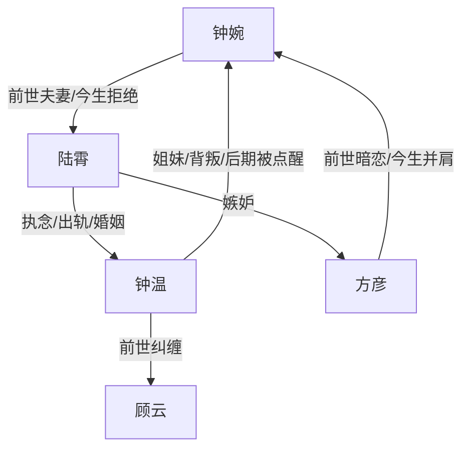

# 角色标签图谱

## 角色清单

### 钟婉 — 清醒逆袭型学霸女主
- 叙事功能: 主视角、情绪债承受者、因果清算执行者。
- 核心标签: 清醒、自强、克制。
- 弧光: 前世婚姻工具人 → 今生事业爱情双自主。
- 台词风格: 短句、反问、冷静讽刺。
- 关键行为: 拒绝陆霄、选择理科、举报贿赂、拒不和解。
- 读者情绪关系: 心疼转爽，读者期待她彻底摆脱旧命运。

### 陆霄 — 自私摇摆型伪深情男
- 叙事功能: 主反派、婚姻压迫源、因果报应承受者。
- 核心标签: 自恋、占有、虚伪。
- 弧光: 前世冷淡丈夫 → 今生求而不得的失败者。
- 台词风格: 自我辩解、道德绑架、占有欲强。
- 关键行为: 临终否定婚姻、追钟温又撩钟婉、贿赂法考、强制求复合。
- 读者情绪关系: 主要恨点，报应越惨越爽。

### 钟温 — 恋爱脑镜像姐姐
- 叙事功能: 女主对照组、亲情背叛源、主题反面教材。
- 核心标签: 明媚、依附、摇摆。
- 弧光: 追求轰烈爱情 → 追求平稳婚姻 → 重启自我。
- 台词风格: 口语、撒娇、情绪化。
- 关键行为: 前世出轨陆霄，今生下药怀孕，离婚后向女主坦白。
- 读者情绪关系: 前期可恨，中后期可怜，最终可被有限原谅。

### 方彦 — 忠犬战友型学霸男主
- 叙事功能: 情感补偿、事业同路人、最终反转承载者。
- 核心标签: 专注、体贴、并肩。
- 弧光: 被错过的旁观者 → 被看见的同路人。
- 台词风格: 轻松、少年感、带小傲娇。
- 关键行为: 互相补习、记住过敏原、保护女主、揭示重生。
- 读者情绪关系: 安全感与甜感来源。

### 顾云 — 隐性旧情人/触发器
- 叙事功能: 钟温旧命运参照物，揭示她“寄托男人”的惯性。
- 核心标签: 旧爱、纠缠、命运岔路。
- 弧光: 前世主线男友 → 今生被钟温拒绝。
- 台词风格: 基本缺席。
- 关键行为: 被钟温用来解释前世情感纠葛。
- 读者情绪关系: 工具性角色，不承担主要情绪。

## 关系网络

## 角色功能对照表（供改编参考）

| 原角色 | 极致标签 | 叙事功能 | 读者情绪功能 | 改编时必须保留的 |
|--------|---------|---------|-------------|---------------|
| 钟婉 | 清醒逆袭学霸 | 主角/清算者 | 心疼、爽、认同 | 不再为男人改命，改为为自己改命 |
| 陆霄 | 自私伪深情男 | 主反派 | 恨、恶心、看报应 | 两世摇摆、占有、职业崩塌 |
| 钟温 | 恋爱脑姐姐 | 镜像对照 | 又恨又怜 | 她既是加害者也是错误价值观受害者 |
| 方彦 | 忠犬战友男主 | 补偿与甜宠 | 安全感、甜 | 事业并肩，不能降级为霸道拯救 |
| 顾云 | 旧命运触发器 | 参照 | 弱 | 用来证明姐姐不是换男人就幸福 |
