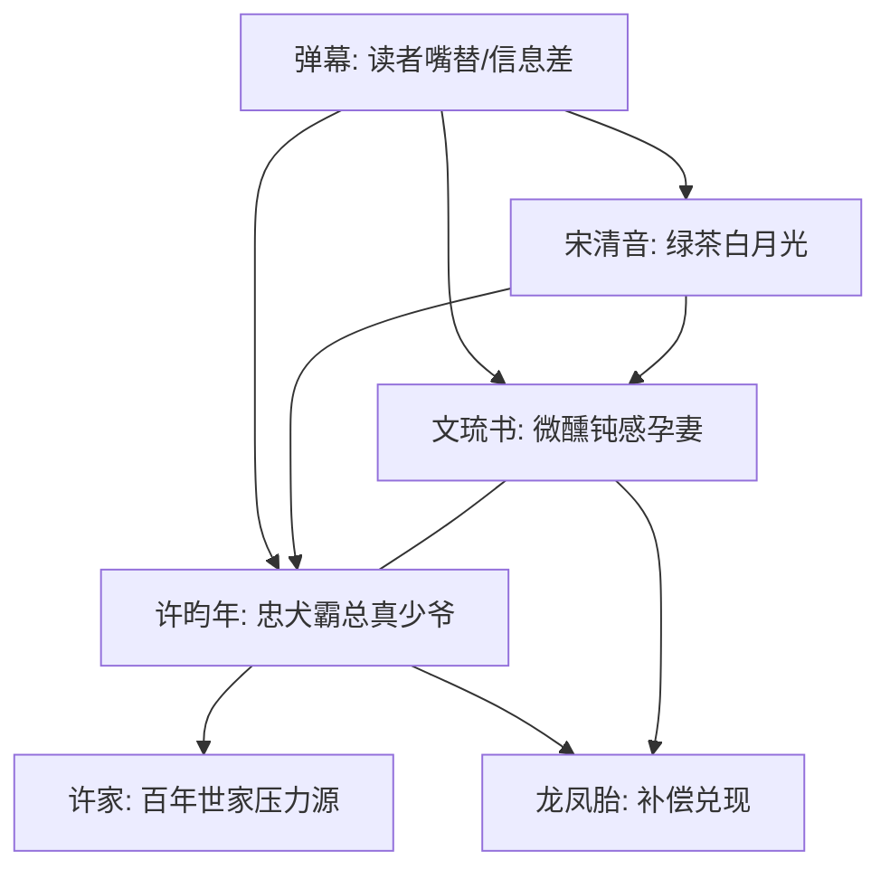

# 角色标签图谱

## 角色清单

### 文琉书 — 微醺钝感孕妻/天然直球女主
- 叙事功能: 误会承载者、轻喜剧源头、甜宠接受者。
- 核心标签: 微醺、慢半拍、善良直球。
- 弧光: 稀里糊涂接受离婚 → 意识到在乎 → 确认被深爱 → 安稳留在婚姻中。
- 台词风格: 慢吞吞、关注点跑偏、逻辑清奇。
- 关键行为: 签离婚、保住孩子、送汤、产检、信任男主、接受求婚。
- 读者情绪关系: 心疼、喜爱、想替她着急。

### 许昀年 — 隐忍忠犬霸总/百年世家真少爷
- 叙事功能: 深情供给者、身份反转核心、甜宠兑现者。
- 核心标签: 忠犬、隐忍、掌权人。
- 弧光: 假破产搬砖 → 误会孩子没了吐血 → 坦白许家身份 → 掌权护妻。
- 台词风格: 克制、哽咽、承诺式短句。
- 关键行为: 离婚保护、转工资、拒绝白月光、坦白身份、重新求婚、陪产。
- 读者情绪关系: 心疼、上头、安心。

### 宋清音 — 绿茶白月光/误会催化剂
- 叙事功能: 制造替身误会、推动男主表态、提供打脸对象。
- 核心标签: 自恋、挑衅、绿茶。
- 弧光: 自认白月光优势 → 工地/医院挑拨 → 许家花园被公开切割。
- 台词风格: 温柔带刺、暗示式攻击。
- 关键行为: 上门炫耀旧照、工地送饭、医院误导“手术”、许家挑衅。
- 读者情绪关系: 厌恶、期待被打脸。

### 弹幕 — 读者嘴替/信息差系统
- 叙事功能: 提示原著设定、误导女主、放大爽点、制造追读。
- 核心标签: 吐槽、预告、站队。
- 弧光: 误认替身文 → 心疼男主女主 → 揭露许家线索 → 完结祝福。
- 台词风格: 网感强、密集感叹、即时反应。
- 关键行为: 提示白月光、提示真搬砖、提示许家、见证求婚和结局。
- 读者情绪关系: 代入、共鸣、催促。

### 许家老爷子/许家旁支 — 豪门压力背景
- 叙事功能: 男主破产原因、身份反转后的权力场。
- 核心标签: 高压、门第、考验。
- 弧光: 逼男主回归 → 接受条件 → 被男主掌控局面。
- 台词风格: 简短威压。
- 关键行为: 设计破产、要求搬进老宅。
- 读者情绪关系: 紧张，但存在感弱于白月光。

## 关系网络

## 角色功能对照表（供改编参考）

| 原角色 | 极致标签 | 叙事功能 | 读者情绪功能 | 改编时必须保留的 |
|--------|---------|---------|-------------|---------------|
| 文琉书 | 微醺钝感孕妻 | 误会与喜剧核心 | 心疼+喜爱 | 慢半拍但善良，不能真蠢 |
| 许昀年 | 忠犬霸总真少爷 | 深情与身份反转 | 心疼+上头 | 保护型离婚、低谷搬砖、后期掌权 |
| 宋清音 | 绿茶白月光 | 误会催化与打脸对象 | 恨与爽 | 温柔带刺、故意误导、被公开切割 |
| 弹幕 | 读者嘴替 | 信息差与节奏器 | 追读欲 | 既误导又预告，不能只吐槽 |
| 许家 | 豪门权力场 | 身份升维 | 爽感背景 | 百年世家/顶级资源压迫感 |
