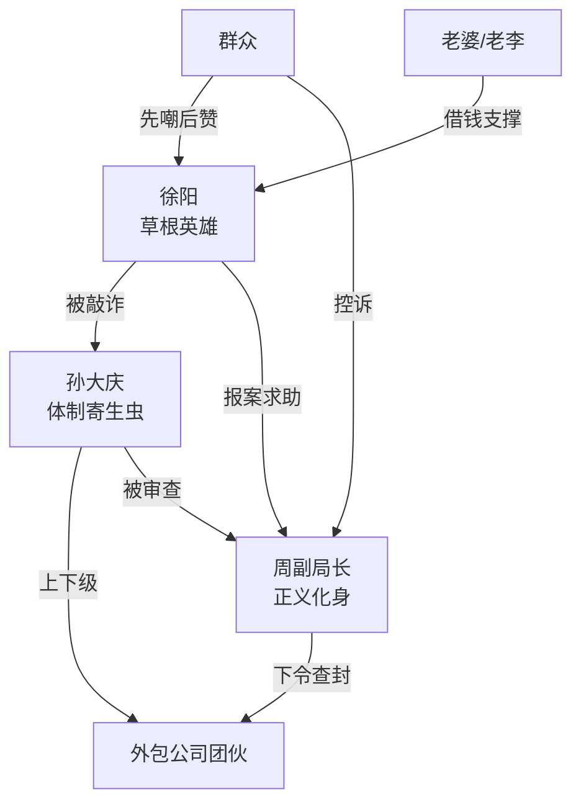

# 角色标签图谱

## 角色清单

### 徐阳（主角）— **隐忍爆发型草根英雄**

- **叙事功能**: 视角承载者 + 正义执行者
- **核心标签**: 草根老板、破釜沉舟、以牙还牙
- **弧光**: 被欺压的小老板 → 冰冷清醒的猎人 → 逆袭爆红的国货之光
- **台词风格**: 前半段卑微求饶，后半段冷静锋利，结尾反讽回旋
- **关键行为**: 
  1. 忍辱筹钱交税（示弱蓄力）
  2. 要求盖章写明"爱马仕三千万"（设陷阱）
  3. 走向警察报案（扣上死环）
- **读者情绪关系**: 前半同情→心疼→后半代入→爽翻

---

### 孙大庆（主要反派）— **有恃无恐的体制寄生虫**

- **叙事功能**: 压迫源 + 爽感制造器
- **核心标签**: 傲慢、贪婪、欺软怕硬
- **弧光**: 嚣张跋扈 → 得意忘形 → 惊恐崩溃 → 跪地求饶
- **台词风格**: 拖长音、带讥讽、用"系统""规矩"做挡箭牌
- **关键行为**:
  1. 拒绝核实、威胁查封（恃强凌弱）
  2. 随手盖章（傲慢中的致命失误）
  3. 跪地坦白（彻底崩溃）
- **读者情绪关系**: 恨得牙痒 → 看他崩溃时极度爽快
- **标志性动作**: 拧保温杯、磕保温杯、弹烟灰、翻保温杯

---

### 周副局长 — **正义化身/清官模板**

- **叙事功能**: 天降正义的执行者
- **核心标签**: 冷峻、锐利、一针见血
- **弧光**: 无弧光（扁平功能角色）
- **台词风格**: 言简意赅，极具压迫感
- **关键行为**: 到场封锁、一眼看穿猫腻、下令查私账
- **读者情绪关系**: 安全感、正义得到伸张的满足

---

### 群众（复合角色）— **墙头草/民意放大器**

- **叙事功能**: 舆论背景 + 情绪放大器
- **核心标签**: 先嘲讽后叫好
- **弧光**: 围观冷嘲 → 震惊佩服 → 控诉受害
- **关键行为**: 议论"活该被逮" → "卧槽这老哥狠人" → 争先控诉
- **读者情绪关系**: 前半让读者更憋屈，后半放大爽感

---

## 关系网络

## 角色功能对照表（供改编参考）

| 原角色 | 极致标签 | 叙事功能 | 读者情绪功能 | 改编时必须保留的 |
|--------|---------|---------|-------------|---------------|
| 徐阳 | 草根隐忍→爆发 | 视角+执行者 | 代入→心疼→爽 | 在绝境中冷静设陷阱的智慧，以及"以其人之道"的反讽 |
| 孙大庆 | 傲慢贪婪→崩溃 | 压迫源 | 恨→爽 | 前期的嚣张必须足够极致，崩溃必须足够彻底 |
| 周副局长 | 冷峻正义 | 执行力 | 安全感 | 出场即转折，一针见血的判断力 |
| 群众 | 墙头草 | 放大器 | 情绪倍增 | 前嘲后赞的反差 |
| 老婆/家人 | 温情锚点 | 情感依托 | 心疼 | 最后那通报平安的电话 |
