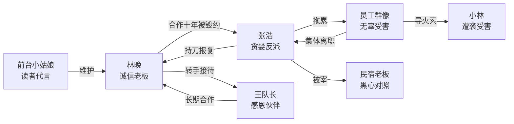

# 角色标签图谱

## 角色清单

### 林晚 — 隐忍大女主/诚信商人
- 叙事功能: 第一人称主角，故事的视角和行动核心
- 核心标签: 隐忍、精明、诚信
- 弧光: 忍辱负重的老好人 → 冷静反击的清醒女老板
- 台词风格: 冷静、精炼、不卑不亢（"不行。""不好意思，住满了。"）
- 关键行为: 被打后不发怒而是立即转手接百人团；淡定拒绝张浩的降价请求；最终拉黑
- 读者情绪关系: 代入→心疼→爽感

### 张浩 — 极致贪婪/蛮不讲理反派
- 叙事功能: 核心反派/施害者，提供全部冲突
- 核心标签: 贪便宜、蛮横、死要面子
- 弧光: 嚣张跋扈的老顾客 → 求饶无果的可怜虫 → 丧失理智的犯罪者
- 台词风格: 大嗓门、情绪化、爱用"我告诉你"句式
- 关键行为: 打人→威胁差评→赖在大堂→讨价还价→挑拨老人→求饶→持刀报复
- 读者情绪关系: 厌恶→嘲笑→轻蔑→恐惧
- 崩塌节奏: 7层递进下坠（符合M6机制）

### 王队长 — 救星/正面对照
- 叙事功能: 反差工具人，用来放大张浩的愚蠢
- 核心标签: 感恩、实在、急切
- 弧光: 绝望（订不到房公司快倒闭）→ 大喜（被林晚救命）→ 感恩（长期合作）
- 台词风格: 热情、夸张、带感叹号（"你真是救了我的命了！"）
- 关键行为: 秒转5万订金、带百人团入住、后续介绍更多团
- 读者情绪关系: 好感/暖意

### 前台小姑娘 — 读者代言人
- 叙事功能: 情绪出口，替读者说出"怎么这么不要脸"
- 核心标签: 正义感、直率、年轻
- 台词风格: 口语化、带情绪（"你这人怎么这样啊"）
- 关键行为: 帮林晚说话、被气得脸都白了
- 读者情绪关系: 共鸣

### 员工群像 — 被拖累的无辜者
- 叙事功能: 群体反馈器，展示张浩决策的连锁后果
- 核心标签: 无辜、怨恨、无奈
- 弧光: 跟风 → 不满 → 反叛 → 离职
- 关键行为: 开始帮腔→发现真相后不满→小林遭袭后彻底爆发→集体离职
- 读者情绪关系: 同情

### 小林 — 受害催化剂
- 叙事功能: 导火索角色，她的遭遇引爆员工的集体反叛
- 核心标签: 柔弱、无辜、受害
- 关键行为: 生理期独自买药被流氓袭击
- 读者情绪关系: 心疼→愤怒（转嫁到张浩）

### 民宿老板 — 社会对照/黑心商人
- 叙事功能: 对照林晚的诚信经营，让张浩体验真正的"杀熟"
- 核心标签: 奸商、冷漠、趁火打劫
- 台词风格: 不耐烦、叼着烟、"爱住不住"
- 读者情绪关系: 嘲讽（张浩终于遇到了"真正的黑店"）

## 关系网络

## 角色功能对照表（供改编参考）

| 原角色 | 极致标签 | 叙事功能 | 读者情绪功能 | 改编时必须保留的 |
|--------|---------|---------|-------------|-----------------|
| 林晚 | 隐忍杀手级女老板 | 第一人称主角 | 代入+爽 | 被打不怒→冷静转手→淡定拒绝的三段弧光 |
| 张浩 | 极致贪婪死要面子 | 核心反派 | 厌恶→嘲笑→轻蔑 | 7层递进崩塌（M6必须保留）|
| 王队长 | 急切感恩的救人者 | 正面对照 | 暖意+爽感加倍 | 秒转账+感恩发言制造反差 |
| 员工群像 | 被拖累的无辜者 | 群体反馈 | 同情+怨恨迁移 | 从帮腔到反叛的弧光 |
| 前台小姑娘 | 正义嘴替 | 读者代言人 | 共鸣 | 可合并或保留 |
| 民宿老板 | 真正的黑心 | 讽刺对照 | 嘲讽 | 500元破房间 vs 500元全包的对比 |
