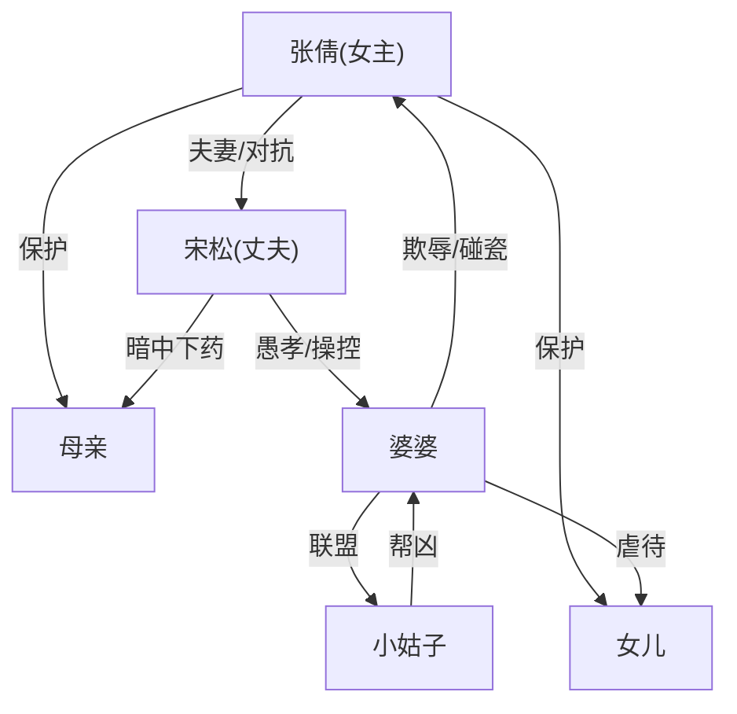

# 角色标签图谱

## 角色清单

### 张倩（女主/我）— 隐忍爆发型大女主
- 叙事功能: 第一人称叙述者+复仇执行者
- 核心标签: 隐忍、冷静、果决
- 弧光: 委屈忍耐 → 暗中观察 → 精准反击 → 冷静切割
- 台词风格: 极简冷硬，不解释不辩护（"我直接挂了电话""我冷声问"）
- 关键行为: ① 发现牙膏下药渠道 ② 买同款料反击 ③ 面粉替代(守住底线) ④ 揭穿手机证据 ⑤ 冷静离婚
- 读者情绪关系: 代入感极强，为她憋屈，替她爽

### 宋松（丈夫）— 愚孝操控者
- 叙事功能: 核心反派+M5温度反转载体
- 核心标签: 愚孝、两面派、软刀子
- 弧光: 体贴丈夫(假象) → 暗中下药 → 和稀泥 → 崩溃跳楼 → 残疾认命
- 台词风格: 伪温柔式操控（"老婆别生气""你就让我妈来吧"）
- 关键行为: ① 牙膏下药 ② 论坛发帖记录全过程 ③ 婆婆闹事时和稀泥 ④ 跳楼自残
- 读者情绪关系: 恨——越温柔越恶心

### 婆婆（宋母）— 极致控制狂恶婆婆
- 叙事功能: 冲突催化剂+情绪炸弹
- 核心标签: 泼辣、贪财、碰瓷
- 弧光: 幕后操控 → 登堂入室 → 撒泼碰瓷 → 被面粉灌嘴 → 跪地求饶 → 继续作恶(不改) → 报应（被新媳妇赶出家门）
- 台词风格: 碎嘴式辱骂+碰瓷式哭嚎，台词量极大
- 关键行为: ① 不请自来 ② 踢踹女主 ③ 剃光孙女头 ④ 抢衣服 ⑤ 当众碰瓷 ⑥ 逼儿子离婚
- 读者情绪关系: 极致恨意（越恶越让读者期待报应）

### 小姑子 — 帮凶/搅局者
- 叙事功能: 婆婆的火力延伸+制造额外混乱
- 核心标签: 跋扈、自私、见风使舵
- 弧光: 挑事 → 摔杯威胁 → 带男友入侵 → 事发后跑路
- 台词风格: 趾高气扬的命令式
- 关键行为: ① 带婆婆不请自来 ② 带男朋友霸占家 ③ 事发后立刻跑路
- 读者情绪关系: 恨+鄙夷

### 母亲（女主的妈）— 沉默受害者/情感锚点
- 叙事功能: 情感锚点+反杀动机来源
- 核心标签: 沉默、善良、受害
- 弧光: 帮忙带娃三年 → 被下药身体崩溃 → 要求回家不添麻烦
- 台词风格: 极少台词，只一句"有什么话坐下说，别伤和气"
- 关键行为: 被动承受，存在感全靠女主的反应呈现
- 读者情绪关系: 心疼至极

### 女儿 — 无辜受害者/情绪催化剂
- 叙事功能: 底线触发器（女儿受伤 = 女主爆发的催化剂）
- 核心标签: 天真、懂事
- 弧光: 被剃光头 → 抱着妈妈哭 → 结尾冷静拒绝帮爸爸说好话
- 台词风格: 童言一针见血（"爸爸和奶奶欺负妈妈，坏"）
- 关键行为: ① 被婆婆剃光头 ② 拒绝帮爸爸求情
- 读者情绪关系: 心碎+欣慰（最后的成熟）

## 关系网络

## 角色功能对照表（供改编参考）

| 原角色 | 极致标签 | 叙事功能 | 读者情绪功能 | 改编时必须保留的 |
|--------|---------|---------|-------------|-----------------|
| 张倩 | 隐忍爆发 | 第一人称叙事者+反杀执行 | 代入感+爽感 | 冷静克制的语气+精准反击（不能改成暴力型） |
| 宋松 | 两面派操控 | 核心反派+温度反转 | 恶心+恨 | 伪温柔的台词风格+具体的下药行为+最终的物理代价 |
| 婆婆 | 碰瓷控制狂 | 冲突催化剂 | 极致恨意 | 碎嘴式辱骂+碰瓷行为+结尾报应（不可和解） |
| 母亲 | 沉默受害者 | 情感锚点 | 心疼 | 几乎无台词但存在感极强+被害是反杀动机 |
| 女儿 | 天真懂事 | 底线触发器 | 心碎+欣慰 | 被物理伤害(光头)+最终的成熟回应 |
